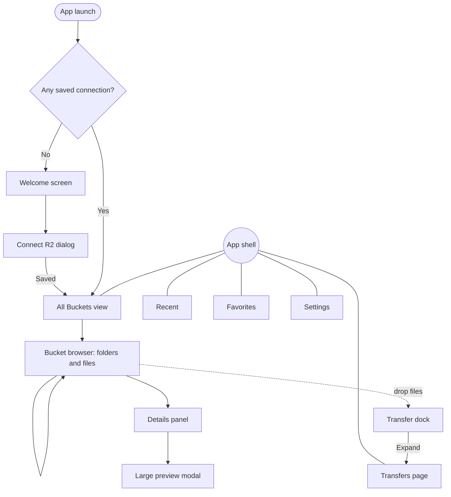
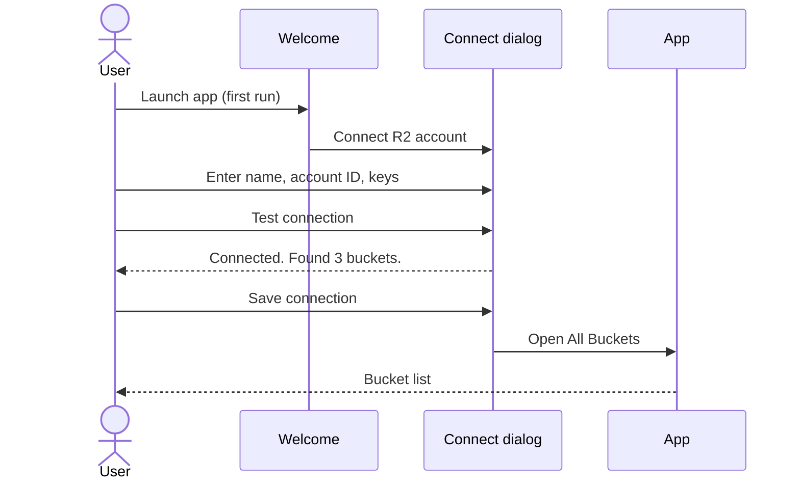
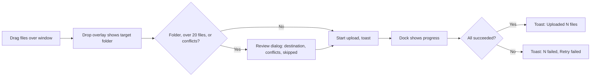

# R2Dock Design Specification

Version: 0.1 (design brief for the first interactive prototype)
Status: Implemented in version 0.1.0, except where PLAN.md section 17.1 says otherwise.

This document is a standalone brief. A designer or design tool should be able to build a coherent, interactive desktop prototype from it without reading any other project file.

---

## 1. Product Summary

R2Dock is a lightweight desktop application for Windows, macOS, and Linux that turns Cloudflare R2 object storage into a familiar file manager. Users connect their own R2 account with R2 S3 credentials, then browse buckets, open folders, upload and download files, and manage objects without using a terminal or the Cloudflare dashboard.

One sentence for the welcome screen:

> Browse, upload, and manage your Cloudflare R2 storage like a regular drive. Your keys stay on this computer.

What R2Dock is not:

- Not a replacement for Cloudflare R2 or its dashboard.
- Not a sync client. It does not mirror a local folder in the background.
- Not a cloud service. There is no R2Dock account, server, or subscription.

### 1.1 How storage is represented (important for the design)

R2 stores **objects** identified by **keys** such as `covers/dragon-ball/cover.webp`. There are no real folders. R2Dock shows the part of a key before each `/` as a folder so the experience feels like a drive. The design must respect this:

- A "folder" exists because some object key starts with that prefix, or because an empty marker object named `folder-name/` exists.
- Renaming or moving a folder means copying and deleting every object inside it. It can be slow and can partially fail. The UI must show progress and a clear result summary, never an instant "Renamed" toast for a folder.
- Folder sizes are not known without listing every object inside. List rows show "--" for folder size.
- R2 has no server-side search. Search filters the current folder or searches by key prefix within a bucket. The UI must say which scope is being searched.

---

## 2. Target Audience

| Persona | Description | What they need |
|---|---|---|
| Creator (primary) | Runs a media site or podcast. Stores audio, covers, and video in R2. Not comfortable with CLI tools. | Drag files in, see progress, copy a public link, never lose an upload. |
| Developer (primary) | Uses R2 for app assets and backups. Comfortable with S3 concepts but tired of the CLI for quick tasks. | Fast navigation through thousands of objects, keyboard shortcuts, exact keys, ETags, multiple accounts. |
| Small team operator (secondary) | Manages a few buckets for a small business. | Safe deletes, clear permission errors, confidence that keys are stored securely. |

All personas use laptops and desktop monitors. There is no mobile version.

---

## 3. Design Principles

1. **Familiar first.** Use file-manager conventions people already know: sidebar, breadcrumbs, list view, right-click menus, drag and drop.
2. **Honest about storage.** Never pretend R2 is a filesystem when it matters: folder moves, sizes, search scope, and public links are described accurately.
3. **Calm under load.** Thousands of objects and hundreds of transfers should look orderly. Summaries first, detail on demand.
4. **Safe by default.** Destructive actions always confirm. Large deletes require typed confirmation. Secrets are never shown after saving.
5. **Dense but readable.** Desktop users want to see many rows. Use tight spacing with strong typographic hierarchy instead of large cards.
6. **Quiet chrome, loud content.** The interface recedes; file names and progress stand out. The accent color is reserved for primary actions, selection, and active progress.
7. **Every icon earns its place.** No decorative illustrations. Empty states use one simple icon and clear text.
8. **No extra text.** Labels are one or two words. Helper text appears only where a beginner would otherwise get stuck (credentials, destructive actions, errors). Prefer a tooltip or an info icon over a paragraph.
9. **Beginner safe.** A first-time user can connect, upload, and download without reading documentation. Risky actions are hard to do by accident; normal actions are one click.

---

## 4. Brand Personality and Logo Direction

### 4.1 Personality

Plain, calm, precise, quietly retro. Think of a well-built piece of 1980s lab equipment redrawn with modern spacing: dark grey body, warm cream labels, one amber indicator light. Closer to a professional tool than a consumer cloud app. Avoid mascots, gradients, glassmorphism, neon, and generic "AI SaaS" styling.

Voice: short, plain, specific. Say what happened and what to do next.

| Do | Avoid |
|---|---|
| "Upload paused. 3 of 8 parts sent." | "Oops! Something went wrong." |
| "This key can only see 1 bucket." | "Insufficient privileges detected." |
| "Delete 214 objects?" | "Are you sure???" |

### 4.2 Logo (final)

The logo is **finalized**. It is a mark only, with no text inside it.

**Description** (use this to redraw it as a clean SVG):

- Four horizontal pill shapes (fully rounded ends) of equal length and equal height, stacked vertically with equal gaps.
- They alternate horizontally: bars 1 and 3 are aligned left; bars 2 and 4 are shifted right by about 15% of the bar length. The result reads as a stack of stored objects sliding in and out of a dock.
- Bar 2 (second from top) is **amber `#F4A836`**. Bars 1, 3, and 4 are **cream `#F7F0E3`**.
- Background (app icon only): flat dark charcoal `#2A2832`, square canvas, rounded corners applied by each OS where relevant.
- Proportions: each bar is about 44% of the canvas width and 11% of the canvas height; gap between bars about 2.2% of canvas height; the whole stack is centered optically.
- Flat colors only. No gradient, glow, texture, or shadow.

**Clean-up required:** the generated source image has a blurred grey ghost shape above the top bar. It is an artifact and must not appear in any version. Redraw the mark as vector shapes; do not trace the raster.

**Logo files** (in `assets/brand/`):

| File | Content |
|---|---|
| `logo-icon.svg` | Clean app icon, 1024 x 1024, charcoal background. Use this as the master |
| `logo-icon-1024.png` | PNG render of the app icon |
| `logo-mark.svg` | Mark only, transparent background, for the sidebar, Welcome, and About |
| `logo-small.svg` | 3-bar version for 16 to 24 px sizes |
| `logo-source.jpg` | Original generated image, for reference only (contains the artifact; do not use in the app) |

Exact geometry of the master (1024 canvas): bars 445 x 110, corner radius 55, at x = 256 (bars 1 and 3) and x = 323 (bars 2 and 4), y = 256, 390, 524, 658.

| Variant | Use | Colors |
|---|---|---|
| App icon | Installers, dock, taskbar, Start menu | Mark on `#2A2832` square |
| Inline mark | Sidebar header (20 px), Welcome (48 px), About (64 px) | Mark on transparent; cream bars use `text.primary`, amber bar uses `accent.default` |
| Paper theme inline | Light theme | Cream bars become `#2A2722`, amber bar becomes `#A86A1E` |
| Monochrome | macOS menu bar template, Linux symbolic icons | All bars one color; amber bar marked by 60% opacity instead of color |
| Small sizes (16 to 24 px) | Tray, favicon | Use 3 bars instead of 4 (drop the bottom bar), keep amber as bar 2 |

Do not add text to the mark. Do not use cloud shapes, the Cloudflare logo or its orange, or Google Drive shapes or colors.

**Wordmark:** "R2Dock" in IBM Plex Sans, semibold, `text.primary`, placed to the right of the inline mark only in the sidebar header and About screen. Never inside the icon.

The logo palette defines the app palette: charcoal background, cream text, one amber accent. The rest of the UI follows that restraint.

---

## 5. Design Tokens

All values are proposals for the prototype. Contrast ratios marked "target" must be checked with a contrast tool during design review.

### 5.1 Color tokens

Direction: **dark grey first, plain, retro warm text, taken from the final logo (section 4.2).** The default and primary theme is a flat charcoal grey with a faint cool tint (not pure black) and warm cream text, like an old terminal printed on paper. One accent color, **Amber** (`#F4A836`), the same amber as the logo's highlighted bar. A light "Paper" theme exists for users who need it, but the dark theme is the reference design.

Rules:
- Flat colors only. No gradients, glows, glass, or blur.
- Amber appears only on the primary action, selection, focus, and active progress. Everything else is grey and cream.
- Status colors are muted retro tones so they sit calmly on grey.

| Token | Dark (default) | Paper (light) | Usage |
|---|---|---|---|
| `bg.app` | `#1E1D22` | `#F2EEE6` | Window background |
| `bg.sidebar` | `#1A191E` | `#EAE5DB` | Sidebar background |
| `bg.surface` | `#25242A` | `#FAF8F3` | File list, panels |
| `bg.raised` | `#2C2B32` | `#FFFFFF` | Menus, dialogs, popovers |
| `bg.hover` | `#322F38` | `#EFEAE0` | Row and item hover |
| `bg.selected` | `#3B3226` | `#F3E6CF` | Selected rows (amber tinted) |
| `bg.inset` | `#17161B` | `#E9E4D9` | Inputs, progress track |
| `border.subtle` | `#2F2D35` | `#E2DCD0` | Dividers, row separators |
| `border.default` | `#3B3942` | `#D3CBBC` | Inputs, cards, panels |
| `border.strong` | `#4D4B55` | `#B5AB99` | Hovered inputs |
| `text.primary` | `#F2EADB` | `#2A2722` | Main text (warm cream on dark) |
| `text.secondary` | `#B8AE9B` | `#5E574B` | Metadata, labels |
| `text.muted` | `#A39A8A` | `#6D6558` | Helper text, placeholders, disabled text |
| `text.onAccent` | `#1E1D22` | `#FFFFFF` | Text on amber fills |
| `text.onDanger` | `#1E1D22` | `#FFFFFF` | Text on destructive button fills |
| `accent.default` | `#F4A836` | `#A6691E` | Primary buttons, active progress |
| `accent.hover` | `#F7B955` | `#935C18` | Primary button hover |
| `accent.pressed` | `#DB9324` | `#7C4D13` | Primary button pressed |
| `accent.text` | `#F6B652` | `#8F5A17` | Links, accent text |
| `accent.subtle` | `#3D3121` | `#F1E2C6` | Drop zone fill, accent badges |
| `focus.ring` | `#F6B652` | `#A86A1E` | Keyboard focus outline |
| `success.default` | `#8FBF7A` | `#3B7232` | Completed transfers |
| `success.subtle` | `#253122` | `#E3EEDC` | Success badge background |
| `warning.default` | `#D8C25B` | `#776511` | Paused, needs attention |
| `warning.subtle` | `#33301C` | `#F2ECCD` | Warning banner background |
| `danger.default` | `#E47F6F` | `#A93A2B` | Errors, destructive buttons |
| `danger.hover` | `#E98F81` | `#B84D3F` | Destructive button hover |
| `danger.pressed` | `#D26553` | `#93311F` | Destructive button pressed |
| `danger.subtle` | `#3A2420` | `#F5DEDA` | Error banner background |
| `info.default` | `#7FA7C9` | `#3A6690` | Informational notices |
| `info.subtle` | `#1F2A33` | `#DEE7EF` | Info banner background |

Contrast targets (WCAG 2.2 AA): body text 4.5:1, large text and component boundaries 3:1. Cream `#F2EADB` on `#1E1D22` and `#25242A` is well above 4.5:1. Amber `#F4A836` is used as a fill with dark `text.onAccent`, not as small text on dark grey. In the dark theme the destructive button uses dark `text.onDanger` the same way. Every text token (`text.*`, `accent.text`, and the status colors) meets 4.5:1 on every `bg.*` token, and text on filled controls and tinted badges meets 4.5:1 in default, hover, and pressed states. `src/styles/contrast.test.ts` computes these ratios from `tokens.css`, so a token change that breaks a pair fails the tests.

File-type icon tints (small icons only, never text). Kept low saturation so the list stays calm:

| Type | Dark | Paper |
|---|---|---|
| Folder | `#C8B48A` | `#8A7346` |
| Image | `#8FAFC4` | `#3F6680` |
| Audio | `#B8A2C9` | `#6C548A` |
| Video | `#C99A9A` | `#8A4E4E` |
| Document / text | `#A39C8F` | `#625B4F` |
| Archive | `#C9B07A` | `#7D6631` |
| Code / data | `#93BFA8` | `#3F7560` |
| Unknown | `#7D766A` | `#8C8475` |

### 5.2 Typography

- UI typeface: **IBM Plex Sans** (SIL Open Font License), bundled with the app. Its engineered, slightly retro computing character suits the theme while staying very legible. Fallback: `system-ui, -apple-system, "Segoe UI", Ubuntu, sans-serif`.
- Monospace: **IBM Plex Mono** (SIL Open Font License), bundled. Used only for object keys, ETags, account IDs, and byte counts.
- Enable tabular numerals for sizes, dates, speeds, and percentages so columns do not jitter during progress updates.
- Fonts are bundled locally. The app must not load fonts from the internet.

| Token | Size / line height | Weight | Usage |
|---|---|---|---|
| `type.display` | 26 / 34 | 600 | Welcome headline only |
| `type.title` | 20 / 28 | 600 | Page titles (Settings, Transfers) |
| `type.heading` | 15 / 22 | 600 | Panel and dialog titles |
| `type.body` | 13 / 20 | 400 | Default UI text, file names |
| `type.bodyStrong` | 13 / 20 | 500 | Selected file name, buttons |
| `type.small` | 12 / 16 | 400 | Metadata, column headers |
| `type.micro` | 11 / 14 | 500 | Badges, keyboard hints |
| `type.mono` | 12 / 18 | 400 | Object keys, ETags, IDs |

Base size is 13 px. Users can choose a larger text size in Settings; all layout uses relative units so it scales cleanly.

### 5.3 Spacing scale (4 px base)

| Token | Value |
|---|---|
| `space.0` | 0 |
| `space.0_5` | 2 px |
| `space.1` | 4 px |
| `space.1_5` | 6 px |
| `space.2` | 8 px |
| `space.3` | 12 px |
| `space.4` | 16 px |
| `space.5` | 20 px |
| `space.6` | 24 px |
| `space.8` | 32 px |
| `space.10` | 40 px |
| `space.12` | 48 px |
| `space.16` | 64 px |

Fixed layout dimensions:

| Element | Value |
|---|---|
| Title bar / window chrome | Native (do not draw a custom title bar in the prototype except on macOS where content may extend under transparent traffic lights; leave 78 px left inset there) |
| Toolbar height | 48 px |
| Sidebar width | 240 px expanded, 56 px collapsed |
| Details panel width | 320 px (resizable 280 to 480 px) |
| Transfer dock (collapsed bar) | 40 px tall |
| Transfer dock (expanded) | 280 px tall (resizable 200 to 50% of window) |
| File row height | 32 px comfortable, 26 px compact |
| Grid tile | 132 x 132 px comfortable, 104 x 104 px compact |
| Minimum window | 960 x 600 px |

### 5.4 Border radius

| Token | Value | Usage |
|---|---|---|
| `radius.xs` | 3 px | Badges, checkboxes |
| `radius.sm` | 6 px | Buttons, inputs, rows, menu items |
| `radius.md` | 8 px | Cards, grid tiles, popovers |
| `radius.lg` | 12 px | Dialogs, drop overlay |
| `radius.full` | 9999 px | Avatars, pills, progress bars |

### 5.5 Shadows and elevation

Dark grey theme relies on surface color steps plus a 1 px border. Shadows are minimal; the design should read as flat.

| Level | Usage | Dark | Light |
|---|---|---|---|
| `elevation.0` | Base surfaces | none | none |
| `elevation.1` | Grid tile hover, transfer dock | `0 1px 2px rgba(0,0,0,0.35)` | `0 1px 2px rgba(42,39,34,0.06)` |
| `elevation.2` | Dropdowns, context menus, toasts | `0 6px 16px rgba(0,0,0,0.40), 0 0 0 1px #3B3942` | `0 6px 16px rgba(42,39,34,0.10), 0 0 0 1px #E2DCD0` |
| `elevation.3` | Dialogs | `0 16px 40px rgba(0,0,0,0.50), 0 0 0 1px #3B3942` | `0 16px 40px rgba(42,39,34,0.16), 0 0 0 1px #E2DCD0` |

Dialog backdrop: `rgba(0,0,0,0.55)` dark, `rgba(42,39,34,0.32)` paper. No background blur (it is expensive to render in some webviews).

### 5.6 Motion

| Token | Duration | Easing | Usage |
|---|---|---|---|
| `motion.fast` | 100 ms | ease-out | Hover, press |
| `motion.base` | 160 ms | cubic-bezier(0.2, 0, 0, 1) | Menus, panels opening |
| `motion.slow` | 240 ms | cubic-bezier(0.2, 0, 0, 1) | Dock expand, dialog enter |

Rules:

- Animate only `opacity` and `transform`. Never animate width, height, or layout properties of large lists.
- Progress bars update their value without easing (smooth easing makes speed look inaccurate).
- When the OS requests reduced motion, replace all transitions with instant changes or a 1-frame opacity change. Indeterminate spinners become a static "Loading" label with a pulsing dot disabled.
- No animation ever blocks input or delays a file operation.

---

## 6. Navigation Architecture



Top-level destinations in the sidebar:

1. **All Buckets** (default)
2. **Recent** (files this device recently uploaded, downloaded, or previewed; stored locally only)
3. **Favorites** (pinned buckets and folders; stored locally only)
4. **Transfers**
5. **Settings** (bottom of sidebar)

The sidebar also lists buckets of the active connection under a "Buckets" group so users can jump directly.

---

## 7. App Shell and Primary Layout

```text
+------------------------------------------------------------------------------------------+
| [=] R2Dock           |  < >  Personal R2 / media-library / Audiobook G     [ Search  ] |
|                      |  [Upload v] [New folder]  [Refresh]        Sort v  [List|Grid]  ... |
| [Personal R2      v] |------------------------------------------------------------------|
|                      |  [ ] Name                         Type      Size      Modified   |  Details
|  [] All Buckets      |  [ ] [D] The Strongest Legend...  Folder    --        --          |  panel
|  [] Recent           |  [ ] [D] Another Audiobook        Folder    --        --          |  (when a
|  [] Favorites        |  [x] [I] cover.webp               WebP img  412 KB    Oct 2, 2026 |  file is
|  [] Transfers   (3)  |  [ ] [A] intro.mp3                MP3 audio 18.4 MB   Sep 28      |  selected)
|                      |                                                                    |
|  BUCKETS             |                                                                    |
|   media-library   |                                                                    |
|   site-assets        |                                                                    |
|   backups-archive    |                                                                    |
|                      |                                                                    |
|  [] Settings         |--------------------------------------------------------------------|
|  Personal R2 . Online| ^ Uploading 3 files . 42% . 6.1 MB/s . about 2 min left   [Expand] |
+------------------------------------------------------------------------------------------+
```

### 7.1 Left sidebar (`SidebarNav`)

Top to bottom:

1. **App header**: logo mark (20 px) and "R2Dock" wordmark. Collapse toggle button (icon `PanelLeftClose`) on the right.
2. **Connection switcher** (`ConnectionSwitcher`): shows the active connection name and a small status dot (green online, amber needs attention, gray offline). Opens a dropdown listing all connections, each with name and account ID shortened (`a1b2...9f0e`), plus "Add connection" and "Manage connections".
3. **Primary nav items**: All Buckets (`Database`), Recent (`Clock`), Favorites (`Star`), Transfers (`ArrowDownUp`) with a count badge of active transfers.
4. **Buckets group**: collapsible heading "Buckets", list of bucket names of the active connection (max 8 visible, then "Show all"). Active bucket is highlighted with `bg.selected` and a 2 px accent bar at the left edge.
5. **Spacer**.
6. **Storage note** (`StorageSummary`): honest about what is known. Shows "Size not calculated" with a text button "Calculate" for the current bucket. After calculation: "2,431 objects . 18.6 GB . calculated 5 min ago". A tooltip explains that calculating lists every object and uses R2 operations that may be billed.
7. **Settings** item (`Settings` icon).
8. **Footer status line**: connection name and "Online", "Offline", or "Needs attention".

Collapsed state (56 px): icons only with tooltips, connection switcher becomes a 32 px monogram tile, bucket list hidden.

Empty state (no connection): the sidebar shows only the app header, a disabled nav, and a prominent "Connect R2 account" button.

### 7.2 Toolbar (`Toolbar`)

Left group:
- Back and Forward buttons (`ChevronLeft`, `ChevronRight`), history within the session.
- Breadcrumb (`Breadcrumb`): `Connection name / bucket / folder / subfolder`. Middle segments collapse into a `...` dropdown when space is short. Each segment is a drop target for moving selected items (move confirms first, see 9.5). The last segment is not a link.

Right group (in this order):
- Search field (`SearchField`), 240 px, placeholder "Search in Audiobook G". Expands to 320 px on focus.
- **Upload** primary button with split menu: "Upload files...", "Upload folder...".
- **New folder** secondary button.
- Refresh icon button (`RotateCw`).
- Sort dropdown (`ArrowUpDown`): Name, Size, Modified, Type; ascending/descending; "Folders first" toggle (default on).
- View toggle segmented control: List (`List`) and Grid (`LayoutGrid`).
- Overflow menu (`MoreHorizontal`): Density (Comfortable/Compact), Show details panel, Copy current path, Bucket settings (public URL), Calculate folder size.

When items are selected, the left group of the toolbar is replaced by a **selection bar** (`SelectionBar`): "3 selected", Download, Move to..., Copy key(s), Delete, and a "Clear" button. Keep the right group visible.

### 7.3 Main file explorer (`FileExplorer`)

**List view** (`FileTable`) columns:

| Column | Width | Content |
|---|---|---|
| Checkbox | 32 px | Visible on hover and when any item is selected |
| Name | flex, min 240 px | File-type icon + name. Long names truncate in the middle: `The Strongest Legend of Dra...Ball.mp3` |
| Type | 120 px | Human type: "Folder", "WebP image", "MP3 audio", "Unknown" |
| Size | 96 px, right-aligned | "412 KB", "--" for folders |
| Modified | 140 px | "Oct 2, 2026" or "Today, 14:32"; tooltip shows full ISO timestamp with time zone |
| Storage class | 110 px, hidden by default | "Standard" or "Infrequent Access" |

- Header row is sticky. Click a header to sort, click again to reverse. Sort arrow shown on the active column.
- Rows are virtualized (only visible rows render) so 10,000+ items stay smooth.
- When a folder has more objects than the first page, the list shows loaded rows plus a footer row: "Showing 1,000 of more objects. Loading more..." that loads automatically when scrolled into view. A count is never claimed until the full listing is loaded.
- Alternate row shading: off. Use a 1 px `border.subtle` separator.

**Grid view** (`FileGrid`): tiles with a 64 px icon or an image thumbnail (images only, when thumbnails are enabled in Settings), name below (2 lines max), size in `type.small`. Folders render as folder tiles.

**Interactions**:

| Action | Behavior |
|---|---|
| Single click | Select row, open details panel if enabled |
| Double click / Enter | Open folder, or open preview for files |
| Cmd/Ctrl + click | Toggle selection |
| Shift + click | Range select |
| Space | Quick preview of selected file |
| Right click | Context menu (see 10.6) |
| Drag files from OS onto window | Drop overlay (Screen 4) |
| Drag selected rows onto a folder or breadcrumb | Move with confirmation |
| Type a letter | Jump to next item starting with that letter |

**Keyboard shortcuts** (show `Ctrl` on Windows/Linux and `Cmd` on macOS):

| Shortcut | Action |
|---|---|
| Cmd/Ctrl + U | Upload files |
| Cmd/Ctrl + Shift + U | Upload folder |
| Cmd/Ctrl + Shift + N | New folder |
| Cmd/Ctrl + F | Focus search |
| Cmd/Ctrl + R or F5 | Refresh listing (overrides webview reload) |
| Cmd/Ctrl + A | Select all loaded items |
| Delete / Cmd + Backspace | Delete selected (always confirms) |
| F2 | Rename the selected item |
| Cmd/Ctrl + [ / Alt + Left | Back |
| Cmd/Ctrl + ] / Alt + Right | Forward |
| Backspace / Alt + Up | Go to parent folder |
| Cmd/Ctrl + 1 / 2 | List / grid view |
| Cmd/Ctrl + I | Toggle details panel |
| Cmd/Ctrl + Shift + C | Copy object key |
| Cmd/Ctrl + J | Toggle transfer dock |
| Cmd/Ctrl + , | Settings |
| Esc | Clear selection, close menu or dialog |
| ? | Keyboard shortcut sheet |

### 7.4 Transfer dock (`TransferDock`)

A persistent bar docked at the bottom of the content area (not under the sidebar).

- **Hidden** when there has been no transfer this session.
- **Collapsed bar (40 px)**: aggregate status. Examples:
  - "Uploading 3 files . 42% . 6.1 MB/s . about 2 min left"
  - "2 failed . 14 completed" with a red dot
  - "All transfers complete" (auto-fades to hidden after 8 seconds if nothing failed)
  - A thin 2 px aggregate progress line along the top edge of the bar.
- **Expanded (280 px)**: tabbed list with tabs Active, Queued, Completed, Failed, each with a count. Rows show the same content as the Transfers page (Screen 5) in compact form. "Open Transfers" link opens the full page.

### 7.5 Details panel (`DetailsPanel`)

Right side, 320 px. Opens on selection when enabled (default on for windows wider than 1200 px, off for narrower).

Content for a file (top to bottom):

1. Preview area (16:10 box): image thumbnail, text snippet, audio player, or a large file-type icon when preview is unsupported.
2. File name (`type.heading`, wraps, max 3 lines).
3. Actions row: Download (primary), Copy key, More (`MoreHorizontal`: Copy public URL, Rename, Move, Delete).
4. Metadata list (`MetadataList`), label/value pairs:
   - Size: "18.4 MB (19,293,184 bytes)"
   - Type: "audio/mpeg"
   - Modified: "Sep 28, 2026, 09:14"
   - Storage class: "Standard"
   - Key: monospace, wraps, with copy button
   - ETag: monospace, truncated with copy button, info icon tooltip: "Identifies this version of the object. It is not always an MD5 hash of the file. Files uploaded in parts have a different format."
   - Custom metadata: collapsible section, shown only if present.
5. Public URL row: shown only when a public base URL is configured for this bucket. Otherwise a muted line: "No public URL configured. Set one in Bucket settings."

For a folder: name, "Folder (key prefix)", key prefix in monospace, "Size not calculated" with Calculate button, actions Open, Download folder, Delete.

For multiple selection: "3 items selected", total size of selected files only, and bulk actions.

---

## 8. Screen Specifications

Prototype priority:

| Priority | Screen |
|---|---|
| P0 (must have in first prototype) | Screen 3 Main explorer, Screen 2 Connect, Screen 4 Drag and drop upload, Screen 5 Transfer manager, dark grey theme (Paper light theme can follow in P1) |
| P1 | Screen 1 Welcome, Screen 6 Preview and details, Screen 7 Settings |
| P2 | Screen 8 Empty and error states (at least: no connection, empty folder, offline, access denied, failed upload) |

### Screen 1: Welcome / Onboarding (`WelcomeScreen`)

Shown on first launch, and whenever no connection exists.

Layout: centered column, max width 520 px, on `bg.app`. No sidebar content except the logo.

Content (keep it this short):

- Logo mark 48 px.
- Headline (`type.display`): "Your R2 storage, on your desktop."
- One line (`text.secondary`): "Keys stay on this computer. No sign-up."
- Primary button (40 px tall): **Connect R2 account**.
- Text link: "Where do I find my keys?" (opens the help drawer from Screen 2).
- App version in `text.muted` at the bottom.

### Screen 2: Connect Cloudflare R2 (`ConnectDialog`)

Modal dialog, 560 px wide, or a full page on first run. Two-column variant allowed on wide windows: form on the left, help panel on the right (300 px).

Title: "Connect R2 account"

No intro paragraph. The callout below is the only explanatory text.

Fields:

| Field | Type | Helper text | Validation |
|---|---|---|---|
| Name | Text | Placeholder "Personal" | Required, 1 to 60 characters |
| Account ID | Text, monospace | Info icon tooltip: "On your Cloudflare R2 overview page." | Required, format check (hex, 32 characters, to be confirmed) |
| Access Key ID | Text, monospace | None | Required |
| Secret Access Key | Password with show/hide toggle (`Eye`/`EyeOff`) | Lock icon + "Saved in your system keychain" | Required |
| Bucket (optional) | Text or dropdown | Tooltip: "Needed if your key is limited to certain buckets." | Optional |
| Jurisdiction (under "Advanced", collapsed) | Select: Default, EU, FedRAMP | Tooltip only | Default "Default" |

Callout box (`info.subtle`, `Info` icon):

> **Use an R2 API token, not your Cloudflare API key or password.** For safety, limit the token to the buckets you need.

Secret field behavior:
- Masked by default. Show/hide toggle has an accessible label ("Show secret", "Hide secret").
- After saving, the secret is never displayed again. Editing a connection later shows "Stored in keychain" with a "Replace secret" button.
- Paste is allowed. Copy from the field is disabled when masked.

Actions (footer, right aligned): **Cancel** (ghost), **Test connection** (secondary), **Save connection** (primary). Save runs a test first if one has not passed.

Test states (inline result area above the footer):

| State | Visual | Copy |
|---|---|---|
| Testing | Spinner + text | "Connecting to R2..." |
| Success, admin token | `success` check | "Connected. Found 3 buckets." |
| Success, bucket-scoped token | `success` check | "Connected to media-library. This key can only see this bucket." |
| Invalid access key | `danger` | "The Access Key ID was not recognized. Check that you copied the R2 token's Access Key ID." |
| Wrong secret | `danger` | "The Secret Access Key does not match this Access Key ID. Paste the secret again or create a new token." |
| Access denied | `warning` | "R2 refused to list buckets. If your token is limited to specific buckets, enter a bucket name above. Otherwise check the Access Key ID and Secret Access Key." |
| Bucket not found | `danger` | "No bucket named "medi-library" was found for this account, or this key cannot see it." |
| Invalid account ID / endpoint | `danger` | "Could not reach R2 for this account ID. Check the account ID and jurisdiction." |
| Network failure | `danger` | "Could not connect. Check your internet connection or proxy settings, then try again." |
| Timeout | `warning` | "R2 did not respond in time. Try again." |

Errors never repeat the secret, the full access key, or raw server responses. A "Show technical details" disclosure may show an error code such as `SignatureDoesNotMatch` and a request ID.

Help drawer ("Help finding credentials"), slides in from the right, 360 px:

1. Open the Cloudflare dashboard and go to R2.
2. Find your Account ID on the R2 overview page.
3. Select "Manage API tokens" and create a token.
4. Choose "Object Read & Write" and pick the buckets R2Dock should manage. Choose "Admin" permissions only if you need to see all buckets.
5. Copy the Access Key ID and Secret Access Key. The secret is shown only once.

Include a note: "R2 S3 credentials are different from Cloudflare API tokens used by other tools. R2Dock only needs the S3 credentials." Steps describe the dashboard in words only; do not reproduce Cloudflare screenshots or branding.

### Screen 3: Main Dashboard / File Explorer

Two states to prototype.

**3A. All Buckets** (`BucketList`)

Title row: "Buckets" and the connection name. Table with columns Name, Created, Jurisdiction (if not default), and a Favorite star on hover. Grid alternative shows bucket cards with a `Database` icon.

Sample rows (simulated):

| Bucket | Created |
|---|---|
| media-library | Mar 14, 2025 |
| site-assets | Jun 2, 2025 |
| backups-archive | Jan 9, 2026 |

Note under the table in `text.muted` when the token is bucket-scoped: "This key can only see buckets you added manually. Add bucket..."

Bucket size and object count are not shown here (R2's S3 API does not report them without a full listing).

**3B. Bucket browser** (`FileExplorer`)

Breadcrumb: `Personal R2 / media-library / Audiobook G / The Strongest Legend of Dragon Ball`

Rows (simulated):

| Name | Type | Size | Modified |
|---|---|---|---|
| ch 1-195 | Folder | -- | -- |
| cover.webp | WebP image | 412 KB | Oct 2, 2026 |
| description.txt | Text | 3.1 KB | Oct 2, 2026 |
| trailer.mp3 | MP3 audio | 4.8 MB | Sep 30, 2026 |

Inside `ch 1-195/`: 195 files named `ch-001.mp3` through `ch-195.mp3`, sizes between 9 MB and 32 MB, modified dates spread across September 2026. Use this folder to demonstrate scrolling, multi-select, and bulk download.

Full sample tree for the prototype:

```text
media-library/
├── Audiobook G/
│   ├── The Strongest Legend of Dragon Ball/
│   │   ├── ch 1-195/            (195 mp3 files)
│   │   ├── cover.webp
│   │   ├── description.txt
│   │   └── trailer.mp3
│   └── Another Audiobook/
│       ├── cover.jpg
│       └── ch-001.mp3
├── covers/                      (24 webp and jpg files)
├── audio/
│   ├── jingles/                 (empty folder marker)
│   └── podcast-ep-041.mp3
└── uploads/                     (empty folder)
site-assets/
├── css/  js/  img/
└── robots.txt
backups-archive/
└── 2026/
    ├── db-2026-09-30.sql.gz     (2.4 GB, Infrequent Access)
    └── db-2026-10-15.sql.gz     (2.6 GB, Infrequent Access)
```

These names and sizes are illustrative sample data only.

Second connection for the switcher: "Studio (EU)", jurisdiction EU, one bucket `studio-renders`.

### Screen 4: Drag-and-Drop Upload (`DropOverlay`, `UploadReviewDialog`)

Step 1, drag over window:

- Full content-area overlay with `accent.subtle` fill at 85% opacity, a 2 px dashed `accent.default` border inset 12 px, radius 12 px.
- Center: `UploadCloud` icon (40 px), text "Drop to upload to **The Strongest Legend of Dragon Ball**", subtext "Files and folders. Folder structure is kept."
- Hovering a folder row while dragging highlights that row and changes the target text to that folder.

Step 2, review (shown when the drop contains a folder, more than 20 files, or conflicts; otherwise uploads start immediately and a toast appears):

Dialog title: "Upload 214 items"

- Destination line with change button: "To: media-library / Audiobook G / The Strongest Legend of Dragon Ball  [Change]"
- Summary: "2 folders, 212 files, 3.4 GB"
- Conflicts section (if any): "4 files already exist in this folder." Options (radio): **Ask for each**, **Replace existing**, **Skip existing**, **Keep both** (adds " (1)" before the extension). Default: Skip existing for folder uploads, Ask for each for individual files.
- Skipped items notice (if any): "3 items will be skipped: 2 shortcuts (symbolic links) and 1 file with a name R2 cannot store." Expandable list.
- Compression box (when compression is on and the upload has audio files; the review dialog is then always shown): switch "Compress audio before upload" (on), description "195 audio files. Estimated 2.4 GB to 1.2 GB." plus "N other audio files already small, uploaded as is." when some stay unchanged. Disclosure "12 files get a new extension" lists "raw/Take 1.wav becomes raw/Take 1.mp3". Warnings: "Compression tools are not installed, so files upload unchanged." with a link to Compression settings, and "One name is used by more than one file after compression (a.mp3). The choice for existing files decides what happens." When nothing would shrink: "The audio files here are already small and upload as they are."
- Actions: Cancel, **Upload**.

Step 3, progress:

- Transfer dock appears and expands briefly (or stays collapsed if the user collapsed it before).
- Uploaded files appear in the list as soon as each completes, with a brief highlight (`bg.selected` fading over 1 s, instant when reduced motion).
- Files still uploading show as ghost rows with an inline mini progress bar in the Size column and the text "Uploading 34%".

Step 4, completion:

- Toast: "Uploaded 212 files to The Strongest Legend of Dragon Ball." Action: "Show".
- With failures: "Uploaded 209 of 212 files. 3 failed." Actions: "Retry failed", "Details".

File-level error examples (shown in transfer rows):
- "File changed while uploading. Upload again to send the latest version."
- "Could not read file. It may be open in another app or you may not have permission."
- "Name is too long for R2 (keys are limited to 1,024 bytes)."

### Screen 5: Transfer Manager (`TransfersPage`)

Full page reached from the sidebar or "Open Transfers".

Header: title "Transfers", summary line "3 active . 12 queued . 1 failed", buttons: Pause all (only affects transfers that support pausing), Clear completed, and a filter dropdown (All, Uploads, Downloads).

Tabs: **Active (3)**, **Queued (12)**, **Completed (186)**, **Failed (1)**.

Transfer row (`TransferRow`), 56 px tall:

```text
[^] ch-142.mp3                                             28.4 MB of 31.0 MB
    Upload to media-library/Audiobook G/.../ch 1-195    [=============----] 92%
    5.8 MB/s . 1 s left . Part 6 of 7                       [Pause] [Cancel]
```

- Direction icon: `ArrowUp` for uploads, `ArrowDown` for downloads.
- Progress bar 4 px tall, `bg.inset` track, `accent.default` fill. Paused: `warning.default`. Failed: `danger.default`. Completed: `success.default`.
- Speed and time remaining appear only after 3 seconds of data (no wild early estimates). Time remaining is hidden if speed varies wildly; show "Calculating..." instead.
- Row actions depend on capability:

| Transfer kind | Pause | Resume | Cancel | Retry |
|---|---|---|---|---|
| Small upload (single request) | No (button hidden) | No | Yes | Yes, restarts from beginning |
| Large upload (sent in parts) | Yes, after current parts finish | Yes, continues with remaining parts | Yes, discards uploaded parts | Yes, re-sends only failed parts |
| Download | Yes | Yes, continues from saved bytes | Yes, deletes partial file | Yes, continues from saved bytes when possible |

- Folder uploads appear as one **group row** ("Uploading folder ch 1-195 . 87 of 195 files") with an expand chevron that reveals child rows (virtualized).

**Interrupted transfers banner** (on app start after an unexpected quit, `warning.subtle`):
"2 transfers did not finish before R2Dock closed. Started downloads and large uploads continue where they stopped; the rest start again." Actions: **Resume all**, Review, Discard.

**Completed tab**: rows show final size, duration, average speed, and "Show in folder" (downloads) or "Show in bucket" (uploads). History is kept locally for 30 days or 1,000 entries by default.

**Failed tab**: each row shows a plain-language reason and a primary "Retry" action, plus "Details" with error code and an "Open activity log" link. Bulk "Retry all".

**Compression in rows**: while compressing, the status reads "Compressing 42%" (Pause stops the encode; Resume starts it again). A finished upload adds "Saved 330 MB (50%)", or "Not compressed: Already compressed (48 kbps)", "Not compressed: Would save only 6%", "Not compressed: Compression tools are not installed", "Not compressed: HDR video kept as is", "Not compressed: Already efficient (HEVC)", or "Compression failed; uploaded the original". The review box counts "12 audio files and 3 videos" and its switch reads "Compress audio and video before upload" when videos are included. Non-audio files show nothing about compression.

**Not compressed toast**: when compression is on and a file goes up as the original, a neutral toast says so once per file while the upload continues: "intro.wav can't be compressed: Already compressed (128 kbps). Uploading the original." or "Couldn't compress intro.wav. Uploading the original." Files that reach this point within about a second share one toast: "3 files can't be compressed. Uploading the originals." Nothing is shown for files compression does not apply to (not audio or video, or video while video compression is off).

### Screen 6: File Preview and Details (`PreviewModal`, `DetailsPanel`)

Two entry points: the details panel (7.5) for quick inspection, and a large preview modal opened with Space or double click.

Preview modal:
- 80% of window width and height, `bg.raised`, radius 12 px.
- Header: file name, size, and actions: Download, Copy key, Open details, Close (`X`).
- Left/right arrows to move to the previous/next file in the folder.

Supported previews (prototype should show each):

| Type | Behavior |
|---|---|
| Images (PNG, JPEG, WebP, GIF, AVIF) | Fit to modal, zoom with Cmd/Ctrl + scroll. Only files under 25 MB preview automatically; larger ones show "Large image (48 MB). Preview anyway?" |
| SVG | Shown as a static image (scripts never run) |
| Text and code (txt, md, json, csv, log, xml, yaml, js, css, html) | Plain monospace text, first 1 MB, with "Showing first 1 MB" note. HTML and Markdown are shown as source text, never rendered |
| Audio (mp3, m4a, ogg, wav, flac where supported by the system) | Compact player: play/pause, scrubber, time, volume. Streams from R2 without downloading the whole file first |
| Video | P2 for the prototype. Same streaming principle as audio. Shown as "Preview not available yet" in the MVP |
| Other (zip, exe, pdf in MVP) | Large file-type icon, "No preview for this file type", Download button |

Details panel: objects R2Dock compressed show a "Compressed" row, "From 660 MB (mp3-32k)", read from the object metadata `r2dock-original-size` and `r2dock-compression`.

Never show "Open in browser" unless a public URL is configured. Do not assume objects are public.

### Screen 7: Settings (`SettingsPage`)

Layout: left sub-navigation (200 px) and content area (max 720 px). Sections and defaults:

**Connections**
- List of connections: name, account ID (shortened), jurisdiction, status, "Last tested 2 days ago". Actions: Test, Edit, Replace secret, Remove.
- Remove confirmation: "Remove Personal R2? Its keys will be deleted from your system keychain. Your files in R2 are not affected."
- Per-bucket settings (reachable from a connection): Public base URL (example placeholder: `https://media.example.com`), used only to build "Copy public URL".
- Button: "Add connection".

**Appearance**
- Theme: Dark (default), Paper (light), System.
- Density: Comfortable (default), Compact.
- Text size: Default (13 px), Large (14 px), Larger (15 px).
- Show image thumbnails in grid view: On (default). Helper: "Thumbnails download small images from R2 and may count toward usage."
- Default view: List (default) or Grid.

**Transfers**
- Simultaneous transfers: 3 (default), range 1 to 8.
- Default download folder: system Downloads folder (default), with Change button.
- Ask where to save each download: Off.
- When a file already exists: Ask (default), Skip, Replace, Keep both.
- Keep transfer history: 30 days (default).
- Advanced (collapsed): Upload in parts for files larger than [100] MB; bandwidth limit (off by default, later release).

**Compression** (its own section, after Transfers)
- Switch "Compress audio and video before upload": Off (default). Helper: "Makes audio (MP3, M4A, WAV, FLAC) and video (MP4, MOV, MKV) smaller on your computer before they upload. Your original files are never changed, and files that would not get smaller upload as they are."
- Tools block (`bg.inset`): not installed: "Compression tools are not installed (17.5 MB download)." with **Install compression tools** and "Use FFmpeg from my system..."; installing: "Downloading compression tools: 8.0 MB of 17.5 MB", progress bar, Cancel; ready: "FFmpeg 9.0.2 (LGPL 3), downloaded and checked by R2Dock." with Remove tools, or "from your system" with the path and "Use downloaded tools"; unusable: warning banner "The chosen FFmpeg cannot be used: ...".
- Compare quality: "Choose a file..." encodes 30 seconds at each setting and lists them with an audio player and "about 14.4 MB per hour".
- Format: Keep format (default) or Smallest (helper changes to "Speech becomes Opus (.opus); file names change.").
- Speech quality: 32 kbps (default) or 48 kbps. Music quality: Standard (default) or Smaller. WAV and other lossless audio: MP3 (default; Opus in Smallest), FLAC (lossless), Keep.
- Video: segmented "Smallest file (AV1)" (default; helper "About a third of the size. Plays in Chrome, Edge, Firefox, and Safari on recent Apple devices.") or "Most compatible (H.264)" (helper "Plays everywhere. Saves less on videos that are already compressed."). Video size: Small (720p), Balanced (1080p, default), Keep resolution, Don't compress video; helper "The shorter side of the picture, so portrait phone videos are treated the same."
- Minimum saving: 15% (5 to 50). If compression fails: Upload the original (default) or Skip the file. Files compressed at the same time: 1 (default) to 4.

**Security**
- "Credentials are stored in: macOS Keychain" (or "Windows Credential Manager", "Secret Service (GNOME Keyring or KWallet)").
- Require confirmation for deletes: always on (shown as non-editable explanation).
- Typed confirmation for deleting more than [50] objects or any folder: On.
- Warn before opening downloaded files that can run programs (.exe, .msi, .app, .sh, .bat, .ps1, .command): On.
- Clear local history (recent files, transfer history).
- If the keychain is unavailable (some Linux systems): banner explaining that keys cannot be saved and the app will ask for the secret each session.

**Notifications**
- System notification when a long transfer finishes while R2Dock is in the background: On.
- Notify on failures: On.
- Sound: Off.

**Advanced**
- Request timeout, retries, and part size are shown read-only by default with an "Edit advanced settings" unlock.
- Log level: Standard (default) or Detailed. Helper: "Logs never contain your secret keys."
- Open log folder.
- Activity export reports the row count. If queued rows did not reach disk in time, a warning adds: "The export may miss the most recent rows because the activity log is still being written."
- Reset all settings.

**About**
- Logo, version, build, links: Source code, License, Third-party notices, Check for updates (shows signed update status).
- Statement: "R2Dock collects no telemetry. It connects only to Cloudflare R2 and, if enabled, the update server."

### Screen 8: Empty and Error States (`EmptyState`, `ErrorState`, `Banner`)

Pattern: one 32 px icon in `text.muted`, a title in `type.heading`, one or two sentences of body, and at most two actions. Centered in the content area.

| State | Icon | Title | Body | Actions |
|---|---|---|---|---|
| No account connected | `PlugZap` | Connect your first R2 account | You need an R2 API token's S3 credentials. | Connect R2 account; How to get credentials |
| Empty bucket | `Inbox` | This bucket is empty | Drop files here or use Upload to add some. | Upload files; New folder |
| Empty folder | `FolderOpen` | This folder is empty | Drop files here to upload them to this folder. | Upload files |
| No search results | `SearchX` | No matches for "dragon" in this folder | Search checks names in the current folder. Try searching the whole bucket. | Search whole bucket; Clear search |
| Offline | `WifiOff` | You are offline | R2Dock will reconnect automatically. Transfers will continue when the connection returns. | Try again |
| Access denied | `ShieldAlert` | You do not have access to this | This key cannot list "backups-archive". Use a token with access to this bucket. | Edit connection; Go to buckets |
| Invalid credentials | `KeyRound` | These credentials no longer work | The key may have been deleted or rotated in Cloudflare. | Replace secret; Edit connection |
| Failed upload (row) | `AlertCircle` | Upload failed | Connection lost after 3 attempts. | Retry; Details |
| Failed download (row) | `AlertCircle` | Download failed | Not enough disk space in Downloads (needs 2.4 GB). | Choose another folder; Retry |
| Operation unavailable | `Ban` | This action is not available | Your key has read-only access, so uploads and deletes are disabled. | Learn more |
| Credentials removed | `KeyRound` | Keys not found in keychain | The saved secret for "Personal R2" was removed outside R2Dock. | Enter secret again; Remove connection |
| Interrupted transfer | `PauseCircle` | Transfer interrupted | ch-142.mp3 stopped when R2Dock closed. 6 of 7 parts are already uploaded. | Resume; Discard |

Banners (`Banner`, inline at top of content, 40 px): Offline (warning), Needs attention (warning), Read-only key (info). Dismissible except Offline.

Loading states (`Skeleton`):
- File list: 8 skeleton rows with shimmer disabled when reduced motion is on. Show skeletons only after 150 ms to avoid flashing on fast responses.
- Details panel: skeleton metadata lines while object details load.
- Bucket list: skeleton rows.
- Never block the whole window with a spinner.

---

## 9. Core User Journeys

### 9.1 First connection



### 9.2 Upload by drag and drop



### 9.3 Download

Select files, press Download. Files go to the default download folder. If a file exists, apply the conflict setting. Folder downloads recreate the folder structure. Completion toast with "Show in folder".

### 9.4 Delete

- Single file: dialog "Delete cover.webp? This cannot be undone. R2 does not keep a trash." Buttons Cancel, **Delete** (danger).
- Folder or more than 50 objects: dialog lists counts ("Delete folder "ch 1-195" and 195 objects inside?"), requires typing the folder name or `delete 195`. Progress shown in the dock. Result summary lists any objects that failed to delete.

### 9.5 Rename and move

- File rename: inline edit in the list. On confirm: "Renaming copies the file to the new name, then deletes the original." (shown once, with "Do not show again"). Shows a brief progress state on the row.
- Folder rename or move: always opens a confirmation dialog: "Move 195 objects to covers/? Each object is copied and then the original is deleted. If something fails, some objects may exist in both places." Progress in dock, final summary dialog listing failures with Retry.

---

## 10. Component Definitions

### 10.1 Buttons (`Button`)

Sizes: sm 28 px, md 32 px (default), lg 40 px. Horizontal padding 10/12/16 px. Radius `radius.sm`. Icon 16 px, gap 6 px. Label `type.bodyStrong`.

| Variant | Default | Hover | Pressed | Disabled |
|---|---|---|---|---|
| Primary | `accent.default` fill, `text.onAccent` | `accent.hover` | `accent.pressed` | 40% opacity, no pointer |
| Secondary | `bg.raised` fill, `border.default` 1 px, `text.primary` | `bg.hover`, `border.strong` | `bg.inset` | 40% opacity |
| Ghost | transparent, `text.secondary` | `bg.hover`, `text.primary` | `bg.inset` | 40% opacity |
| Danger | `danger.default` fill, white text | 8% lighter | 8% darker | 40% opacity |
| Icon button | 32 x 32 ghost, icon only, tooltip required | same as ghost | same as ghost | same |

Loading state: label replaced by a 14 px spinner plus the label text kept for width stability ("Testing..."). Buttons keep their width.

### 10.2 Inputs (`TextField`, `SecretField`, `Select`, `SearchField`)

- Height 32 px (md), padding 0 10 px, `bg.inset`, `border.default`, radius `radius.sm`.
- Label above in `type.small` `text.secondary`, helper text below in `type.small` `text.muted`.
- Hover: `border.strong`. Focus: `focus.ring` 2 px outline offset 1 px (no glow).
- Error: `danger.default` border, error text below with `AlertCircle` 14 px, `aria-describedby` linked.
- Success (after test): small `success.default` check at the right edge.
- `SecretField`: monospace, trailing show/hide icon button.
- `SearchField`: leading `Search` icon, trailing clear `X`, scope chip inside the field ("This folder" / "Whole bucket") that toggles on click.

### 10.3 Sidebar and navigation (`SidebarNav`, `NavItem`)

NavItem: 32 px tall, padding 0 10 px, radius `radius.sm`, 16 px icon, gap 10 px. States: default `text.secondary`; hover `bg.hover`, `text.primary`; active `bg.selected`, `text.primary`, 2 px accent bar on the left; focus ring. Count badge at right: `type.micro`, `bg.inset`, radius full.

### 10.4 Tables and file rows (`FileTable`, `FileRow`)

- Row: 32 px (comfortable) or 26 px (compact), padding 0 12 px, radius `radius.sm` for hover and selection highlights (inset 4 px from the table edges).
- States: hover `bg.hover`; selected `bg.selected`; selected + focused adds focus ring; drop target `accent.subtle` with 1 px `accent.default` border; uploading ghost row at 70% opacity with inline progress.
- Name cell: 16 px file-type icon tinted by type, 8 px gap, name in `type.body`. Search matches highlighted with `accent.subtle` background on the matched substring.
- Column header: `type.small`, `text.secondary`, 28 px tall, sticky, bottom border `border.subtle`.
- Unusual names: control characters and bidirectional override characters are shown as visible placeholders (for example `⟨U+202E⟩`) so a name cannot disguise its real extension. Names with leading or trailing spaces show a subtle dotted underline on the space. Keys containing `//` or ending in `/` with content show a small warning badge with tooltip "Unusual key name".

### 10.5 Cards and panels (`Panel`, `BucketCard`, `GridTile`)

`bg.surface`, `border.subtle` 1 px, radius `radius.md`, padding 16 px. Panel header: `type.heading`, 40 px tall, bottom border. Grid tile hover: `elevation.1` and `bg.hover`.

### 10.6 Dropdown menus and context menus (`Menu`, `ContextMenu`)

- `bg.raised`, `elevation.2`, radius `radius.md`, padding 4 px, min width 200 px.
- Item: 28 px tall, padding 0 8 px, radius `radius.sm`, icon 16 px, label `type.body`, right-aligned shortcut hint in `type.micro` `text.muted`.
- Separator: 1 px `border.subtle`, 4 px vertical margin.
- Destructive items in `danger.default`, placed last after a separator.
- Disabled items show a tooltip explaining why ("Read-only key").

File context menu items: Open / Preview, Download, separator, Copy key, Copy public URL (only when configured), separator, Rename, Move to..., separator, Details, separator, Delete.

Empty-area context menu: Upload files, Upload folder, New folder, Refresh, Paste key path (navigate to a typed prefix).

### 10.7 Progress indicators (`ProgressBar`, `ProgressRing`, `Spinner`)

- `ProgressBar`: 4 px (rows) or 2 px (dock edge), radius full, track `bg.inset`. Indeterminate: a 30% segment sliding, replaced by a static striped fill under reduced motion.
- `ProgressRing`: 16 px, used in the sidebar Transfers badge.
- `Spinner`: 14 px or 20 px, 1.5 px stroke, `text.secondary`.
- Always pair progress with text (percent or "Preparing...") for screen readers (`role="progressbar"` with `aria-valuenow`).

### 10.8 Modal dialogs (`Dialog`, `ConfirmDialog`, `TypedConfirmDialog`)

- Width 440 px (confirm), 560 px (forms), 720 px (review lists). Radius `radius.lg`, `elevation.3`, padding 24 px.
- Title `type.heading`, body `type.body`, footer actions right aligned with 8 px gap. Primary action last.
- Focus moves into the dialog on open and returns to the trigger on close. Esc closes unless a destructive operation is running.
- `TypedConfirmDialog`: input labeled "Type ch 1-195 to confirm". Delete button stays disabled until the text matches.

### 10.9 Toasts and notifications (`Toast`)

- Bottom right above the transfer dock, max 3 visible, width 360 px, `bg.raised`, `elevation.2`, radius `radius.md`.
- Variants: neutral, success, warning, danger (left 3 px colored bar and icon).
- Auto-dismiss after 5 s for success and neutral; warnings and errors stay until dismissed. Pausing on hover. Each toast has at most one action.
- Announce via an ARIA live region (polite for success, assertive for errors).
- System notifications are used only when the window is in the background.

### 10.10 Empty, loading, and error states

See Screen 8. Components: `EmptyState`, `Skeleton`, `ErrorState`, `Banner`, `InlineError`.

### 10.11 Keyboard focus indicators

- Every interactive element has a visible focus style: 2 px solid `focus.ring` outline with 1 px offset (2 px offset on filled buttons).
- In the file table, focus and selection are separate: arrow keys move a focus outline; Space toggles selection with Cmd/Ctrl held.
- Focus is never removed with `outline: none` without a replacement.

### 10.12 Other components

- `Breadcrumb`, `SelectionBar`, `ConnectionSwitcher`, `MetadataList`, `CopyButton` (icon changes to a check for 1.5 s, announces "Copied"), `Tooltip` (500 ms delay, `bg.raised`, `type.small`), `Tabs`, `SegmentedControl`, `Badge`, `Kbd` (keyboard key chip).

---

## 11. Responsive Desktop Behavior

| Window width | Behavior |
|---|---|
| 960 to 1199 px (small laptop) | Sidebar collapses to 56 px automatically. Details panel opens as an overlay sheet instead of pushing content. Type and Storage class columns hidden; Type shown as icon only. Search collapses to an icon that expands. |
| 1200 to 1599 px (standard) | Full sidebar, details panel docked (pushes content), all default columns visible. |
| 1600 px and wider (external monitor) | Content max line lengths respected; the table grows the Name column; grid view adds columns. Optional third column of metadata (Storage class) shown by default. |
| Height below 700 px | Transfer dock expanded height limited to 200 px; welcome screen facts hide. |

Scaling:
- All sizes in CSS pixels that scale with OS display scaling (Windows 125%, 150%, 200%; macOS Retina). Icons are vector (SVG), never raster.
- 1 px borders must stay crisp at 150% scaling; use `border` rather than box-shadow hairlines where possible.
- Linux: respect the system theme preference where the desktop exposes it, and assume no global menu bar.

Platform conventions:
- macOS: Cmd shortcuts, native traffic lights, app menu with About, Settings (Cmd+,), and Quit.
- Windows and Linux: Ctrl shortcuts, native title bar and window controls.

---

## 12. Accessibility Requirements

- Meet WCAG 2.2 AA for contrast, focus visibility, and target size (minimum 24 x 24 px for pointer targets; icon buttons are 32 x 32 px).
- Everything must be operable by keyboard alone, including drag and drop alternatives (Upload button, "Move to..." dialog).
- Use semantic roles: the file list is a `grid` (or `treegrid` for expanded transfer groups) with row and column headers; menus use `menu` and `menuitem`; dialogs use `dialog` with labels.
- Virtualized lists must expose total row counts when known (`aria-rowcount`) or `-1` when unknown.
- Status changes (upload complete, errors, offline) are announced through live regions without stealing focus.
- Never rely on color alone: transfer states use icon plus text plus color.
- Support OS reduced motion, high contrast (Windows forced colors mode should keep focus and selection visible), and larger text sizes.
- Every icon-only button has an accessible name and a tooltip.
- Time remaining and speeds are given in words for screen readers ("about 2 minutes remaining").

---

## 13. Design Acceptance Criteria

The prototype is acceptable when:

1. It is a desktop application window, not a landing page or marketing site.
2. The dark grey theme is the default and is complete on every screen. The Paper light theme is switchable at runtime from Settings. The look is flat and plain, with cream text and amber used sparingly.
2a. No screen carries explanatory paragraphs beyond those specified; labels are short.
3. The sidebar, toolbar, file explorer, transfer dock, and details panel are present and match the layout in section 7.
4. A user can: switch connection, open a bucket, navigate into nested folders, use breadcrumbs and Back, select one and many files, open the details panel, open the context menu, and open the preview modal.
5. Drag-and-drop upload shows the overlay, the review dialog (with a conflict example), and simulated progress that completes, including at least one simulated failure with Retry.
6. The transfer dock collapses and expands, and the Transfers page shows all four tabs with realistic rows, including a paused multipart upload and a group row for a folder upload.
7. The Connect dialog shows a successful test and at least two error states.
8. At least five empty or error states from Screen 8 are designed.
9. Delete shows a confirmation dialog, and folder delete shows typed confirmation.
10. Folder rows show "--" for size and nothing claims instant folder rename.
11. Uses only original iconography (Lucide-style line icons are appropriate) and no Cloudflare or Google branding.
12. Focus states are visible on all interactive elements.
13. All data and transfers are simulated. No network calls, no real credentials.

---

## Prototype Brief

Use the following brief to build an interactive design prototype.

> Build an interactive, high-fidelity **desktop application prototype** for R2Dock, a file manager for Cloudflare R2 object storage, using this document as the complete specification. Do not build a landing page, marketing site, or mobile layout. The result should look and behave like a polished native desktop app window at 1440 x 900, and it should remain usable when resized down to 960 x 600.
>
> Use the design tokens in section 5 exactly: flat charcoal grey surfaces, warm cream retro text, a single muted Amber accent, IBM Plex Sans for UI text, IBM Plex Mono only for object keys and technical values, the 4 px spacing scale, and the radius and elevation levels. The dark grey theme is the default and the reference look; also provide the Paper light theme behind a working theme switch (Dark, Paper, System) in Settings. Keep it plain: no gradients, glows, glass, or decorative illustration, and keep on-screen text to short labels as specified (no extra explanatory copy). Use simple line icons in the style of Lucide. Do not use Cloudflare or Google branding, logos, or colors. Use the finalized logo described in section 4.2: four staggered cream pill bars with the second bar in amber, drawn as a clean flat SVG with no text and without the blurred artifact.
>
> Build these screens first, in this order: the main file explorer (Screen 3) with the sidebar, toolbar, file table, details panel, and transfer dock; the Connect R2 dialog (Screen 2); drag-and-drop upload (Screen 4); and the Transfer Manager (Screen 5). Then add Welcome (Screen 1), Preview (Screen 6), Settings (Screen 7), and the empty and error states (Screen 8).
>
> Make the prototype interactive with simulated data only:
> - Start on the Welcome screen. "Connect R2 account" opens the Connect dialog. "Test connection" shows a 1 second loading state and then success; provide a hidden way (for example typing "wrong" in the secret) to show the wrong-secret error. Saving opens All Buckets.
> - Switch between the "Personal R2" and "Studio (EU)" connections from the sidebar switcher.
> - Open buckets and navigate folders using the sample tree in Screen 3. Breadcrumbs, Back, and Forward must work.
> - Select files with click, Cmd/Ctrl+click, and Shift+click. Show the selection bar and the details panel.
> - Right-click a file to open the context menu.
> - Toggle list and grid views and comfortable and compact density.
> - Simulate dragging files onto the window with a button labeled "Simulate drop" in a small prototype-controls tray (clearly marked as prototype only), which shows the drop overlay, then the review dialog with 4 conflicts, then simulated progress across about 8 files with varied speeds. One file should fail with "Connection lost after 3 attempts" and succeed when Retry is pressed. One large file should show "Part 3 of 7" and support Pause and Resume.
> - Expand the transfer dock into the full Transfers page.
> - Open a file preview with Space or double click: show an image, a text file, and an audio file with a simulated player.
> - Delete a file (simple confirmation) and a folder (typed confirmation).
> - Open Settings and move through all sections. Changing theme and density must apply immediately.
> - Provide a way to view the Offline banner and the Access denied state from the prototype-controls tray.
>
> All buckets, files, sizes, transfers, and errors are fake. Never connect to Cloudflare, never ask for or store real credentials, and never make network requests. Keep text copy as written in this document unless it does not fit, and keep the writing plain and specific. Prioritize clarity, density, and calm visual hierarchy over decoration. Respect reduced motion and show visible keyboard focus on every interactive element.
