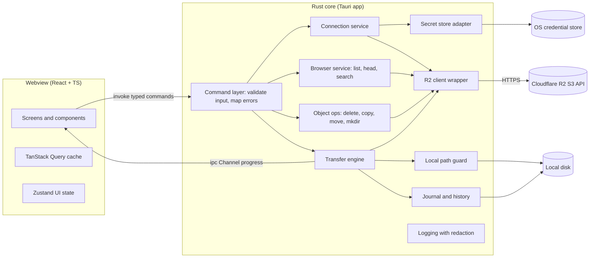
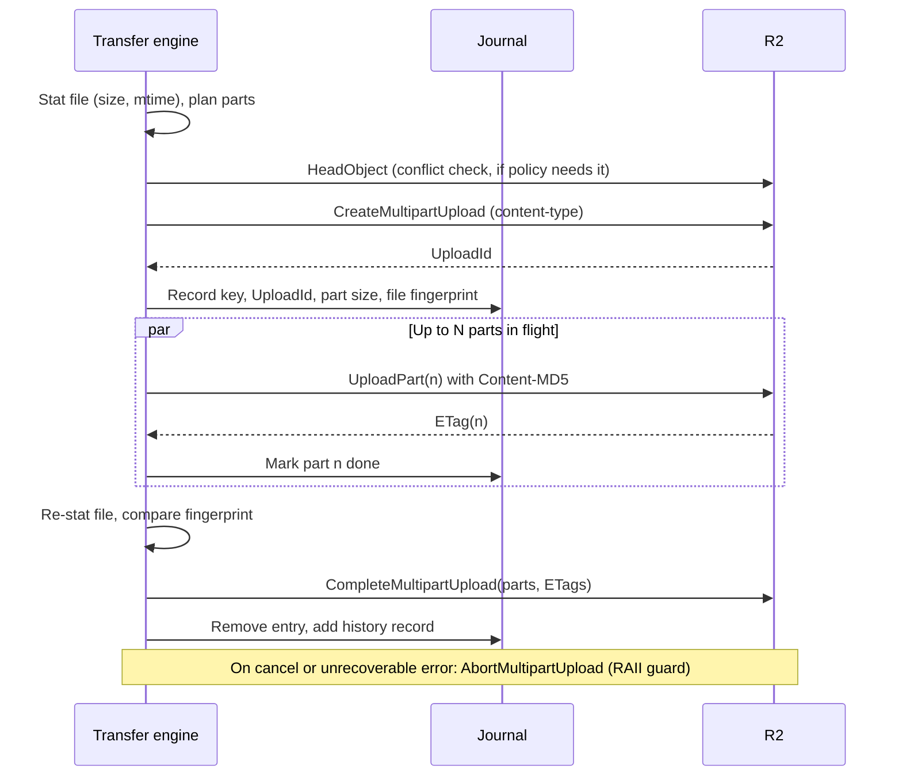
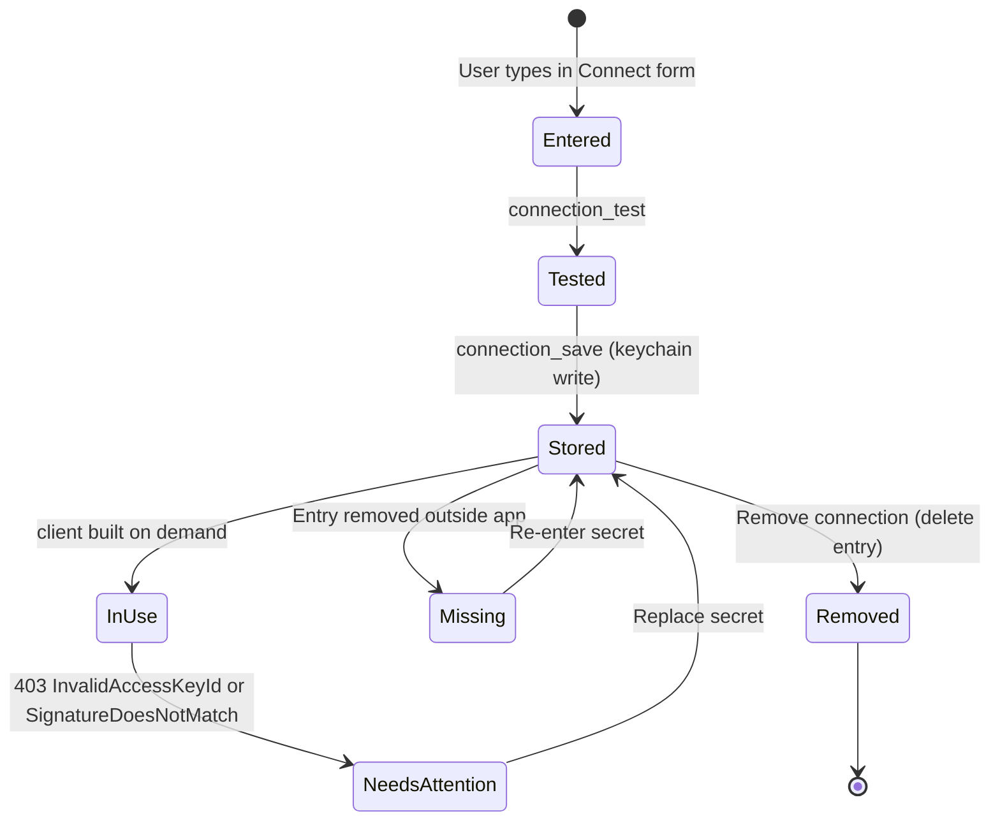
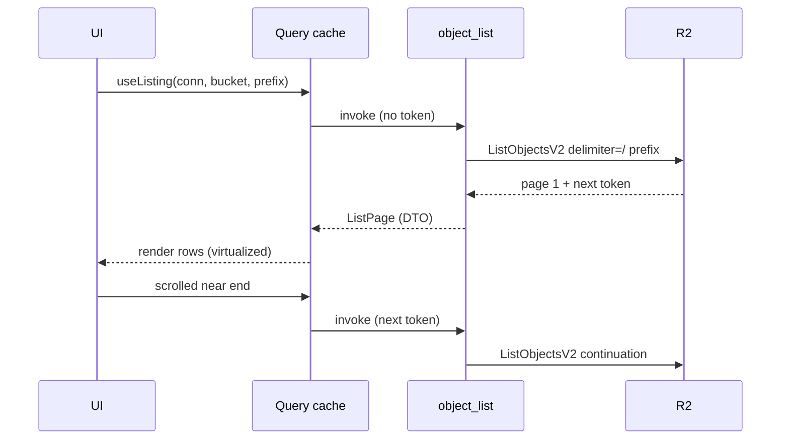
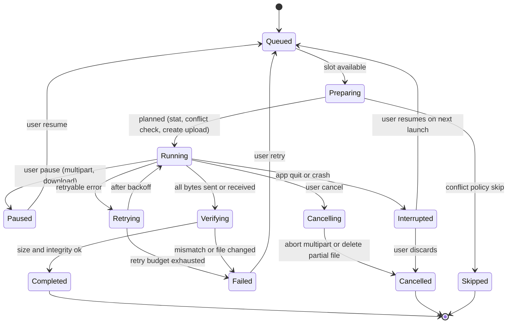

# R2Dock Technical Plan

Version: 0.1
Status: Version 0.4.0 implements Phases 1 to 5 plus the CSV activity log and audio and video compression (see section 17.1 for what is done and what remains). Items still marked **[Verify]** have not been checked against a real R2 bucket.

> The product name is R2Dock (decided 2026-10-17). The name should still live in one place in code (app config and a constants module).

### How to read this document

Statements are tagged where it matters:

| Tag | Meaning |
|---|---|
| **[Confirmed]** | Verified against official documentation during planning (October 2026). Source linked in section 6.10. |
| **[Decision]** | Proposed implementation choice. Can change with a written reason. |
| **[Verify]** | Assumption that must be validated in Phase 0 before code depends on it. |
| **[Optional]** | Not required for MVP. |

---

## 1. Executive Summary

R2Dock is a cross-platform desktop application (Windows, macOS, Linux) that lets people manage Cloudflare R2 object storage through a simple file-manager interface. Users bring their own R2 S3 credentials. The app talks directly to R2's S3-compatible API from the user's machine. There is no backend, no R2Dock account, and no telemetry.

Recommended architecture **[Decision]**:

- **Tauri 2** desktop shell with a **Rust** core that owns all networking, credentials, file system access, and transfers.
- **React + TypeScript + Vite** frontend that only renders UI and calls a small set of typed Tauri commands. It never receives secret keys.
- **aws-sdk-s3** (official AWS Rust SDK) configured for R2, running on **Tokio**.
- Secrets in the **OS credential store** (macOS Keychain, Windows Credential Manager, Linux Secret Service). No plaintext fallback.
- A **transfer engine** in Rust with bounded concurrency, streaming I/O, parallel multipart uploads, ranged resumable downloads, and a small on-disk journal for recovery after restart.

Three qualities drive every decision, in this order when they conflict:

1. **Secure**: keys never leave Rust after entry, minimal IPC surface, strict CSP, safe local paths.
2. **Stable**: transfers survive network drops and restarts where the protocol allows; nothing is silently overwritten or lost.
3. **Easy for beginners**: connect, upload, and download without reading documentation; risky actions are hard to do by accident.

---

## 2. Product Scope

### 2.1 In scope for MVP

- Connect one or more R2 accounts with R2 S3 credentials; test, edit, replace secret, remove.
- Bucket list (or manually added buckets for bucket-scoped tokens).
- Prefix-based folder browsing with pagination, sorting of loaded items, list and grid views.
- Object details (size, type, modified, ETag, storage class, custom metadata).
- Uploads: files, folders, drag and drop, conflict handling, multipart for large files.
- Downloads: files and folders, resumable, to a safe local destination.
- Transfer manager: queue, progress, speed, cancel, retry, pause/resume where supported, history.
- New folder, delete (with confirmation), rename and move of files (copy then delete).
- Search within the current folder (loaded items) and by key prefix within a bucket.
- Safe previews: images, plain text, audio streaming.
- Dark grey default theme and Paper light theme.
- Signed installers for Windows and macOS, and Linux packages.

### 2.2 Out of scope for MVP

- Background folder sync or mirroring.
- Bucket creation, deletion, CORS, lifecycle, or custom domain management.
- Sharing via presigned links (planned for v1.1, see section 21).
- Video preview, PDF preview.
- Editing object metadata.
- Cloudflare REST API or analytics integration (needs different credentials).
- Any server component, account system, or telemetry.

---

## 3. Users and Use Cases

| ID | Persona | Use case |
|---|---|---|
| U1 | Creator, non-technical | Drag a folder of 195 audiobook chapters into a bucket and leave it running. |
| U2 | Creator | Copy a public URL for a cover image to paste into a website CMS. |
| U3 | Developer | Browse a bucket with 50,000 objects, find a key by prefix, check its ETag and content type. |
| U4 | Developer | Download a 2.4 GB database backup over unstable Wi-Fi and have it resume. |
| U5 | Operator | Manage two accounts (default and EU jurisdiction) from one app. |
| U6 | Operator | Delete an old folder safely, knowing exactly how many objects will be removed. |
| U7 | Beginner | Install the app, find credentials using in-app help, and upload a first file within a few minutes. |

---

## 4. Functional Requirements

Priority: **M** = MVP, **S** = should have for MVP if time allows, **L** = later.

| ID | Requirement | Priority |
|---|---|---|
| F1 | Add a connection with name, account ID, access key ID, secret, optional bucket, jurisdiction | M |
| F2 | Test a connection and report a specific, secret-free result | M |
| F3 | Store secrets only in the OS credential store; show clear state if unavailable | M |
| F4 | Edit connection, replace secret, remove connection (deletes stored secret) | M |
| F5 | List buckets (admin tokens) or use manually entered buckets (scoped tokens) | M |
| F6 | Browse prefixes with `/` delimiter, paginated, with folder markers handled | M |
| F7 | Sort and filter loaded items; list and grid view; compact and comfortable density | M |
| F8 | Show object details via HeadObject | M |
| F9 | Upload files and folders via picker and drag and drop | M |
| F10 | Multipart upload for large files with parallel parts | M |
| F11 | Conflict policy: ask, skip, replace, keep both | M |
| F12 | Download files and folders with streaming to disk and safe paths | M |
| F13 | Transfer queue with progress, speed, ETA, cancel, retry | M |
| F14 | Pause/resume for multipart uploads and downloads | M |
| F15 | Recover multipart uploads and partial downloads after app restart | S |
| F16 | Create folder (marker object) | M |
| F17 | Delete objects and folders with confirmation and typed confirmation for large deletes | M |
| F18 | Rename and move files (copy then delete, verified) | M |
| F19 | Rename and move folders (batch copy then delete with result report) | S |
| F20 | Prefix search across a bucket | M |
| F21 | Image, text, and audio preview | M (audio S) |
| F22 | Copy object key; copy public URL when a public base URL is configured | M |
| F23 | Recent and Favorites (local only) | S |
| F24 | On-demand bucket or folder size calculation | S |
| F25 | Settings as specified in DESIGN.md | M |
| F26 | Signed auto-update | S |
| F27 | Presigned share links | L |
| F28 | Bandwidth limit | L |
| F29 | Storage class selection on upload | L |

---

## 5. Nonfunctional Requirements

| ID | Area | Requirement |
|---|---|---|
| N1 | Security | Secrets never sent to the frontend after entry, never logged, never written to disk outside the OS credential store. |
| N2 | Security | Frontend can only call an explicit allowlist of app commands; no generic fs, shell, or http plugin access. |
| N3 | Security | Strict CSP with no remote script, no `unsafe-eval`, no inline script. |
| N4 | Stability | No silent overwrite of remote or local files. |
| N5 | Stability | A crash or forced quit never leaves a partially written file at the final download path. |
| N6 | Stability | Uploads never complete a multipart object from a file that changed during upload. |
| N7 | Performance | Memory used by transfers is bounded by configuration, independent of file size. |
| N8 | Performance | UI stays responsive (no frame longer than about 100 ms from app logic) with 10,000 loaded rows and 500 queued transfers. Provisional, see section 14. |
| N9 | Performance | Near-zero CPU when idle with no transfers (no polling loops). |
| N10 | Usability | A first-time user can connect and upload a file without external docs (validated with at least 3 usability test participants). |
| N11 | Accessibility | WCAG 2.2 AA targets, full keyboard operation. |
| N12 | Privacy | No telemetry. Network traffic only to R2 endpoints, the update endpoint (if enabled), the pinned FFmpeg download (only when the user installs compression tools), and `api.cloudflare.com` (only when the user saved an optional API token and opens a file's details or copies its public link). |
| N13 | Portability | Windows 10 and 11 (x64, arm64 [Verify]), macOS 12 or later [Verify against Tauri minimum], mainstream Linux (Ubuntu LTS, Fedora) with WebKitGTK. |

---

## 6. Technology Evaluation

### 6.1 Desktop framework: Tauri 2 **[Decision]**

| Option | Pros | Cons | Verdict |
|---|---|---|---|
| **Tauri 2** | Rust core, small bundles, uses system webview, capability-based permissions, updater with signatures, mature ecosystem | Three different webviews (WebView2, WKWebView, WebKitGTK) behave differently; Linux WebKitGTK can be slower | **Selected** |
| Electron | Most mature, one Chromium everywhere, consistent rendering | Large bundles and memory, Node backend instead of Rust, larger attack surface | Rejected (resource goals) |
| egui / iced / Slint (pure Rust UI) | Single language, no webview | File-manager UIs with virtualization, rich text, drag and drop, and accessibility take much more effort; accessibility support varies | Rejected for MVP |
| Dioxus desktop | Rust-only React-like model | Still uses a webview on desktop; smaller ecosystem | Not worth the trade |

Security implications: Tauri 2 capabilities restrict which commands each window can call **[Confirmed]**. App commands are callable from all windows unless restricted via `AppManifest::commands` in `build.rs` **[Confirmed]**. We use a single main window, so the main risk is XSS in the webview; mitigated by strict CSP, no HTML rendering of remote content, and a minimal command surface.

Performance implications: memory includes the separate webview processes. All measurements must sum the app process and its webview child processes (section 14).

### 6.2 Frontend: React + TypeScript + Vite + CSS variables **[Decision]**

- React and TypeScript: largest contributor pool, strong typing for IPC DTOs.
- Vite: fast dev server, officially supported by Tauri templates.
- Styling: tokens from DESIGN.md are CSS custom properties in `src/styles/tokens.css`, used by plain CSS per component. Tailwind was not adopted: it added a build dependency without removing real complexity (ADR 0004).
- Svelte or Solid would be lighter, but React's ecosystem for accessible primitives and virtualization is stronger. Bundle size is local, so the cost is mostly startup parse time, which we will measure.

### 6.3 Component primitives **[Decision]**

- **Radix UI primitives** (unstyled, accessible) for dialog, dropdown, context menu, tooltip, tabs, select. Alternative: **React Aria** (Adobe), which has stronger grid and drag-and-drop accessibility. Phase 0 spike decides between them using the file grid as the test case. **[Verify]**
- Avoid heavy styled kits (MUI, Ant Design).

### 6.4 Icons: Lucide **[Decision]**

Tree-shakeable SVG icons, ISC license, consistent line style. Import per icon.

### 6.5 Virtualization **[Decision]**

**TanStack Virtual** (headless, small). Alternative: react-virtuoso (used by the Brows3 reference project, simpler API, larger). Choose in Phase 0 by testing 10,000 rows with keyboard navigation.

### 6.6 State management **[Decision]**

- **TanStack Query** for IPC-backed server state (listings, details) with caching and invalidation after uploads and deletes.
- **Zustand** (tiny) for UI state: selection, view mode, panel visibility, theme.
- Transfer state is owned by Rust. The frontend holds a read model updated from a progress channel.
- No Redux, no global event bus.

### 6.7 R2 client: aws-sdk-s3 **[Decision]**

| Option | Notes | Verdict |
|---|---|---|
| **aws-sdk-s3** (official) | Maintained by AWS, full S3 surface including multipart, UploadPartCopy, presigning, conditional headers, retries, streaming bodies | **Selected** |
| rust-s3 | Simpler API, smaller | Smaller maintainer base, less complete error modeling |
| object_store (Apache Arrow) | Clean abstraction, multipart support | Hides S3 details we need (ETag formats, ListParts, conditional writes) |
| OpenDAL | Many backends | Extra abstraction we do not need |

Costs: compile time and binary size are higher. Mitigate with minimal features (`rustls`, no SSO or credential-process features since R2 does not use them).

Required configuration (see section 8.1): region `auto`, account endpoint, static credentials, and checksum settings `WhenRequired`.

### 6.8 Supporting crates (all **[Decision]**, versions pinned in Phase 0)

| Purpose | Crate | Reason |
|---|---|---|
| Async runtime | `tokio` | Required by aws-sdk; Tauri uses it internally |
| Errors | `thiserror` | Typed errors per module; no `anyhow` at module boundaries (allowed in tests and tools) |
| Logging | `tracing`, `tracing-subscriber`, `tracing-appender` | Structured logs, rolling files, redaction layer |
| Secrets | `keyring` | OS credential store; see 9.2. Version 4 restructured into `keyring-core` plus per-platform store crates **[Confirmed]**; the Brows3 reference uses v3. Pick the version and API in Phase 0 **[Verify]** |
| Secret handling | `secrecy`, `zeroize` | Keep secrets in wrappers that do not `Debug`/`Display` and zero on drop |
| Directory walking | `walkdir` | Folder uploads; does not follow symlinks by default |
| MIME | `mime_guess` | Content-Type on upload |
| Hashing | `md-5` | Per-part Content-MD5 integrity (section 8.10) |
| Serialization | `serde`, `serde_json` | Config and journal |
| Temp files | `tempfile` | Atomic writes, `persist_noclobber` for downloads |
| Paths | `directories` or Tauri path API | Platform config/data/log dirs |
| Disk space | `fs4` | Free-space preflight before downloads [Verify API] |
| Tauri plugins | `dialog`, `notification`, `updater`, `clipboard-manager`, `opener` | Each scoped by capability. **No** `fs`, `shell`, or `http` plugins exposed to the frontend |

### 6.9 Prior art reviewed

Four open-source projects were cloned into `reference/` (read only, never built or run) and reviewed. Lessons are applied throughout this plan. Code from these projects must not be copied unless the license allows it and attribution is added; Furman is GPL-3.0 and must not be copied at all into this project if it is not GPL.

| Project | Stack | License | Lessons applied |
|---|---|---|---|
| Brows3 (`rgcsekaraa/brows3`) | Tauri 2, Next.js, aws-sdk-s3, zustand, react-virtuoso | MIT | **Copy ideas**: secrets marked `skip_serializing` so they never cross IPC; keychain entries keyed by a random ID and rotated on edit; RAII guard that aborts multipart uploads on error or drop; defensive pagination (fail on missing or repeated continuation tokens); conditional writes (`If-None-Match: *`) to avoid overwrites; temp file plus no-clobber rename for downloads; one shared client builder for "test" and real use; journal backup on corruption; `request_checksum_calculation` and `response_checksum_validation` set to `WhenRequired` for S3-compatible endpoints. **Avoid**: silent plaintext `secrets.json` fallback; loose CSP (`unsafe-inline`, `connect-src https:`) combined with `withGlobalTauri`; sequential part uploads; no multipart resume after restart; global events for high-rate progress; region `us-east-1` default; sorting entire folders in memory; one 3,000-line transfer module. Its docs state it was validated against MinIO only, not R2. |
| Furman (`fenio/furman`) | Tauri 2, aws-sdk-s3 | GPL-3.0 | Ideas only. See section 6.9.1. |
| S3 Manager (`MassivDash/S3_Manager`) | Tauri 1, Svelte, aws-sdk-s3 | MIT (declared) | **Avoid**: `allowlist: all` with `csp: null`; arbitrary local paths accepted from IPC; `unwrap`/`panic!` in commands; DeleteObjects with more than 1,000 keys in one call; whole objects read into memory on download; folder uploads that flatten structure and silently overwrite; presigned URLs handed to the webview for every image; tests against a real bucket; a new client per command. |
| R2-Explorer (`G4brym/R2-Explorer`) | Cloudflare Worker + Vue | MIT | **UX ideas**: context menu shape, full-window drop overlay, hidden dotfiles setting, folder marker objects filtered out of file lists, backoff wrapper around part uploads. **Avoid**: no multipart abort (orphaned uploads), get-put-delete moves streaming bytes through the client instead of server-side copy, unsalted password hashes for share links. |

#### 6.9.1 Furman notes

Furman (Tauri 2.10, Svelte 5, aws-sdk-s3 1, GPL-3.0-only). Ideas only; no code may be copied.

- **Ideas worth adopting**: `request_checksum_calculation(WhenRequired)` plus path style for non-AWS endpoints; dynamic part sizing to stay under 10,000 parts; semaphore-bounded parallel parts; `ByteStream::read_from().path().offset().length()` for streaming parts from disk; progress over `tauri::ipc::Channel` (used throughout, confirming the approach in 12.4); streaming checksum verification on download (CRC32C or single-part MD5, then size); atomic temp-file persistence for config and journal; upload sources opened relative to a pinned directory with `O_NOFOLLOW` per path component, accepting only normal components, rejecting symlinks and non-regular files, and detecting file changes before and after upload; interceptors as provider-specific safety gates.
- **Mistakes to avoid**: the plaintext secret is returned to JavaScript by a `keychain_get` command and passed back into connect commands (our design forbids any secret-returning command); no Windows credential store registered; **download path traversal** (`dest.join(key)` without rejecting `..`, absolute paths, or backslashes, followed by `create_dir_all`); downloads written directly to the final path without a temp file or Range resume; progress events on every chunk without throttling; cancellation checked only between files or parts, not inside streams; whole parts buffered in a `Vec` in the older upload path; Tauri `assetProtocol` scope `**/*` (webview can read any file; we do not enable the asset protocol for user files); SDK default timeouts left unset.
- **Credential crate signal**: Furman uses `keyring-core` 1 with `apple-native-keyring-store` and `dbus-secret-service-keyring-store`. This confirms the keyring v4 split architecture is usable, and that the Windows store must be explicitly added. Input to the Phase 0 ADR.

### 6.10 Sources consulted (official)

- Cloudflare R2 S3 API compatibility: https://developers.cloudflare.com/r2/api/s3/api/
- R2 multipart objects: https://developers.cloudflare.com/r2/objects/multipart-objects/
- R2 API tokens and endpoints: https://developers.cloudflare.com/r2/api/tokens/
- R2 limits: https://developers.cloudflare.com/r2/platform/limits/
- R2 presigned URLs: https://developers.cloudflare.com/r2/api/s3/presigned-urls/
- R2 with aws-sdk-rust: https://developers.cloudflare.com/r2/examples/aws/aws-sdk-rust/
- Tauri 2 capabilities: https://v2.tauri.app/security/capabilities/
- keyring crate: https://docs.rs/keyring/latest/keyring/

---

## 7. System Architecture



Layer rules **[Decision]**:

1. The webview has no direct network, file system, or shell access. Everything goes through app commands.
2. Commands are thin: parse and validate inputs, call a service, map errors to `AppError` DTOs.
3. Services hold logic and are testable without Tauri (they live in workspace crates without a Tauri dependency).
4. Only the secret store adapter and the R2 client builder ever see a secret.

### 7.1 IPC contract

Commands (initial list, names illustrative):

| Command | Input | Output |
|---|---|---|
| `connection_list` | none | `ConnectionSummary[]` (id, name, account id, jurisdiction, status, buckets) |
| `connection_test` | `NewConnectionInput` (includes secret) or `connection_id` | `TestResult` |
| `connection_save` | `NewConnectionInput` | `ConnectionSummary` |
| `connection_update` | id, fields, optional new secret | `ConnectionSummary` |
| `connection_remove` | id | ok |
| `bucket_list` | connection id | `BucketSummary[]` |
| `object_list` | connection id, bucket, prefix, continuation token | `ListPage` (folders, objects, next token) |
| `object_search_prefix` | connection id, bucket, prefix | `ListPage` |
| `object_head` | connection id, bucket, key | `ObjectDetails` |
| `object_public_url` | connection id, bucket, key | `PublicLink` (url, source, status; may call the Cloudflare API, cached) |
| `object_delete` | connection id, bucket, keys or prefix, confirmation token | job id |
| `object_copy_move` | source, destination, mode | job id |
| `folder_create` | connection id, bucket, prefix | ok |
| `transfer_enqueue_upload` | connection id, bucket, prefix, local selection id, conflict policy | job ids |
| `transfer_enqueue_download` | connection id, bucket, keys or prefix, destination id | job ids |
| `transfer_control` | job id, action (pause, resume, cancel, retry) | ok |
| `transfer_subscribe` | `Channel<TransferEvent>` | ok |
| `preview_text` | connection id, bucket, key | text (capped) |
| `settings_get` / `settings_set` | typed settings | typed settings |

Key rules:

- **Local paths come from Rust-side pickers or OS drag-and-drop events, not from arbitrary frontend strings.** The dialog plugin returns paths; Rust registers them and gives the frontend an opaque selection id. For drag and drop, Tauri delivers dropped paths through its window drag-drop event on the Rust side **[Verify the exact event API in Tauri 2]**; Rust registers them the same way. This prevents a compromised webview from uploading `~/.ssh` by passing a path string.
- **Delete of more than N objects or any prefix requires a confirmation token** obtained from a `delete_preview` call that returns the count. The backend refuses deletes without a matching, unexpired token.
- All DTOs are generated or mirrored in TypeScript from Rust types (Phase 0 evaluates `specta`/`tauri-specta` or `ts-rs` **[Verify]**).

---

## 8. R2 API Integration

### 8.1 Client configuration

```text
endpoint      https://<ACCOUNT_ID>.r2.cloudflarestorage.com         [Confirmed]
              https://<ACCOUNT_ID>.eu.r2.cloudflarestorage.com      (EU jurisdiction) [Confirmed]
              https://<ACCOUNT_ID>.fedramp.r2.cloudflarestorage.com (FedRAMP) [Confirmed]
region        auto                                                  [Confirmed]
credentials   static access key id + secret, no session token       [Confirmed]
checksums     request_checksum_calculation = WhenRequired
              response_checksum_validation = WhenRequired           [Verify on R2; used by Brows3]
path style    force_path_style(true)                                [Verify; both styles likely work]
retries       SDK standard retry mode, max 3 attempts per request   [Decision]
timeouts      set explicitly (never rely on SDK defaults):
              connect 10 s; metadata/list attempt 30 s;
              transfer bodies use a stall timeout (no bytes for 60 s)
              instead of a total timeout                            [Decision]
```

Why the checksum settings: recent aws-sdk versions compute CRC checksums by default on uploads. Several S3-compatible services rejected this at the time of change, and reference projects set `WhenRequired` as a workaround. Phase 0 must test both default and `WhenRequired` against a real R2 test bucket, because R2's compatibility page lists supported checksum algorithms and types **[Confirmed]** and the default may now work.

One client per (connection, jurisdiction), built lazily and cached in memory. Rebuilt when a secret is replaced. The "Test connection" path uses the same builder as real use.

### 8.2 Credentials and permissions

| Token permission | Can list buckets | Can read/list objects | Can write/delete | Scope |
|---|---|---|---|---|
| Admin Read & Write | Yes | Yes | Yes | Account [Confirmed] |
| Admin Read only | Yes | Yes | No | Account [Confirmed] |
| Object Read & Write | No: `ListBuckets` returns `AccessDenied` even when the token covers all buckets [Confirmed 2026-10-17 against real R2] | Yes, by bucket name | Yes | Selected or all buckets [Confirmed] |
| Object Read only | Probably no | Yes | No | Selected buckets [Verify] |

App behavior:
- Test with `ListBuckets`. If access denied and a bucket was entered, test `ListObjectsV2` with `max-keys=1` on that bucket. Save the bucket list for scoped tokens in connection config. The Connect form accepts several bucket names separated by commas.
- A wrong secret returns `SignatureDoesNotMatch` (403), not `AccessDenied` [Confirmed 2026-10-17], so `AccessDenied` on `ListBuckets` means the key works but is an object-level token.
- A read-only live check lives in `crates/r2dock-r2/tests/live_r2.rs` (ignored by default; run with `--ignored` and the `R2DOCK_LIVE_*` environment variables).
- Detect read-only tokens lazily: the first denied write marks the connection read-only in the UI and disables write actions, with an explanation. Do not probe with test writes.
- The help text recommends Object Read & Write scoped to specific buckets.

Format checks before network calls **[Verify]**: account ID appears to be 32 hex characters; access key ID 32 hex; secret 64 hex (the secret is a SHA-256 hash of the token value **[Confirmed]**). Use these as warnings, not hard blocks, until confirmed.

### 8.3 Listing and folders

- `ListObjectsV2` with `delimiter=/`, `prefix=<current>`, page size 1,000 (S3 default max; R2 page size limit **[Verify]**), `continuation-token` paging **[Confirmed supported]**.
- `CommonPrefixes` become folders. Contents become files, except a zero-byte object whose key equals the current prefix (the folder's own marker), which is hidden.
- Pagination is incremental: the first page renders immediately; more pages load as the user scrolls. Sorting applies to loaded items and the UI says so until the listing is complete ("Sorted 1,000 of more items"). Users can choose "Load all" for folders below a threshold (default 20,000 items) **[Decision]**.
- Defensive paging: stop with an error if a truncated response has no continuation token or repeats one (Brows3 pattern).
- Cache: TanStack Query caches pages per (connection, bucket, prefix) for the session; invalidated by uploads, deletes, and moves into that prefix; manual Refresh always refetches. No background polling.
- Cost awareness: R2 bills list operations as Class A operations **[Verify current pricing]**. Avoid automatic full listings; size calculation is explicit.

### 8.4 Uploads

| Size | Method | Notes |
|---|---|---|
| Below multipart threshold (default 100 MiB) | `PutObject` streaming from file | Single PUT limit about 5 GiB [Confirmed] |
| At or above threshold | Multipart | Up to 10,000 parts, 5 MiB min part (except last), 5 GiB max part, all parts except last equal size, about 5 TiB max object [Confirmed] |

Part size **[Decision, tune in Phase 6]**: `max(16 MiB, ceil(file_size / 9,000))` rounded up to a whole MiB. The 9,000 divisor leaves headroom under 10,000 parts. 16 MiB keeps retries cheap and progress smooth.

Bodies stream from disk with `ByteStream::read_from().path(..).offset(..).length(..)` (pattern seen in Brows3) **[Verify API in the pinned SDK version]**. No part is fully held in memory unless Content-MD5 is computed, which reads the part range once to hash it before sending.

Multipart flow:



Notes:
- Re-uploading a part number replaces the previous part; if that retry fails, the original is lost and must be re-uploaded **[Confirmed]**. Retry logic must treat the part as not done until a new ETag is received.
- R2 auto-aborts incomplete multipart uploads after 7 days by default **[Confirmed]**. Resume after restart is only possible within that window, and only if the bucket's lifecycle rules have not been changed to something shorter.
- `CreateMultipartUpload` does not support tagging or ACL headers **[Confirmed]**. We never send ACL headers.
- Conflict handling: for "skip" or "ask" policies on single PUT, send `If-None-Match: *`; R2 evaluates PutObject conditions atomically and returns 412 if the key exists **[Confirmed]**. Multipart completion conditional headers are not listed for R2 **[Verify]**, so multipart uses HeadObject before Create and again before Complete; a small race window remains and is documented.
- Concurrent writes to the same key are limited to 1 per second (429 above that) **[Confirmed]**. The engine never schedules two writes to the same key concurrently.

### 8.5 Downloads

- `GetObject` streamed to a temp file in the destination folder named `.<name>.r2dock-part` (hidden, same volume for atomic rename).
- Resume uses `Range: bytes=<received>-` with `If-Match: <etag>` so a changed object restarts instead of corrupting **[Confirmed: conditional GET supported]**.
- On completion: verify size; for single-part ETags (no `-N` suffix and no SSE-C), compare the MD5 of the file with the ETag; then rename with no-clobber semantics. If the target appeared meanwhile, apply the conflict policy.
- Large files may use parallel ranged GETs **[Optional, Phase 6]**.

### 8.6 Delete

- Single: `DeleteObject`.
- Many: `DeleteObjects` in batches of up to 1,000 keys (S3 limit; R2 supports DeleteObjects **[Confirmed]**, batch size limit **[Verify]**). Parse per-key errors from the response; report partial failures.
- Folder delete = list every key under the prefix (no delimiter), show the count, require typed confirmation, then batch delete including the marker.
- There is no trash and no versioning (R2 does not implement bucket versioning APIs **[Confirmed]**). The UI says deletion is permanent.

### 8.7 Copy, rename, move

R2 has no rename or move operation. All are built from primitives and **none are atomic**.

| Action | Implementation |
|---|---|
| Copy file up to 5 GiB | `CopyObject` (server side, no bytes through the client) [Confirmed supported; 5 GiB limit Verify] |
| Copy file above 5 GiB | Multipart copy with `UploadPartCopy` [Confirmed supported] |
| Rename/move file | See "Move sequence" below: conditional copy, destination ETag check, source ETag re-check, then `DeleteObject` on source |
| Rename/move folder | For each object under the prefix: copy, verify, delete. Bounded concurrency. Journaled. |

Partial failure handling:
- If copy fails: source untouched; report.
- If copy succeeds and delete fails: both exist; report "copied but original not removed" with Retry delete.
- If anything changed during the move, or the outcome is unclear, the source is kept and the item is reported (see below).

Move sequence for one object (`crates/r2dock-r2/src/bulk.rs`, `move_one`):

1. Unless overwriting, `HeadObject` on the destination; an existing object is a conflict.
2. `HeadObject` on the source; remember its size and ETag. No ETag means no move.
3. Copy that version only:
   - Up to 5 GiB: `CopyObject` with `x-amz-copy-source-if-match: <source ETag>` **[Confirmed supported on CopyObject]** and, unless overwriting, `cf-copy-destination-if-none-match: *` **[Confirmed documented R2 extension, marked beta]**. R2 checks the destination condition when the copy is committed, so a destination created after step 1 is not replaced; the request fails with 412. The two conditions are not atomic with each other, which does not matter here: the source condition picks the version, the destination condition guards the write.
   - Above 5 GiB: R2 lists `x-amz-copy-source-if-*` as unsupported on `UploadPartCopy` and documents no conditions on `CompleteMultipartUpload` **[Confirmed]**, so no source condition is sent on parts. The source ETag and size are checked before `CreateMultipartUpload` and again after the last part; unless overwriting, the destination is checked for absence before creating and again right before completing. Any mismatch aborts the upload. A change in the short window between the last check and `CompleteMultipartUpload` is not detected, and a source that changed and changed back (same ETag) between parts is not detected.
4. `HeadObject` on the destination: its size and ETag must equal the source size and the ETag returned by the copy. Same size alone is not enough. A mismatch means someone replaced the destination; the source is kept and the item is reported as failed.
5. `HeadObject` on the source: its size and ETag must still equal step 2. A change keeps the source and reports the item as copied, original kept. A source that is already gone counts as moved.
6. `DeleteObject` on the source. R2 documents no conditional headers on `DeleteObject` **[Confirmed: none listed]**, so the delete is unconditional. A change to the source in the single round trip between step 5 and the delete can still be lost. This window is narrow but not closed.

Unclear outcomes keep the source: a copy whose response is lost is reported as failed (a retry is refused by the destination condition), and a destination or source check that errors is reported as copied, original kept. Request-ordering tests for these cases use an in-process mock (`crates/r2dock-r2/tests/move_races.rs`); they prove the client's sequencing, not R2's enforcement. **[Verify]** against a disposable R2 test bucket: `cf-copy-destination-if-none-match` returns 412 for an existing key, and the `CopyObject` result ETag equals the ETag `HeadObject` then reports for the new object (if it ever differs, moves keep the source instead of deleting it).
- If the app quits mid-folder-move: journal lists processed keys; on restart offer "Finish move" or "Leave as is".
- Destination conflicts are checked before starting (list destination prefix) and per object with the conflict policy.
- `CopyObject` supports `x-amz-metadata-directive` **[Confirmed]**; use `COPY` to keep content type and custom metadata. Whether `COPY` also keeps the storage class on R2 is **[Verify]**; single copies do not send `x-amz-storage-class` today.
- Multipart copy cannot use the metadata directive, so `CreateMultipartUpload` sets each field from the source `HeadObject`: Content-Type, Cache-Control, Content-Encoding, Content-Disposition, Content-Language, Expires, `x-amz-storage-class`, and custom `x-amz-meta-*` metadata (all listed as supported on R2 `CreateMultipartUpload` **[Confirmed]**). Absent fields are not sent. An `Expires` value that is not a valid HTTP date is dropped. Tagging, ACLs, and website redirects are not supported by R2 and are not copied.

### 8.8 Metadata and storage classes

- `HeadObject` gives size, content type, last modified, ETag, custom metadata, storage class.
- Storage classes: `STANDARD` and `STANDARD_IA` (Infrequent Access) **[Confirmed]**. IA has retrieval charges and a minimum storage duration **[Verify current pricing]**; the UI shows the class and a tooltip.
- Object tagging is not supported on R2 **[Confirmed]**; no tagging UI.
- Owner and ACL fields are not shown.

### 8.9 Public and private access

- The S3 API endpoint always requires signed requests. Public access exists only via r2.dev URLs or custom domains configured in the Cloudflare dashboard.
- The app cannot reliably know whether a bucket is public using S3 credentials. Users set a **public base URL** per bucket; "Copy public URL" is `base_url + "/" + percent-encoded key`. The app never claims an object is public.
- **Detected public domains (optional).** A connection may also hold a Cloudflare API token (the "Token value" shown when an R2 token is created). With it, Rust reads the bucket's public domains from the Cloudflare REST API **[Confirmed against the API reference 2026-10-18; not yet tested live]**:
  - `GET https://api.cloudflare.com/client/v4/accounts/{account_id}/r2/buckets/{bucket_name}/domains/custom` returns `result.domains[]` with `domain`, `enabled`, and `status.ownership` / `status.ssl` (`pending`, `active`, `deactivated`, `blocked`, `error`, `unknown`; ssl also `initializing`).
  - `GET .../domains/managed` returns `result` with `bucketId`, `domain` (the `pub-<id>.r2.dev` host), and `enabled`.
  - Both use `Authorization: Bearer <token>` and an optional `cf-r2-jurisdiction` header (`default`, `eu`, `us`, `fedramp`, `fedramp-high`); R2Dock sends `eu` or `fedramp` for those jurisdictions and no header otherwise.
  - The reference does not list the permission needed. The R2 token page says Admin Read only and Workers R2 Storage Read can "view bucket configuration"; Object Read & Write tokens only work with the S3 API, so for them the lookup is expected to return 403 **[Verify]**.
- Resolution order for the link shown in Details and copied by "Copy public URL": the manual public base URL (label "Public URL"), else an enabled custom domain, active ones first ("Custom domain"), else the `r2.dev` domain when enabled ("r2.dev"), else a hint. Domain names from the API are accepted only as plain lowercase host names and always used with `https://`. Lookups happen only when the Details panel or the context menu asks (no polling), are cached in memory per connection and bucket (5 minutes when found, 30 seconds after a failure), and the cache is dropped when the connection changes. A 401 or 403 shows a one-line hint in Details, not an error toast.
- Presigned URLs: GET, HEAD, PUT, DELETE supported, max 7 days, only on the S3 API domain, not custom domains **[Confirmed]**. They are bearer tokens. Planned as a v1.1 feature with explicit expiry choice and warning.

### 8.10 Integrity

- Single PUT: send `Content-MD5` (supported on PutObject and UploadPart **[Confirmed]**). R2 rejects mismatches **[Verify behavior]**.
- Multipart: per-part `Content-MD5`; the completed ETag is MD5 of concatenated part MD5s plus `-<parts>` **[Confirmed]**, so the app can compute and compare the expected multipart ETag locally.
- The UI and code never treat an ETag as a full-file MD5 unless it is known to be a single-part, non-SSE-C upload.
- Hashing cost: reading each part twice (hash, then send) doubles disk reads. Measure in Phase 6; if too costly, compute MD5 while streaming and rely on SDK-level CRC checksums instead (requires the checksum decision from 8.1).

### 8.11 Retries, rate limits, and error mapping

- SDK standard retry handles transient errors per request (with exponential backoff and jitter). The transfer engine adds job-level retries on top (default 3, backoff 2 s, 8 s, 30 s with jitter) only for retryable failures. The two layers must not multiply into long silent hangs: total retry budget per part is capped, and the UI shows "Retrying (2 of 3)".
- 429 and 503 slow down responses reduce the engine's concurrency temporarily (halve, recover gradually) **[Decision]**.

| Condition | Typical signal | User message (short) | Retry |
|---|---|---|---|
| Bad access key | `InvalidAccessKeyId` (403) | Access Key ID not recognized | No |
| Bad secret | `SignatureDoesNotMatch` (403) | Secret does not match this key | No |
| No permission | `AccessDenied` (403) | This key cannot do that | No |
| Bucket missing | `NoSuchBucket` (404) | Bucket not found | No |
| Object missing | `NoSuchKey` (404) | File no longer exists | No |
| Conflict on conditional write | 412 | Already exists | No (apply policy) |
| Rate limited | 429 | Busy, retrying | Yes |
| Server error | 500, 503 | R2 error, retrying | Yes |
| DNS or connect failure | client error | Cannot reach R2 | Yes (and offline state) |
| Timeout / stalled | client timeout | Connection stalled, retrying | Yes |
| TLS failure | client error | Secure connection failed (proxy?) | No |
| Invalid account ID | DNS failure or specific error code | Check account ID | [Verify exact signal] |
| Disk full | `ENOSPC` / Windows equivalent | Not enough disk space | No |

The exact error codes R2 returns for each case must be captured in Phase 0 against a test bucket and stored as fixtures for tests.

---

## 9. Credential and Security Architecture

### 9.1 Principles

- Every user owns their credentials. The app never sees anything else (no Cloudflare global keys, no passwords). The only other credential is an optional R2 API token value, used read-only to find a bucket's public domains (8.9).
- Secrets enter once (the Connect form), move to Rust, and are stored in the OS credential store. They never return to the frontend.
- Least privilege is recommended and supported (bucket-scoped tokens work).

### 9.2 Storage

| Platform | Backend | Notes |
|---|---|---|
| macOS | Keychain | Entries readable by the signed app; unsigned dev builds may prompt [Verify] |
| Windows | Credential Manager | Protected per user by the OS |
| Linux | Secret Service (GNOME Keyring, KWallet) | May be missing on minimal or headless setups |

Entry naming: service `app.r2dock.credentials` **[Decision]**, account = random UUID per stored secret. The connection config stores only this UUID reference. A new UUID is created when a secret is replaced and the old entry is deleted after the new one is confirmed.

The optional Cloudflare API token is stored exactly like the secret access key: its own credential store entry with its own random reference (`apiToken` in the config), session memory when the store is unavailable, never returned to the frontend (the summary only has `hasApiToken`), cleared from React state after a successful save, replaced and removed under the same commit and cleanup rules as the secret. It is sent only to `api.cloudflare.com` by `r2dock-r2::cfapi`, never logged, and never part of an error.

Non-secret connection config (name, account ID, jurisdiction, buckets, public base URLs, secret and API token references) is stored as JSON in the platform app config directory, written atomically (temp file then rename).

**No plaintext fallback.** If the credential store is unavailable, the app offers **session-only mode**: the secret is held in memory (zeroized on drop) until quit, and the UI states this clearly. This is a deliberate difference from the Brows3 reference.

**No command ever returns a secret** (a mistake seen in the Furman reference). Secrets in memory use `secrecy::SecretString`. Types holding secrets do not implement `Serialize`, `Debug`, or `Display` without redaction.

The secret (and the optional API token) does cross IPC once, from the Connect form to `connection_save`/`connection_test`. Mitigations: the field is cleared from React state immediately after the call; the value is never put in TanStack Query or Zustand; the command logs nothing about inputs.

### 9.3 Credential lifecycle



Rotation: "Replace secret" writes the new secret under a new reference, tests it, switches the config, then deletes the old entry. Transfers in progress for that connection pause and resume with the new client.

Config changes are committed as a whole: the change is applied to a copy of the config, the copy is written atomically, and only then does it become the live config. Session-only secrets and API tokens are published, and cached clients for that connection dropped, in the same step under the config lock, so no reader can pair new settings with an old secret or old settings with a new secret. A failed save leaves memory, disk, cached clients, and stored secrets as they were (nothing is published, and a credential store entry written for the failed save is deleted again). The same rule applies to `settings.json`.

Unused credential store entries are never forgotten. When a connection is removed or its secret or API token replaced or removed, the old entry's opaque reference is recorded in `connections.json` (`secretCleanup`, references only, never secret values) in the same save that stops using it. If a save fails and the entry written for it cannot be deleted either, its reference is written to `connections-cleanup.json` next to the config (references only) so it survives a quit; it is moved into `secretCleanup` by the next successful save and the side file is removed. The entry is then deleted; if the credential store is unavailable or refuses, the record stays and deletion is retried at the next start and after every connection change. A reference still used by a connection is never deleted. Settings > Security shows how many entries are still waiting. There is no plaintext fallback at any step.

### 9.4 Tauri hardening

- Capabilities: one capability file for the `main` window with only the needed core permissions plus dialog (open/save), notification, clipboard write, opener (only for "Show in folder" and https links to docs), and updater. No `fs`, `shell`, `http`, or remote URL access.
- App commands restricted via `AppManifest::commands` to the documented list.
- `withGlobalTauri: false`. The frontend imports `@tauri-apps/api` modules.
- CSP (proposal, verify each directive against Tauri's injected needs in Phase 0):

```text
default-src 'self';
script-src 'self';
style-src 'self' 'unsafe-inline';      (only if needed by the component library; try to remove)
img-src 'self' blob: data: r2dock-media:;
media-src 'self' r2dock-media:;
font-src 'self';
connect-src ipc: http://ipc.localhost;
object-src 'none';
frame-src 'none';
base-uri 'none';
form-action 'none';
```

- Devtools disabled in release builds.
- No remote content is ever rendered as HTML. Text previews use text nodes. SVG is shown only via `` (scripts do not run there) or not at all **[Verify per webview]**.

### 9.5 Media and previews

- Images and audio are served through a custom URI scheme (`r2dock-media://<opaque-token>`) handled in Rust, which fetches from R2 with Range support and streams to the webview. The token maps to (connection, bucket, key) in memory and expires. **No presigned URL or credential reaches the webview** (a lesson from S3 Manager). **[Verify]** that WKWebView, WebView2, and WebKitGTK handle Range requests for audio through Tauri's asynchronous URI scheme protocol.
- Size caps: images 25 MiB, text 1 MiB, thumbnails 10 MiB source size.
- Response bounds: one scheme request returns at most 64 MiB whole or one 2 MiB range. The body is read as a stream with a hard cap equal to the length HEAD reported, so a reply that is longer (the object was replaced after HEAD, or the server ignored the range) is cut off and refused with 502, never collected. The reply must carry the ETag HEAD saw, and a ranged reply must cover exactly the requested bytes. At most 6 R2 previews are fetched at once and they share a 128 MiB byte budget. Requests the webview abandons are not cancelled early; they finish within these bounds.
- Previewed content gets `Content-Type` from a safe allowlist; everything else is served as `application/octet-stream` and not rendered.

### 9.6 Local file safety

Object keys are untrusted. Mapping a key to a local path:

1. Split on `/`; drop empty segments and segments equal to `.`; **reject** any `..` segment.
2. Reject or replace characters invalid on the platform (`<>:"|?*`, control characters, `\` on Windows), trailing dots and spaces on Windows, and reserved names (`CON`, `PRN`, `AUX`, `NUL`, `COM1` to `COM9`, `LPT1` to `LPT9`).
3. Strip or reject bidirectional override and other invisible formatting characters (for example U+202E) in local names; show them visibly in the UI.
4. Enforce path length limits (Windows long path handling **[Verify]**).
5. Join to the destination root, then confirm the result is still inside the root (canonical comparison of the parent directory).
6. Never follow an existing symlink at the destination; refuse to write through symlinked directories inside the destination root.
7. Never overwrite an existing file without the conflict policy saying so.

Folder uploads:
- `walkdir` with `follow_links(false)`; symlinks are skipped and reported. Special files (sockets, devices) are skipped.
- When opening each file for upload, re-check that it is a regular file and not a symlink at open time (on Unix, open with `O_NOFOLLOW`; on Windows, check reparse points) to avoid swap-after-scan races **[Decision; Verify Windows approach]**.
- Local path to key: relative path with `/` separators, NFC normalized **[Decision; Verify macOS NFD behavior]**, key length at most 1,024 bytes **[Confirmed]**.
- Hidden OS files (`.DS_Store`, `Thumbs.db`, `desktop.ini`) excluded by default with a setting to include.

Downloads:
- Executable and script extensions are not auto-opened. "Open" on them shows a warning.
- Apply the platform download marker where feasible (macOS quarantine attribute, Windows Mark of the Web) so OS protections apply **[Verify feasibility in Phase 0]**.
- Downloaded files never get an executable bit set by the app.
- Two selected objects never share one local destination. The planner compares destinations by a collision key (Unicode NFC on every platform, plus case folding on macOS and Windows) and gives later duplicates a "Keep both" name. Only the local name changes; object keys are never rewritten. On case-sensitive, normalization-sensitive file systems this can add a suffix that was not strictly needed.

### 9.7 Logging and redaction

- `tracing` with a redaction layer that drops `authorization`, `x-amz-*-signature`, `x-amz-security-token`, query strings containing `X-Amz-Signature`, and any field named `secret`.
- SDK HTTP wire logging is disabled in release builds.
- Local paths logged with the home directory replaced by `~`; object keys logged only at debug level.
- Logs rotate (5 files, 5 MB each) in the platform log directory.
- A test asserts that a known fake secret never appears in captured logs or error DTOs.
- **Activity log** (separate from the diagnostic log): one CSV row per user action and result in `activity-YYYY-MM-DD.csv` (UTC date), in `<logs>/activity` or a folder chosen with the folder picker. Columns are fixed (see the README); each file starts with a UTF-8 byte order mark and a header row. It records action names, counts, durations, error codes, messages, and R2 request IDs. It never records secrets, command arguments, clipboard text, or link paths. Bucket names, keys, and file names are written as short stable hashes unless the user enables names. The same applies inside error messages and details: names recorded for the action, names the error marks as names, paths that continue a recorded folder name, and text in curly quotes are replaced by their hashes. Error codes and request ids are kept. Every cell passes through the same redaction filter (which also hides the account id in R2 endpoint hosts), cells that a spreadsheet would read as a formula get a leading `'`, and line breaks become spaces so each record is one line. Rows are written in batches on a background thread through a bounded queue (200,000 rows or 64 MiB). Callers never wait on disk: a row that does not fit is dropped and counted, and the count is written to the log as an `activity_rows_dropped` row once writing works again. Rows that cannot be written (folder missing, permission denied, disk full) are counted too, and Settings > Logs shows a warning describing both, without paths. Export first waits up to 5 seconds for queued rows to reach the files, and app exit waits up to 2 seconds. If the export wait expires, it still saves the available rows and warns that the most recent rows may be missing. Files older than the retention setting (default 14 days) are deleted at startup. Settings > Advanced > Logs shows both log folders with Open folder and Copy path (the full path is copied by Rust and never passes through the webview), and exports a date range to one CSV file through the Rust save dialog. Version 0.1.x `.jsonl` files are still trimmed and included in exports.

### 9.8 Threat model

| Asset | Threat | Mitigation | Residual risk |
|---|---|---|---|
| R2 secret | Read from disk by other users or malware | OS credential store only, no plaintext fallback | Malware running as the same user can usually query the store or memory. Not defended. |
| R2 secret | Left in the credential store after its connection is removed or replaced | Opaque cleanup records saved with the config change, retried at startup and after each change | An entry stays until the store accepts the delete; the user can see the pending count in Settings > Security |
| R2 secret | Leaks through logs, crash reports, errors | Redaction layer, `secrecy`, error DTOs without raw responses, no crash upload | Low |
| R2 secret | Exposed to webview JavaScript | Never sent to frontend after entry; strict CSP; no remote scripts | XSS during form entry could read the typed value. Mitigated by CSP and no remote content |
| Preview scheme | A hostile or changed object exhausts memory through a preview response | Streaming reads capped at the HEAD length, ETag and Content-Range checks, 6 concurrent fetches sharing a 128 MiB budget | Bytes already handed to the webview stay in its memory until it drops them |
| Frontend | XSS from object names or previewed content | Names rendered as text; no HTML rendering of objects; CSP; SVG via img only | Low |
| IPC | Compromised webview calls commands to read local files or delete data | Command allowlist; local paths only via Rust pickers and opaque ids; delete confirmation tokens; input validation | A compromised webview could still delete one object per call within confirmation rules |
| R2 traffic | Interception | HTTPS with system or rustls roots; no certificate override option | Corporate TLS interception requires trusting a custom root at OS level |
| Optional API token | Leak, or use beyond reading domains | Same storage as the secret (OS store or session memory, never plaintext, never returned to the frontend); sent only as a Bearer header to the fixed host `api.cloudflare.com` over HTTPS-only reqwest with redirects disabled; only two read-only GET endpoints are called; account ID and bucket name are validated before they enter the URL path; errors are typed and carry no token or response body; the activity log records only the result status | The token's own permissions decide what it could do if stolen. The hint recommends a read-only (Admin Read) token |
| Cloudflare API responses | Crafted domain names (spoofed link, HTML, header or URL injection) | Response bodies capped at 1 MiB; only plain lowercase host names accepted (letters, digits, hyphens, dots; no ports, paths, IPs, or wildcards); managed domains must end in `.r2.dev`; links always built as `https://<host>/<percent-encoded key>`; rendered as text, opened only through the https-only opener | A domain the account owner configured is trusted as their own |
| Local files | Path traversal or overwrite from malicious keys | Path guard (9.6), no-clobber rename, temp files | Low |
| Local files | Following symlinks during upload to exfiltrate | `follow_links(false)`, skip and report | Low |
| Remote data | Accidental destructive operations | Confirmations, typed confirmation, counts shown, no hidden bulk actions | User error remains possible; R2 has no trash |
| Remote data | Another client changes an object during a move, so the move deletes the new version or replaces an object it was not allowed to | Copy bound to the source ETag; atomic destination condition on copies up to 5 GiB; destination ETag must equal the copy result; source ETag re-checked before delete; any mismatch or unclear outcome keeps the source and is reported (8.7) | R2 has no conditional delete: a source change in the one round trip before the delete is lost. Multipart copies (above 5 GiB) only re-check before completing |
| Updates | Malicious update | Tauri updater signature verification, HTTPS, signing keys offline | Compromise of signing key |
| Activity log | Private names leak through error text while names are turned off | Error messages and details are scrubbed with the action's recorded names, names the error marks, paths under recorded folders, and curly-quoted names | A name that an error embeds without marking or quoting it can still appear; producers must mark such names |
| Activity log | A slow or failing disk stalls commands or grows memory without limit | Bounded queue (200,000 rows or 64 MiB); full queue drops and counts rows; failures counted and shown in Settings; bounded flush for export (5 s) and exit (2 s) | Dropped or failed rows are lost, but never silently |
| Activity log | Crafted object or file name runs a formula when the CSV is opened in a spreadsheet | Formula prefixes (`=`, `+`, `-`, `@`, tab, carriage return) neutralized with `'`; RFC 4180 quoting; names hashed by default | Low |
| Media compression | Malicious media file attacks FFmpeg or the probe | FFmpeg runs as a separate process with a fixed argument array, `file:` inputs and `-protocol_whitelist file`, below-normal priority on Windows, a 2 minute watchdog, and kill-on-exit; outputs only in R2Dock's work folder; the original is opened without following symlinks and checked before and after encoding; Symphonia (pure Rust) probes in-process | An FFmpeg vulnerability could still run code as the user while a file is compressed. Compression is off by default |
| Media compression | Tampered or replaced FFmpeg download | Pinned HTTPS URL on this repository's own release, redirects only to GitHub hosts, SHA-256 checked before unpacking and for each binary after unpacking, binaries re-hashed when their size or modification time changes, symlinks and edited records refused; R2Dock never runs `ffmpeg` from `PATH` unless the user picks it | A compromised GitHub account could publish new assets, but the app only accepts the sums compiled into it |
| Supply chain | Malicious dependency | Lockfiles, `cargo deny`, `cargo audit`, `npm audit`, minimal deps, Dependabot review | Not eliminated |

Out of scope: a fully compromised OS or user account, physical attackers with an unlocked session, and Cloudflare-side compromise.

---

## 10. Data and State Management

| Data | Owner | Location | Format |
|---|---|---|---|
| Secrets | Rust | OS credential store | Opaque strings |
| Connections (non-secret) | Rust | `<config>/connections.json` | JSON, schema versioned, atomic writes |
| Settings | Rust | `<config>/settings.json` | JSON, schema versioned |
| Transfer journal (in-flight multipart and partial downloads) | Rust | `<data>/transfers/journal.json` | JSON, atomic writes, backup on corruption |
| Transfer history | Rust | `<data>/transfers/history.jsonl` | Append-only JSON lines, trimmed by age and count |
| Recent and Favorites | Rust | `<data>/recent.json`, `favorites.json` | JSON |
| Listing cache | Frontend | Memory (TanStack Query) | Session only |
| UI state (theme, view, density) | Frontend + settings | Zustand, persisted via settings commands | |

**No database for MVP [Decision]**. The data is small and simple. Revisit SQLite (`rusqlite`) if history or journal size causes measurable slowness.

Schema versioning: every JSON file has `"version": n`. Migrations run at startup; the old file is backed up before migration.

---

## 11. File Browser Architecture



- Navigation history (back/forward) is a frontend stack of (connection, bucket, prefix).
- Breadcrumb segments derived from the prefix; keys with empty segments (`a//b`) are shown with a visible marker and navigable.
- Search:
  - "This folder": client-side filter over loaded items (debounced 150 ms), with a hint when the listing is incomplete.
  - "Whole bucket": prefix search via `ListObjectsV2` without delimiter, prefix = typed text, paginated, cancellable. Substring search across a whole bucket requires a full listing and is offered only as an explicit action with an object-count warning **[Decision]**.
- Size calculation: explicit job that lists without delimiter and sums sizes, cancellable, cached with timestamp.
- Thumbnails: requested lazily for visible image tiles only, through the media scheme, with an in-memory LRU of decoded images capped by count.

---

## 12. Transfer Engine Architecture

### 12.1 Concepts kept separate

| Concept | Meaning | Applies to | MVP |
|---|---|---|---|
| Retry after failure | Start a failed job again. Single PUT restarts from zero; multipart re-sends only missing parts; download continues from saved bytes if ETag unchanged | All | Yes |
| Multipart recovery | Within a running session, failed parts are retried without restarting the whole file | Multipart uploads | Yes |
| Pause and resume | User stops a job and continues later in the same session. Multipart: stop scheduling, let in-flight parts finish for up to 3 s, then stop them (an unfinished part is sent again on resume). Download: stop, keep partial file. Compression: the encode stops and starts again on resume | Multipart uploads, downloads. **Not** single PUT uploads | Yes |
| Resume after restart | After quit or crash, continue using the journal. Multipart: use stored UploadId and `ListParts` to find completed parts. Download: Range from partial file with `If-Match` | Multipart uploads within 7 days, downloads | Should have |

### 12.2 Job state machine



### 12.3 Scheduling and resource bounds **[Decision, provisional defaults]**

- File-level concurrency: 3 jobs (setting 1 to 8).
- Part-level concurrency per multipart job: 4.
- Global cap on in-flight part requests: 8.
- Memory bound: streaming bodies mean memory is roughly `in-flight requests x SDK buffer size`, independent of file size. With MD5 pre-hashing, the hash pass uses a fixed 1 MiB buffer.
- Folder uploads: Rust walks the folder lazily, creates one **group job** with child jobs added in batches, so 10,000 files do not create 10,000 UI objects at once.
- Fairness: round-robin between group jobs so one huge folder does not starve a single file the user just dropped.
- Writes to the same key are serialized.
- Jobs waiting for the encoder are passed over by the upload scheduler without counting toward its look-ahead window, so a long line of files waiting to compress never keeps idle upload slots from other files.
- Compression runs ahead of uploads only a little: a new encode starts only while the finished copies waiting for (or in) upload, plus running encodes, are fewer than the upload slots plus the encoders (3 + 1 by default), and while those copies total less than 4 GiB (one copy is always allowed). Paused, failed, or undecided jobs do not hold this back. Each encode also checks free space first (1.2 times the estimated output), and a file that does not fit is uploaded as the original. Measured in `docs/benchmarks/2026-10-18-compression-at-scale.md`.
- The queue file (`queue.json`) is a compact snapshot plus an append-only change log (`queue.log`), folded into a new snapshot when the log is as large as the snapshot (and at least 1 MiB) and at every start. Draining a 100,000-job queue writes a few dozen bytes per finished job instead of the whole queue every second. Jobs that finished less than about a second before a crash can come back as Interrupted; resuming them is safe (conflict policy and verification apply).

### 12.4 Progress reporting

- One `tauri::ipc::Channel<TransferEvent>` subscription from the frontend **[Confirmed concept in Tauri 2; Verify API details]**.
- Engine aggregates byte counters and emits at most every 250 ms per active job, plus immediate state-change events.
- Speed: exponentially weighted moving average over about 5 seconds; ETA shown only after 3 seconds of data and hidden when variance is high.
- Completed and failed jobs are summarized; the full history is fetched on demand when the Transfers page opens.

### 12.5 Cancellation

- Each job owns a `CancellationToken` (tokio-util). Cancel stops scheduling, drops in-flight requests, and runs cleanup. Cancellation is checked **inside** streaming loops (via `tokio::select!` on the token), not only between files or parts, so large parts and downloads stop promptly.
- Multipart cleanup uses an RAII guard that calls `AbortMultipartUpload` on drop unless the job completed or was paused for later resume (Brows3 pattern, extended for pause).
- A cancelled multipart upload reads Cancelled at once: `AbortMultipartUpload` runs in the background with a 60 s limit, since on a slow or flaky network it can take seconds with the SDK's retries. An abort that never succeeds is cleaned up by R2's default 7-day rule.
- A compressed copy is checked (original unchanged, SHA-256 of the copy) right before every upload attempt, including retries, on a blocking thread that stops between 1 MiB reads when the job is paused or cancelled. Nothing is read at startup, so a restart with many copies is instant and each copy costs one read just before its own upload.
- The UI shows "Cancelling..." or "Pausing..." on a row from the click until the job's new state arrives, with the conflicting buttons disabled.
- Downloads delete the partial temp file on cancel; keep it on pause or interruption.

### 12.6 Module layout

Separate small modules instead of one large manager: `queue`, `scheduler`, `upload_single`, `upload_multipart`, `download`, `journal`, `progress`, `policy` (conflicts), `retry`.

---

## 13. Reliability and Recovery

| Scenario | Behavior | MVP |
|---|---|---|
| Internet disconnect | Requests fail, jobs move to Retrying with backoff; after budget, Failed with Retry. App shows Offline banner after repeated connect failures | Yes |
| Wi-Fi switch | Same as disconnect; in-flight parts retried, completed parts kept | Yes |
| Computer sleep | Stalled connections detected by a per-request stall timeout (no bytes for 60 s); retried after wake | Yes |
| App restart or crash | Journal lists multipart uploads (UploadId, parts) and partial downloads; banner offers Resume, Review, Discard | Should have |
| Cloudflare timeouts or 5xx | Retried with backoff; concurrency reduced on 429/503 | Yes |
| Credential revoked or expired | 403 auth errors stop that connection's jobs (no retry storm), connection marked Needs attention | Yes |
| Disk full | Preflight free-space check before download; ENOSPC fails the job with clear message, partial kept for retry | Yes |
| Partial downloads | Kept as hidden temp file; resumed with Range + If-Match; restarted if object changed | Yes |
| Interrupted multipart | Resumed via ListParts if UploadId still valid; otherwise restarted; orphaned uploads aborted on discard | Should have |
| Duplicate objects / conflicts | Conflict policy; atomic `If-None-Match` for single PUT | Yes |
| File changed during upload | Fingerprint (size, mtime) checked before Complete or after PUT; on change, abort and fail with message | Yes |
| Thousands of files in a folder upload | Lazy walk, group job, batched UI updates, bounded concurrency | Yes |
| Cancel midway | Abort multipart; delete partial download; group cancel cancels children | Yes |
| Orphaned multipart uploads | Optional "Clean up unfinished uploads" tool using `ListMultipartUploads` [Confirmed supported] | Optional |

---

## 14. Performance Strategy

No benchmark numbers exist yet. The targets below are **provisional** and must be validated or revised in Phase 6.

| Metric | Provisional target | Measurement |
|---|---|---|
| Cold start to interactive window | under 1.5 s on reference hardware | Timestamp at process start vs first frame signal from frontend |
| Idle memory (app + webview processes) | under 200 MB | Sum of process tree |
| Idle CPU, no transfers | about 0% average over 60 s | OS tools |
| Folder open (first page rendered after response) | under 100 ms | Performance marks |
| Scroll 10,000 rows | no long tasks over 50 ms | Webview performance profiler |
| Upload throughput | at least 90% of `rclone` on the same machine and network for one large file | Comparison runs |
| Memory during 20 GB upload | flat (bounded), not growing with file size | Sampling every second |

Reference hardware: one low-end Windows laptop (4 cores, 8 GB RAM, HDD or SATA SSD), one Apple Silicon Mac, one Linux machine. Record exact models in the benchmark report.

Methodology:
- Each scenario scripted and repeated 5 times; report median and spread.
- Network conditions: real broadband, and throttled profiles (for example 5 Mbps / 50 ms, 1 Mbps / 300 ms with loss) using OS or proxy tools.
- Tools: Windows Task Manager details, Performance Monitor, and WPR/WPA; macOS Activity Monitor, Instruments (Allocations, Time Profiler); Linux `pidstat`, `/proc/<pid>/smaps_rollup`, `heaptrack`. Always include webview child processes (WebView2 msedgewebview2, WebKit WebContent, WebKitWebProcess).
- Rust: `criterion` for hot pure functions (part planning, key sanitizing), `tokio-console` during development.

Strategies: streaming everywhere, bounded concurrency, virtualization, debounced search, throttled progress, lazy client and thumbnail creation, no polling, code-split rarely used screens (Settings, Transfers page).

---

## 15. Cross-Platform Considerations

| Topic | Windows | macOS | Linux |
|---|---|---|---|
| Webview | WebView2 (Evergreen; bootstrapper in installer) | WKWebView | WebKitGTK (version varies by distro) |
| Credential store | Credential Manager | Keychain | Secret Service; may be absent |
| Paths | Reserved names, `\`, long paths, case-insensitive | Case-insensitive by default, NFD normalization | Case-sensitive |
| Drag and drop | Tauri drag-drop events; test with Explorer | Finder; test folders and aliases | Varies by DE and Wayland vs X11 [Verify] |
| Signing | Authenticode (OV/EV certificate or Azure Trusted Signing) [Verify cost/options] | Developer ID + notarization | Package checksums + signature |
| Packages | MSI or NSIS | DMG (universal or per arch) | AppImage, .deb, .rpm |
| Download marker | Mark of the Web [Verify] | Quarantine xattr [Verify] | None |
| E2E automation | tauri-driver supported | tauri-driver not supported for WKWebView [Verify] | tauri-driver supported |

Display scaling and Retina are handled by the webview; test at 100%, 125%, 150%, 200% on Windows.

---

## 16. Project Directory Structure (proposed, not created)

```text
r2dock/
├── DESIGN.md
├── PLAN.md
├── README.md
├── LICENSE
├── SECURITY.md
├── CONTRIBUTING.md
├── Cargo.toml                 # workspace
├── package.json
├── package-lock.json
├── .github/
│   └── workflows/             # ci.yml, release.yml, audit.yml
├── assets/
│   └── brand/                 # logo masters (exist now: logo-icon.svg, logo-mark.svg, logo-small.svg)
├── docs/
│   ├── adr/                   # architecture decision records
│   ├── threat-model.md
│   ├── r2-compatibility.md    # results of Phase 0 verification
│   └── benchmarks/
├── crates/
│   ├── r2dock-core/           # pure logic: keys, paths, part planning, policies, errors (no I/O to R2)
│   ├── r2dock-r2/             # R2 client builder, list/head/copy/delete wrappers, error mapping
│   ├── r2dock-transfer/       # transfer engine, journal, progress
│   └── r2dock-secrets/        # credential store adapter + session-only store
├── src-tauri/                 # Tauri app: commands, capabilities, media scheme, wiring
│   ├── capabilities/
│   ├── src/commands/
│   └── tauri.conf.json
├── src/                       # React frontend
│   ├── app/                   # shell, routing, providers
│   ├── features/              # connections, browser, transfers, preview, settings
│   ├── components/            # design system components
│   ├── ipc/                   # typed command wrappers (generated types)
│   ├── styles/                # tokens.css
│   └── test/
├── tests/
│   ├── e2e/
│   └── fixtures/              # recorded R2 error responses (no secrets)
└── reference/                 # third-party repos for study only; gitignored, never shipped
```

`reference/` currently exists for planning research and must be added to `.gitignore` when the repository is initialized.

---

## 17. Development Roadmap

MVP = Phases 0 to 7 with items marked M. "Should have" items may slip to v1.1 without blocking release.

### 17.1 Implementation status (0.4.0)

| Phase | Status |
|---|---|
| 0 Research | Partly done. Behaviour was verified against a local S3-compatible server (`s3s-fs`) in automated tests, not against real R2. Every **[Verify]** item about R2 itself is still open. Keyring v3 chosen (ADR 0002). |
| 1 Foundation | Done: workspace, Tauri app, React shell, themes, redacted logging, settings storage, CI on three OSes. |
| 2 Connections | Done: connect, test, edit, replace secret, remove, session-only mode, status tracking. |
| 3 Browser | Done: buckets, prefix navigation, pagination, virtualization, sorting, list/grid, details, prefix search, empty and error states. |
| 4 Transfers | Done: single and multipart upload, resumable downloads, drag and drop, conflict policies, pause/resume/cancel/retry, history, restart journal. |
| 5 Management | Done: new folder, delete with tokens and typed confirmation, rename and move with partial failure reports, copy key, public URL, image/text/audio previews, favorites, size calculation. |
| 0.4.0 Video compression | Done: AV1 (default) or H.264 video compression, plan steps 6 and 7. See [docs/plans/media-compression.md](docs/plans/media-compression.md) and [docs/benchmarks/2026-10-17-video-encoders.md](docs/benchmarks/2026-10-17-video-encoders.md). |
| 0.3.0 Audio compression | Done: optional audio compression before upload, plan steps 1 to 5. See [docs/plans/media-compression.md](docs/plans/media-compression.md). |
| 0.2.0 Logs | Done: CSV activity log, Settings > Advanced > Logs (locations, Open folder, Copy path, Change, Reset to default, export by date range), Help menu entry on macOS and in the shortcut sheet, "Open activity log" in error details. See [docs/plans/logs-and-csv.md](docs/plans/logs-and-csv.md). |
| 6 Hardening | Not started: benchmarks, accessibility audit, usability tests, soak tests. |
| 7 Packaging | Partly done: unsigned installers built by CI. Code signing, notarization, and the updater are not done. |

Known edge cases in 0.1.0 (documented, not yet closed):

- Multipart uploads under Skip, Ask, or Keep both check for an existing object before creating the upload and again before completing it, but completion itself is not conditional. An object created by another client in that small window can be overwritten. Single PUT uploads use `If-None-Match: *` and are not affected.
- If cancelling a multipart upload happens while offline, the abort request can fail. The upload is then left for R2 to clean up (R2 aborts incomplete multipart uploads after 7 days by default).
- File identity checks against swapped files use device and inode numbers on macOS and Linux. On Windows the check relies on opening without following links and on size and modification time.

### Phase 0: Research and Technical Validation

- **Objective**: Prove every **[Verify]** item that affects architecture.
- **Dependencies**: Dedicated R2 test account or bucket, scoped test tokens (admin, object RW, object RO), none with access to valuable data.
- **Deliverables**: `docs/r2-compatibility.md` with results; ADRs for keyring version, component library, virtualization, IPC type generation; throwaway spikes kept out of `main`.
- **Spikes**: aws-sdk-s3 against R2 (checksum modes, path style, error codes for each failure, DeleteObjects batch size, CopyObject size limit, ListBuckets with scoped tokens); keyring on all three OSes including Linux without Secret Service; Tauri custom URI scheme with Range for audio on all webviews; Tauri drag-drop events for folders; tauri-driver availability; CSP compatibility.
- **Risks**: R2 behavior differs from docs; keyring v4 API churn.
- **Acceptance**: Every [Verify] item in this plan is resolved or explicitly deferred with a fallback.
- **Security checks**: Test tokens are scoped and deleted after the phase.
- **Tests**: Spike scripts only; results recorded.
- **Done when**: Plan updated with findings, decisions recorded as ADRs.

### Phase 1: Core Desktop Foundation

- **Objective**: Runnable app shell with design tokens and engineering baseline.
- **Dependencies**: Phase 0 decisions.
- **Deliverables**: Workspace, Tauri app, React shell (sidebar, toolbar, empty explorer, dock placeholder), dark and paper themes from tokens, logging with redaction, error types, settings storage, CI (fmt, clippy, tests, audit) on all three OSes.
- **Risks**: Webview rendering differences.
- **Acceptance**: App launches on all OSes; theme switch works; CI green.
- **Security checks**: Capabilities minimal; CSP applied; devtools off in release; redaction test passes.
- **Tests**: Unit tests for settings migration and redaction; component tests for shell.
- **Done when**: A contributor can clone, run, and test with documented commands.

### Phase 2: Secure R2 Connections

- **Objective**: Add, test, edit, remove connections safely.
- **Dependencies**: Phase 1.
- **Deliverables**: Connect dialog, help drawer, secret store adapter, session-only mode, connection switcher, error mapping for auth failures.
- **Risks**: Linux credential store availability; macOS keychain prompts for unsigned builds.
- **Acceptance**: All test states from DESIGN.md Screen 2 reproducible against fixtures and the test bucket.
- **Security checks**: Secret never in DTOs, logs, config files, or React state after submit (automated test plus manual inspection of config files).
- **Tests**: Adapter tests with a mock store; command tests; frontend form tests; manual tests per OS.
- **Done when**: Connection lifecycle works on all OSes, including credential removal outside the app.

### Phase 3: Object Browser

- **Objective**: Fast, correct browsing.
- **Dependencies**: Phase 2.
- **Deliverables**: Bucket list, prefix navigation, pagination, virtualization, sorting, list/grid, details panel, prefix search, empty/error states.
- **Risks**: Large folder performance; odd keys.
- **Acceptance**: 10,000-object folder scrolls smoothly; malicious-name fixtures render safely.
- **Security checks**: Names rendered as text; bidi and control characters visible.
- **Tests**: Pagination tests with mocked responses (truncated, repeated token, empty pages); component tests; E2E navigation.
- **Done when**: Browsing meets provisional targets on reference hardware.

### Phase 4: File Transfers

- **Objective**: Reliable uploads and downloads.
- **Dependencies**: Phase 3.
- **Deliverables**: Transfer engine, single and multipart upload, downloads with resume, drag and drop, conflict policies, dock and Transfers page, pause/resume, retry, cancel, history, journal (restart recovery as should-have).
- **Risks**: Webview drag-drop differences; SDK streaming API; sleep and network edge cases.
- **Acceptance**: All MVP rows in section 13 pass; memory flat during 20 GB upload.
- **Security checks**: Path guard tests; symlink skip; no-clobber; picker-only local paths.
- **Tests**: See section 18; fault injection proxy runs.
- **Done when**: Stress scenarios pass without data loss.

### Phase 5: File Management

- **Objective**: Safe object management.
- **Dependencies**: Phase 4 (shares job infrastructure).
- **Deliverables**: New folder, delete with previews and tokens, file rename/move, folder rename/move (should-have), copy key, public URL config, previews (image, text, audio), Recent and Favorites, size calculation.
- **Risks**: Partial failures in folder moves; preview Range support.
- **Acceptance**: Partial failure scenarios produce correct reports; no data loss in fault tests.
- **Security checks**: Delete tokens enforced; preview CSP and content-type allowlist.
- **Tests**: Copy/delete failure injection; typed confirmation tests.
- **Done when**: All MVP management features work on all OSes.

### Phase 6: Hardening and Optimization

- **Objective**: Prove security and performance claims.
- **Dependencies**: Phases 1 to 5.
- **Deliverables**: Threat model review, benchmark report, profiling fixes, accessibility audit, usability test with 3 to 5 beginners, dependency review.
- **Risks**: Discovering architecture-level performance issues late.
- **Acceptance**: Provisional targets met or revised with evidence; no high-severity findings open.
- **Security checks**: Full threat model walkthrough; CSP review; IPC fuzzing of command inputs.
- **Tests**: Stress suite, long-running soak test (8 hours of transfers), accessibility scans.
- **Done when**: Benchmark and security review documents published in `docs/`.

### Phase 7: Packaging and Release

- **Objective**: Trustworthy installers.
- **Dependencies**: Phase 6.
- **Deliverables**: Signed and notarized macOS build, signed Windows installer, Linux packages, updater with signed manifests, README, SECURITY.md, CONTRIBUTING.md, changelog.
- **Risks**: Signing certificate cost and lead time; notarization failures.
- **Acceptance**: Clean install, update, and uninstall on each OS; uninstall leaves credentials removable via a documented step or prompt.
- **Security checks**: Updater signature verification tested with a tampered artifact; signing keys stored offline or in CI secrets with restricted access.
- **Tests**: Release smoke tests on fresh VMs.
- **Done when**: v1.0.0 tagged by a maintainer (not by an AI session).

---

## 18. Testing and Stress-Testing Strategy

Rules: tests never use production buckets. R2 integration tests run against a dedicated test bucket with tokens scoped to that bucket, and every test writes under a unique run prefix (`r2dock-test/<run-id>/`) and deletes only within it.

| Layer | Tooling | Scope |
|---|---|---|
| Rust unit | `cargo test`, `proptest` | Key sanitizing, path guard, part planning, ETag computation, policies, error mapping, journal migration |
| Rust mocked S3 | aws-smithy test utilities (for example `StaticReplayClient`) **[Verify crate names]** | Pagination edge cases, retry behavior, error codes from recorded fixtures |
| Rust integration (local S3) | Local S3-compatible server such as MinIO or the `s3s` crate **[Verify licensing and availability]** | Multipart, ranges, conditional writes, deletes, copies |
| R2 compatibility | Manual or scheduled CI job with secrets in CI vault | Same suite against the real test bucket; documents differences |
| Frontend | Vitest, React Testing Library, `@tauri-apps/api` IPC mocks | Components, hooks, form validation, state |
| E2E | WebdriverIO + tauri-driver on Windows and Linux; Playwright against frontend with mocked IPC for macOS coverage **[Verify]** | Main journeys from DESIGN.md |
| Accessibility | axe-core in component tests, manual screen reader passes (VoiceOver, NVDA, Orca) | All screens |
| Security | Secret-leak tests, path traversal corpus, IPC input fuzzing, CSP checks, `cargo audit`, `cargo deny`, `npm audit` | Every PR (automated parts) |
| Memory | Soak tests with sampling; heaptrack/Instruments | Phase 6 and before releases |

Key test cases (expected results in brackets):

- Credentials: save, read, replace, remove on each OS [entries created and removed]; store unavailable [session-only mode, no files written]; fake secret never appears in logs, DTOs, config files [grep finds nothing].
- Listing: 0, 1, 1,000, 1,001, 50,000 objects; truncated without token; repeated token; keys with `//`, trailing spaces, unicode, bidi override, 1,024-byte keys [correct rendering, no crash, defensive errors].
- Upload: 0-byte file, 5 MiB boundary, threshold minus 1 byte and plus 1 byte, 20 GB file, file changed mid-upload [aborted with message], file deleted mid-upload, permission-denied file, folder with symlinks [skipped and reported], folder with 10,000 small files.
- Download: resume after kill, object replaced between attempts [restart], destination exists [policy applied], traversal keys [rejected], disk full (small test volume) [clear failure].
- Retry: injected 500, 503, 429, connection reset, stalled body via a fault-injecting proxy (for example Toxiproxy) [retries within budget, then Failed].
- Cancellation: cancel at each state [multipart aborted, partial deleted, no orphan in ListMultipartUploads].
- Concurrency: 500 queued transfers [UI responsive, memory bounded, fairness].
- Platform: Windows reserved names, long paths, 150% scaling; macOS NFD names, keychain prompts, notarized build; Linux without Secret Service, Wayland and X11 drag and drop.

Stress scenarios: thousands of objects per folder, hundreds of queued transfers, large media files (10 to 50 GB), throttled and lossy networks, sudden disconnects, repeated app restarts during multipart uploads, multipart uploads failing at random parts.

No test results are claimed in this plan. None have been run.

---

## 19. CI/CD and Release Strategy

- **CI on every PR** (GitHub Actions, matrix: windows-latest, macos-latest, ubuntu-latest): `cargo fmt --check`, `cargo clippy -- -D warnings`, `cargo test`, `npm run lint`, `npm run typecheck`, `npm test`, `cargo audit`, `npm audit --omit=dev`.
- **Nightly or manual**: R2 compatibility suite against the test bucket using CI secrets (only on the main repository, never on forks).
- **Release workflow**: tag-triggered build using `tauri-apps/tauri-action` **[Verify current version]**, signing with secrets from protected environments that need maintainer approval, notarization for macOS, checksums (SHA-256) published with every artifact, updater manifest signed with the Tauri updater key.
- **Dependency updates**: Dependabot or Renovate with grouped weekly PRs; no auto-merge for runtime dependencies.
- **Versioning**: SemVer; `CHANGELOG.md` following Keep a Changelog.
- **README plan**: introduction, logo and real screenshot, feature list (only implemented features), supported OS, architecture diagram, security overview linking to SECURITY.md and the threat model, install, setup with credential guide, development, testing, limitations (no sync, no versioning, non-atomic moves), contributing, license. No invented metrics or user counts.

---

## 20. Risks and Mitigations

| Risk | Impact | Likelihood | Mitigation |
|---|---|---|---|
| R2 rejects default SDK checksums or behaves differently from AWS | Uploads fail | Medium | Phase 0 test; `WhenRequired` config; compatibility doc |
| keyring crate API changes (v3 to v4) | Rework | Medium | Adapter crate isolates it; pin versions |
| Linux users without Secret Service | Cannot save keys | Medium | Session-only mode with clear UI |
| Webview differences (drag and drop, media Range) | Broken features per OS | Medium | Phase 0 spikes; per-OS E2E |
| Folder moves partially fail | User confusion, duplicates | Medium | Journal, clear report, retry, honest UI copy |
| Accidental mass delete | Data loss | Low to medium | Typed confirmation, counts, backend confirmation tokens |
| Code signing cost and delay | Release blocked, scary OS warnings | Medium | Start certificate process during Phase 5 |
| Performance on low-end Windows | Poor UX | Medium | Benchmarks early, virtualization, bounded concurrency |
| Scope creep (sync, sharing, analytics) | Delayed MVP | High | MVP list in section 2 is the contract |
| Copying GPL code from references | License violation | Low | Rule in CONTRIBUTING.md; references gitignored |

---

## 21. Future Enhancements

- **Done in 0.2.0:** log folder access in Settings and a CSV activity log: [docs/plans/logs-and-csv.md](docs/plans/logs-and-csv.md).
- **Done in 0.3.0:** optional audio compression before upload: [docs/plans/media-compression.md](docs/plans/media-compression.md).
- **Done in 0.4.0:** video compression (steps 6 and 7 of the same plan).

- Presigned share links with expiry picker and warnings (v1.1).
- Video and PDF previews.
- Parallel ranged downloads for large files.
- Bandwidth limits and schedule.
- Storage class selection and change (copy-in-place).
- Metadata editing (Content-Type, Cache-Control, custom metadata).
- Unfinished multipart upload cleanup tool.
- Optional one-way folder backup (not sync) after MVP feedback.
- Command palette.
- Localization.
- Bucket management (create, CORS, lifecycle) behind Admin token detection.

---

## 22. Open Questions

1. Resolved (2026-10-17): the product name is R2Dock and the bundle identifier is `app.r2dock.desktop`. Update URLs are still open (no updater ships in 0.1.0).
2. Resolved (2026-10-17): MIT license.
3. Code signing budget: Windows certificate option (EV, OV, or Azure Trusted Signing) and Apple Developer Program membership.
4. Is restart recovery of multipart uploads required for v1.0, or acceptable in v1.1?
5. Should Linux session-only mode be the only fallback, or should an encrypted local vault with a user passphrase be offered later?
6. Minimum supported OS versions (Windows 10 support, macOS minimum).

---

## 23. MVP Acceptance Checklist

- [ ] Every [Verify] item resolved or deferred with a documented fallback.
- [ ] Connect, test, edit, replace secret, remove connection on Windows, macOS, Linux.
- [ ] Secrets only in OS credential store or session memory; automated leak tests pass.
- [ ] Bucket list and scoped-bucket mode work.
- [ ] Folder navigation, pagination, sorting, search, list/grid, details panel.
- [ ] Upload files and folders, drag and drop, conflict policies, multipart with parallel parts.
- [ ] Download files and folders with resume and safe paths.
- [ ] Pause/resume where supported, cancel, retry, history.
- [ ] New folder, delete with confirmation, typed confirmation for large deletes.
- [ ] File rename and move with verification and partial failure reporting.
- [ ] Image, text previews; audio if Phase 0 spike succeeded.
- [ ] All empty and error states in DESIGN.md implemented.
- [ ] Dark and Paper themes; keyboard operation; accessibility audit passed.
- [ ] Provisional performance targets measured and documented.
- [ ] Threat model reviewed; CSP and capabilities minimal; dependency audits clean or triaged.
- [ ] Signed installers and verified updater.
- [ ] README describes only implemented features and known limitations.
