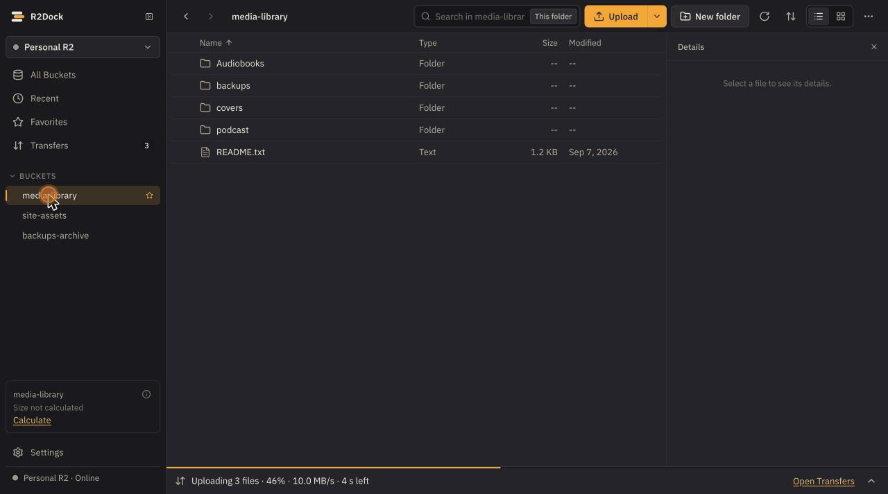
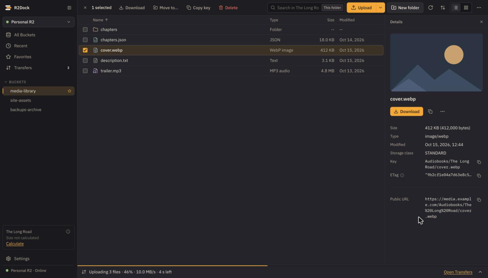
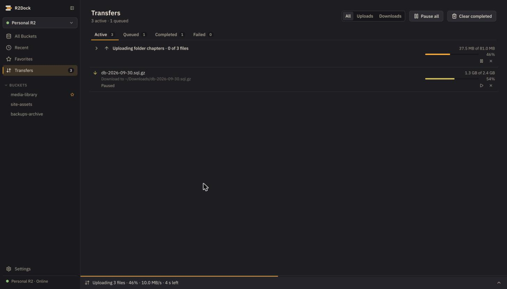
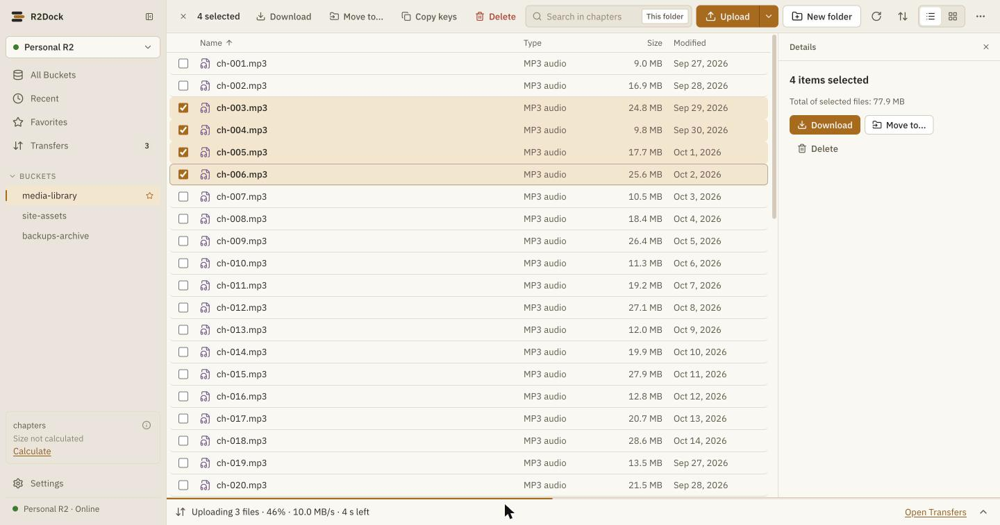
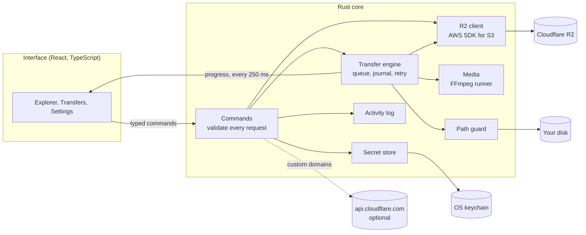
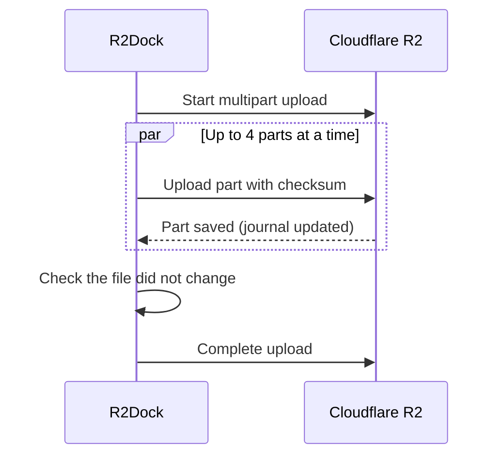
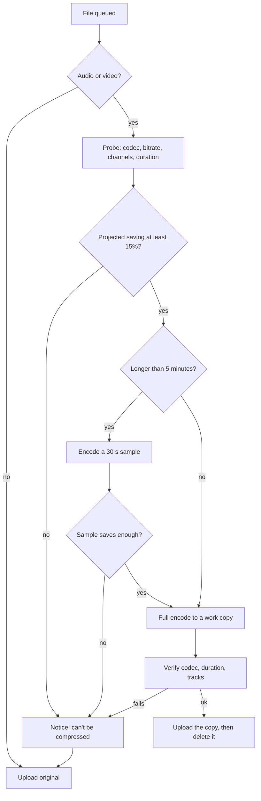
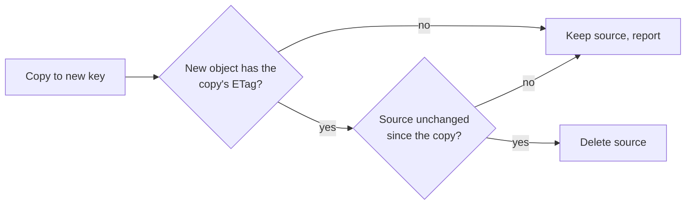

<div align="center">


# R2Dock

**A desktop file manager for Cloudflare R2.**<br>
Browse, upload, and manage your buckets like a regular drive. Your keys never leave your computer.

[](https://github.com/VijaysinghPuwar/R2Dock/actions/workflows/ci.yml)
[](https://github.com/VijaysinghPuwar/R2Dock/releases)
[](LICENSE)


[Download](https://github.com/VijaysinghPuwar/R2Dock/releases/latest) · [How it works](#how-it-works) · [Logs](#logs) · [Security](#security) · [Build from source](#build-from-source)



<sub>Sample data only: browse a bucket, preview files, copy a custom domain link, upload with audio compression.</sub>

</div>

## What it does

R2Dock gives R2 a file-manager interface that runs on your own machine. There is no server, no account, and no telemetry. It talks only to your R2 endpoint, and to `api.cloudflare.com` if you add the optional API token.

| | |
|---|---|
| **Browse** | Buckets and folders, list and grid views, search, sorting, image, text, and audio previews |
| **Details** | Size, type, key, ETag, storage class, and the file's public link by source: Public URL, Custom domain, or r2.dev |
| **Transfer** | Drag and drop, parallel multipart uploads, resumable downloads, pause, resume, retry, and recovery after a restart |
| **Compress** | Optional. Shrinks audio and video on your computer before upload. Files that would not get smaller upload as they are |
| **Manage** | New folder, rename, move, delete with confirmation, copy key or link |
| **Logs** | Daily activity log as CSV, names hidden by default, export by date range |
| **Secure** | Keys in the OS keychain, no file system or network access from the interface, strict Content Security Policy |

## Get started

1. **Install** the file for your computer from the [latest release](https://github.com/VijaysinghPuwar/R2Dock/releases/latest):

   | Computer | File |
   |---|---|
   | Mac with an M chip | `macOS-Apple-Silicon.dmg` |
   | Intel Mac | `macOS-Intel.dmg` |
   | Windows 10 or 11 | `Windows-Setup.exe` |
   | Linux x64 with WebKitGTK 4.1 | `Linux.AppImage` or `Linux.deb` |

2. **Create an R2 API token** in the Cloudflare dashboard under *R2 > Manage API tokens*. Copy the Account ID, Access Key ID, and Secret Access Key.
3. **Connect** in R2Dock. An *Object Read & Write* token cannot list buckets, so type your bucket names as well (comma separated).
4. **Optional:** paste the token's *Token value* into "API token" to see custom domain and r2.dev links in file details. R2Dock needs only the S3 credentials to manage files.

> Builds are not code signed yet. On Windows choose *More info > Run anyway*. On macOS right-click the app and choose *Open*.

## Screenshots



<table>
<tr>
<td></td>
<td></td>
</tr>
<tr>
<td align="center"><sub>Grouped, paused, and resumable transfers</sub></td>
<td align="center"><sub>Light theme and multi-select</sub></td>
</tr>
</table>

## How it works

R2Dock is a [Tauri 2](https://v2.tauri.app) app. A Rust core does all the real work. The React interface only draws the screen and calls a short, typed list of commands. It never sees a secret or a local file path.



| Crate | Job |
|---|---|
| `r2dock-core` | Rules with no I/O: object keys, safe local paths, part sizes, settings, errors |
| `r2dock-secrets` | OS keychain, with a session-only fallback (never a plaintext file) |
| `r2dock-r2` | R2 client, listing, bulk delete, copy and move, Cloudflare API lookups |
| `r2dock-transfer` | Upload and download engine, journal, queue, history |
| `r2dock-media` | Audio and video probing, compression plans, FFmpeg runner, tools download |
| `src-tauri` | Commands, permissions, activity log |

### Uploads

Small files go up in one request. Large files are split into parts that upload in parallel, each with a checksum. Progress is saved to a journal on disk, so a pause, a lost connection, or a restart continues where it stopped.



### Compression

Off by default. Turn it on in *Settings > Compression*. R2Dock downloads FFmpeg once from this project's releases and checks it by SHA-256 (about 20 MB on macOS, 91 MB on Windows, 97 MB on Linux). Your original files are never changed.



- **Audio:** speech becomes 32 kbps MP3, music high-quality MP3, WAV becomes MP3 or FLAC. Bitrate, sample rate, and channels are never raised. Stereo becomes mono only when the whole file proves both channels identical, unless you allow downmixing.
- **Video:** AV1 by default (about a third of the size, plays in current browsers), or H.264 with your computer's hardware encoder. Large videos are reduced to 1080p. HDR video is left as it is.
- **Never blocks an upload:** a file that cannot be compressed (already small, unsupported tracks, failed encode) uploads unchanged, and a short notice says why, for example *"Intro theme.mp3 can't be compressed: Already compressed (128 kbps). Uploading the original."*

### Moves and renames

R2 has no rename or atomic move. R2Dock copies, checks, then deletes:



A file changed by someone else during the move is kept, and the move reports it instead of deleting it.

## Logs

*Settings > Advanced > Logs* has **Open folder** and **Copy path** for both folders.

| OS | Activity log (CSV) | Technical log |
|---|---|---|
| macOS | `~/Library/Logs/app.r2dock.desktop/activity/` | `~/Library/Logs/app.r2dock.desktop/` |
| Windows | `%LOCALAPPDATA%\app.r2dock.desktop\logs\activity\` | `%LOCALAPPDATA%\app.r2dock.desktop\logs\` |
| Linux | `~/.local/share/app.r2dock.desktop/logs/activity/` | `~/.local/share/app.r2dock.desktop/logs/` |

One activity file per day (`activity-YYYY-MM-DD.csv`, UTC), which opens in Excel, Numbers, or Google Sheets. Names show as short codes unless you turn names on. Secrets are never written. A sample with names on:

```csv
time,local_time,session,action,outcome,duration_ms,connection,bucket,item,files,bytes,error_code,error_message,request_id,details
2026-10-18T14:01:48.590Z,2026-10-18 10:01:48,5c19e2d0,upload_start,ok,0,,,,3,,,,,compress=true; policy=Ask
2026-10-18T14:02:31.204Z,2026-10-18 10:02:31,5c19e2d0,transfer_completed,ok,0,7d41a9f3,,Podcasts/Season 2/Episode 01.mp3,,26214400,,,,attempt=1; direction=Upload; job=1f0c8a52; parts=3/3; transferred=26214400
2026-10-18T14:02:33.880Z,2026-10-18 10:02:33,5c19e2d0,transfer_completed,ok,0,7d41a9f3,,Podcasts/Season 2/Intro theme.mp3,,4800000,,,,attempt=1; direction=Upload; job=9b2e6d10; transferred=4800000
```

## Security

- **Keys stay local.** Secrets go to macOS Keychain, Windows Credential Manager, or Linux Secret Service. They are never written to files or logs and never sent back to the interface.
- **Least privilege.** The interface has no file system, shell, or network access. Every command is on an allowlist, and the Content Security Policy blocks remote scripts.
- **Safe downloads.** Object names are untrusted. Downloads cannot leave the chosen folder, never follow symbolic links, and never overwrite a file unless you choose Replace.
- **Careful deletes.** Deleting folders or many files needs a typed confirmation that Rust checks again.

Details: [SECURITY.md](SECURITY.md) and the threat model in [PLAN.md](PLAN.md#98-threat-model).

## Testing

- About 600 automated tests: Rust unit and integration tests, and Vitest for the interface. CI runs them on Windows, macOS, and Linux.
- Integration tests use an in-process S3-compatible server and a mock Cloudflare API, so they never touch a real bucket.
- Stress tests (run before a release): 3,000 uploads and downloads totaling 1.3 GB, 160,000 activity rows from 32 threads, and a year of logs exported in order.

```sh
cargo test -p r2dock-transfer --release --test stress -- --include-ignored
cargo test -p r2dock --release --test activity_stress -- --include-ignored
```

## Build from source

Requires Rust 1.94+, Node.js 22+, and the [Tauri prerequisites](https://v2.tauri.app/start/prerequisites/) for your OS.

```sh
npm ci
npm run tauri dev                    # run the app
npm run tauri build                  # build an installer
cargo test --workspace && npm test   # run the tests
```

## Limitations

- R2 has no real folders, rename, versioning, or trash. Moving a folder copies and then deletes every file inside it, and deletes are permanent.
- R2 cannot make a delete or a multipart completion conditional, so a change made by someone else in the last moment of a move can still be lost. R2Dock checks right before each step to keep that window small.

## License

[MIT](LICENSE) · Not affiliated with Cloudflare. Cloudflare and R2 are trademarks of Cloudflare, Inc.
