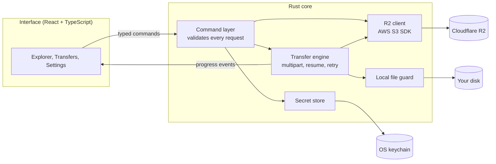
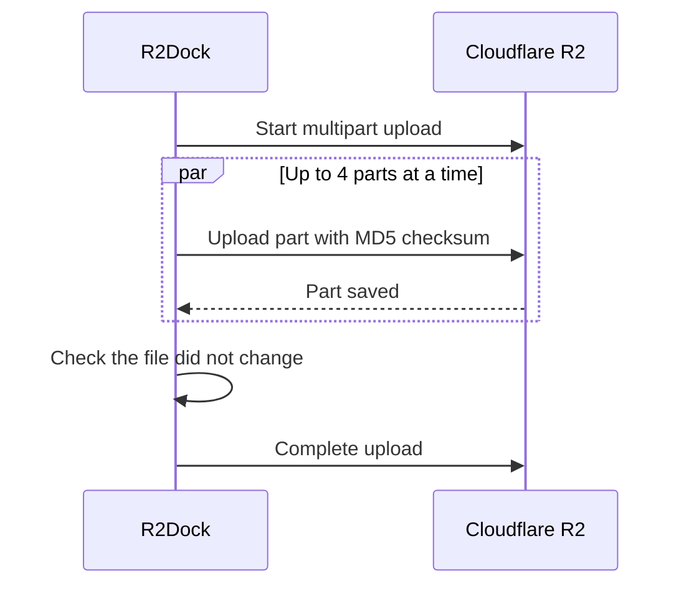

<div align="center">


# R2Dock

**A fast, secure desktop app for Cloudflare R2.**<br>
Browse, upload, and manage your buckets like a regular drive. Your keys never leave your computer.

[](https://github.com/VijaysinghPuwar/R2Dock/actions/workflows/ci.yml)
[](https://github.com/VijaysinghPuwar/R2Dock/releases)
[](LICENSE)


[Download](https://github.com/VijaysinghPuwar/R2Dock/releases) · [How it works](#how-it-works) · [Security](#security) · [Build from source](#build-from-source)


<sub>Walkthrough with sample data: browse a bucket, preview a file, upload with audio compression, and watch transfers.</sub>

</div>

## Why R2Dock

Cloudflare R2 is cheap and fast object storage, but managing it usually means a terminal or a web dashboard. R2Dock gives it a familiar file-manager interface that runs on your own machine, with no server, no account, and no telemetry.

## Features

| | |
|---|---|
| **Browse** | Buckets and folders, list and grid views, search, sorting, file details, image/text/audio previews |
| **Transfer** | Drag-and-drop uploads, parallel multipart uploads for large files, resumable downloads, pause / resume / retry, continues after a restart |
| **Compress** | Optional: shrinks audio and video before upload (an audiobook at 64 kbps becomes half the size; a 1080p web video about a third, as AV1); files that would not get smaller upload unchanged |
| **Manage** | New folder, rename, move, delete with confirmation, copy key or public link |
| **Secure** | Keys in the OS keychain, strict app sandbox, safe local file handling |
| **Logs** | Activity log as CSV (opens in Excel, Numbers, Google Sheets), names hidden by default, export by date range |
| **Comfortable** | Dark and light themes, keyboard shortcuts, accessible controls |

## Screenshots


<p align="center"><sub>File explorer with the details panel</sub></p>

<table>
<tr>
<td></td>
<td></td>
</tr>
<tr>
<td align="center"><sub>Transfer manager: grouped, paused, and resumable transfers</sub></td>
<td align="center"><sub>Light theme and multi-select</sub></td>
</tr>
</table>

## Get started

1. **Install** the build for your system from [Releases](https://github.com/VijaysinghPuwar/R2Dock/releases).
2. **Create an R2 API token** in the Cloudflare dashboard: *R2 → Manage API tokens*. Copy the Account ID, Access Key ID, and Secret Access Key.
3. **Connect** in R2Dock. With an *Object Read & Write* token, also type your bucket names (comma separated), because these tokens cannot list buckets.

> Builds are not code signed yet. On Windows choose *More info → Run anyway*; on macOS right-click the app and choose *Open*.

## Audio and video compression

Off by default. Turn it on in Settings > Compression and install the compression tools (FFmpeg, downloaded once from this project's releases and checked by SHA-256; about 20 MB on macOS, 91 MB on Windows, 97 MB on Linux). Uploads then compress on your computer first. Your original files are never changed.

- Audio: speech to 32 kbps MP3, music to high-quality MP3, WAV to MP3 or FLAC. Compare quality lets you listen to each setting first.
- Video: AV1 by default (about a third of the size at the same quality; plays in Chrome, Edge, Firefox, and Safari on recent Apple devices), or "Most compatible" H.264 with your computer's hardware encoder. Large videos are reduced to 1080p by default; HDR video is left as it is.

Each file is probed, a 30 second sample is tested, and anything that would not shrink by at least 15% uploads as it is, with the reason shown.

## Where are the logs?

Settings > Advanced > Logs shows both folders with **Open folder** and **Copy path**. On macOS, Help > Open Activity Log Folder works too.

| OS | Activity log (CSV) | Technical log |
|---|---|---|
| macOS | `~/Library/Logs/app.r2dock.desktop/activity/` | `~/Library/Logs/app.r2dock.desktop/` |
| Windows | `%LOCALAPPDATA%\app.r2dock.desktop\logs\activity\` | `%LOCALAPPDATA%\app.r2dock.desktop\logs\` |
| Linux | `~/.local/share/app.r2dock.desktop/logs/activity/` | `~/.local/share/app.r2dock.desktop/logs/` |

One file per day (`activity-YYYY-MM-DD.csv`, UTC). Columns: `time`, `local_time`, `session`, `action`, `outcome`, `duration_ms`, `connection`, `bucket`, `item`, `files`, `bytes`, `error_code`, `error_message`, `request_id`, `details`. Secrets are never written, and names appear as short codes such as `#1a2b3c4d` unless you turn names on.

## How it works

R2Dock is a [Tauri 2](https://v2.tauri.app) app. A Rust core does all the real work; the React interface only draws the screen and asks the core for things through a small, typed list of commands.



**Uploading a large file** splits it into parts that upload in parallel. Each part is checksummed, and the upload is saved to a small journal so it can resume after a pause, a lost connection, or an app restart.



## Security

- **Keys stay local.** Secrets go straight to macOS Keychain, Windows Credential Manager, or Linux Secret Service. They are never written to files or logs and never sent back to the interface.
- **Least privilege.** The interface has no file system, shell, or network access of its own. Every command is on an allowlist, and a strict Content Security Policy blocks remote scripts.
- **Safe downloads.** Object names are treated as untrusted. Downloads cannot escape the chosen folder, never follow symbolic links, and never overwrite a file unless you choose Replace.
- **Careful deletes.** Deleting folders or many files needs a typed confirmation that is checked again in Rust.

Details: [SECURITY.md](SECURITY.md) and the threat model in [PLAN.md](PLAN.md#98-threat-model).

## Tech stack

| Layer | Tools |
|---|---|
| Desktop shell | Tauri 2 |
| Core | Rust, Tokio, AWS SDK for Rust (S3), keyring |
| Interface | React 19, TypeScript, TanStack Query and Virtual, Zustand, Radix UI |
| Quality | 250+ automated tests, Clippy, ESLint, CI on Windows, macOS, and Linux |

## Project layout

```
crates/
  r2dock-core       Rules: object keys, safe local paths, part sizes, settings
  r2dock-secrets    OS keychain access and session-only fallback
  r2dock-r2         R2 client, listing, bulk delete and move
  r2dock-transfer   Upload and download engine, journal, history
src-tauri/          Desktop app: commands, permissions, activity log
src/                React interface
```

Integration tests run against an in-process S3-compatible server, so they never touch a real bucket.

## Build from source

Requires Rust, Node.js 22+, and the [Tauri prerequisites](https://v2.tauri.app/start/prerequisites/) for your OS.

```sh
npm ci
npm run tauri dev      # run the app
npm run tauri build    # build an installer
cargo test --workspace && npm test   # run the tests
```

## Limitations

R2 has no real folders, rename, versioning, or trash. Renaming or moving a folder copies and then deletes every file inside it, and deletes are permanent. R2Dock reports anything that fails part way.

## License

[MIT](LICENSE) · Not affiliated with Cloudflare. Cloudflare and R2 are trademarks of Cloudflare, Inc.
