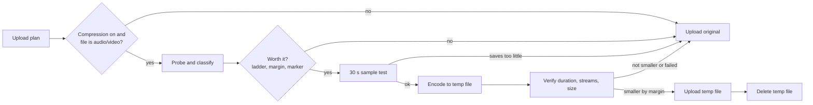

# Plan: Compress audio and video before upload

Status: **Implemented.** Audio released in 0.3.0 (steps 1 to 5); video released in 0.4.0 (steps 6 and 7). See Progress at the end for every change from the original plan.

## Goal

An optional setting that shrinks audio and video on the user's computer before upload, so files use less R2 storage and download faster. It works for single files and whole folders. Images and all other files are uploaded unchanged. The original local file is never modified, and nothing is compressed unless the saving is real.

## Summary of the method

1. **Probe** each file (codec, duration, real bitrate, channels, sample rate, resolution).
2. **Classify** it: speech or music, already compressed or not, and whether every track in the file can be kept.
3. **Pick a target** from a bitrate ladder that never raises quality settings above the source.
4. **Test a 30 second sample** before spending minutes on a long file.
5. **Encode** with FFmpeg to a temp file, **verify** it, and **upload the smaller file** (or the original if compression did not pay off).

## Measured results (real files)

Three spoken-word audiobooks, MP3 mono, about 23 to 24 hours each, measured on 10 minute slices (Apple Silicon Mac, FFmpeg):

| File | Size | Current bitrate | MP3 48 kbps | MP3 32 kbps | Opus 24 kbps |
|---|---|---|---|---|---|
| Audiobook A | 660 MB | 64 kbps | ~495 MB (25%) | ~330 MB (50%) | ~256 MB (61%) |
| Audiobook B | 666 MB | 64 kbps | ~500 MB (25%) | ~333 MB (50%) | ~247 MB (63%) |
| Audiobook C | 505 MB | 48 kbps | **skipped: no saving** | ~336 MB (34%) | ~252 MB (51%) |

All options measured on one 10 minute slice of Audiobook B (4.6 MB):

| Method | Size | Saved | Encode time per 10 min of audio |
|---|---|---|---|
| MP3 32 kbps, constant | 2.3 MB | 50% | 1.2 s |
| MP3 variable quality 9 (average 33 kbps) | 2.4 MB | 49% | 0.7 s |
| MP3 24 kbps at 16 kHz | 1.7 MB | 63% | 0.9 s |
| AAC 48 kbps | 3.7 MB | 20% | 2.0 s |
| Opus 32 kbps | 2.3 MB | 50% | 3.8 s |
| **Opus 24 kbps** | **1.7 MB** | **64%** | 3.6 s |
| Opus 20 kbps | 1.4 MB | 69% | 3.6 s |
| Opus 16 kbps | 1.2 MB | 75% | 3.6 s |

Findings:
- **Opus is the most efficient codec for speech**: at 24 kbps it is about a third the size of the 64 kbps MP3 source, and Opus is designed to keep speech clear at these rates.
- **MP3 is the most compatible**: the file type and key stay the same, existing links keep working, and every browser and player supports it.
- **The native AAC encoder is weak at low bitrates** (only 20% saved at 48 kbps). It is used only when the source is already AAC.
- **Encoding is fast**: a full 24 hour audiobook takes about 2 minutes as MP3 and about 9 minutes as Opus on one core.

Listening samples of every option were produced for the user to choose the default (see Open questions).

## Two modes

| Mode | What it does | Use when |
|---|---|---|
| **Keep format** (default) | MP3 stays MP3, M4A stays M4A, MP4 stays MP4. Same key, same links. | Files are linked from a website or app |
| **Smallest** | Speech audio becomes Opus (`.opus`), video uses the most efficient codec available. Keys change extension. | Archives and personal storage where size matters most |

## Audio method

### Probe

- Audio is probed in-process with **Symphonia** (features `mp3`, `aac`, `isomp4`, `wav`): codec, sample rate, channels, duration. No process is started, so probing a 1,000 file folder is fast.
- Symphonia has no bitrate field and cannot read Opus or HE-AAC, so the **real bitrate is always computed as file size x 8 / duration**. This is correct for variable-bitrate MP3, where the header bitrate is misleading. Files Symphonia cannot read fall back to `ffprobe -v error -print_format json -show_format -show_streams`.
- The codec decides, not the extension (an `.mp3` that is really WAV, or a `.m4a` holding ALAC, is handled by what it actually is).

### Classify

- **Speech or music**: speech if mono, or sample rate 24 kHz or lower, or real bitrate 64 kbps or lower; otherwise music. The user can override per upload ("Treat as speech / music").
- **Channels**: kept as they are, with two exceptions. (1) **Identical stereo**: for stereo speech that would be compressed anyway, FFmpeg decodes the whole first audio track once and measures both left minus right and the mixed signal (`asplit`, then `pan` and `volumedetect` on each branch). The file is encoded as mono only if the loudest difference over the entire stream is at or below -60 dBFS and also at least 40 dB below the loudest point of the mix. The second rule keeps very quiet audio whose channels are opposite (difference near -68 dBFS, mix near silence) in stereo. No information is lost, so this needs no setting. A sample is never enough: the earlier 30 second middle sample (removed after 0.4.1) folded a test file whose opposite-phase intro then disappeared; that file stays stereo now. (2) **Downmix setting** ("Mix multichannel audio down to stereo or mono" in Settings > Compression, off by default): multichannel audio becomes stereo (mono for speech) and stereo speech becomes mono even when the channels differ.
- **Lossless source** (WAV, AIFF, FLAC, ALAC): always worth compressing; the only question is the format (see WAV setting).

Threshold and cost of the identical-channel check, measured with FFmpeg 9.0.1 on an Apple M5 (single runs, synthetic speech):

- Decoded left minus right of the same signal in both channels: WAV and MP3 at 128 kbps (joint stereo or plain stereo) peak at -91 dB, so they become mono. The same signal encoded as AAC 96 kbps peaks at -31 dB and as Opus 64 kbps at -51 dB, so those stay stereo: -60 dBFS is conservative and accepts only near bit-exact matches.
- One hour of stereo MP3 (64 kbps, 22.05 kHz): 2.1 s for the whole-stream check. Decoding scales with length, so a 24 hour audiobook should take under a minute (estimated, not measured). The check runs only for stereo speech that would otherwise be compressed, uses the same runner, watchdog, and cancellation as encodes, and a check that fails keeps both channels.
- The upload review estimate and Compare quality do not run the check, so they show the stereo size; the real result can be smaller.

### Bitrate ladder (Keep format)

| Content | Codec | Target | Sample rate |
|---|---|---|---|
| Speech | MP3 (LAME) | 32 kbps mono, 64 kbps stereo | 22.05 kHz |
| Speech, higher quality | MP3 (LAME) | 48 kbps mono, 96 kbps stereo | 22.05 kHz |
| Music | MP3 (LAME), VBR quality 4 (about 165 kbps) | | 44.1 kHz |
| Music, smaller | MP3 (LAME), VBR quality 6 (about 115 kbps) | | 44.1 kHz |
| AAC source | AAC, same channels | 64 kbps speech / 128 kbps music | unchanged |

Smallest mode: speech becomes Opus 24 kbps mono or 48 kbps stereo (`-application voip`), music becomes Opus 96 kbps stereo (64 kbps mono).

The target is always capped at the source: R2Dock never raises bitrate, sample rate, or channel count. Without the downmix setting, audio with more than two channels is uploaded unchanged ("6-channel audio kept"), checked before any speech or music rule, and stereo is reduced to mono only when the whole-stream check proves the channels identical.

### Keep everything that matters

- Tags and cover art: `-map_metadata 0` and the attached picture stream copied (`-map 0:v? -c:v copy`), ID3v2.3 for MP3.
- Chapters: kept for M4A/M4B audiobooks (`-map_chapters 0`). MP3 chapter frames are kept where FFmpeg supports them; a file whose chapters would be lost is uploaded unchanged unless the user allows it.
- Gapless playback: LAME writes encoder delay and padding in the Xing/LAME header.

### Keep every track

FFmpeg encodes one audio track on the audio path and one video track on the video path, so a file is only compressed when that loses nothing (`crates/r2dock-media/src/streams.rs`):

- **Before planning**, every stream is listed (ffprobe, or the in-process probe's track count when ffprobe is missing). An audio file with a second audio track, a video file with a second video track (cover art does not count), subtitles that cannot be converted to `mov_text` (image subtitles, TTML, anything unknown), attachments, or unknown data tracks is uploaded unchanged with the reason "Has tracks that would be lost".
- **After encoding**, the output's streams are listed again and must match the plan: the same number of video, audio, and subtitle tracks, each audio track with the planned channels and the source's language. A copy that does not match is deleted and the original is uploaded ("Compressed copy lost a track"). This is not a compression failure, so it never stops the upload, whatever "If compression fails" says.
- **Exceptions**, by design: cover art is not a video track (it is kept in MP3, M4A, and FLAC, not in Opus or in video files); timecode, Apple camera metadata, and the QuickTime chapter track are not content (chapters are copied with `-map_chapters`).

## Already compressed files are left alone

Re-encoding a lossy file always loses a little quality, so R2Dock only does it when the saving is worth it. Checks run cheapest first, and any one of them leaves the file unchanged:

1. **Ladder check (instant)**: the real bitrate is already at or below the target (for example Audiobook C at 48 kbps with the 48 kbps preset).
2. **Margin check (instant)**: the projected saving from the bitrate ratio is below the configured margin (default 15%).
3. **Marker check (instant)**: files R2Dock compressed before carry a tag (`R2DOCK_COMPRESSED=<preset>` in ID3 `TXXX`, or the MP4 comment). They are never compressed again.
4. **Sample test (a few seconds)**: for files over 5 minutes, a 30 second sample from the middle is encoded first; if it saves less than the margin, the full encode is skipped.
5. **Final check (after encoding)**: if the result is not smaller by the margin, it is discarded and the original is uploaded.

The transfer row states the reason, for example "Already compressed (48 kbps)" or "Would save only 6%".

## Video method

### Probe

`ffprobe` JSON (Symphonia cannot read video): codec, resolution, frame rate, bit depth, color transfer (HDR), rotation, real bitrate, and all streams (video, audio, subtitles, data).

### Encoder choice (picked once per machine and cached)

| Priority | Encoder | Platforms | Notes |
|---|---|---|---|
| 1 | Hardware H.264: `h264_videotoolbox`, `h264_nvenc`, `h264_qsv`, `h264_amf`, `h264_mf`, `h264_vaapi` | macOS, Windows, Linux | Fast, low CPU, plays everywhere |
| 2 | `libopenh264` | all | Software fallback, lower quality per bit |
| Smallest mode | AV1 (`libsvtav1`, or hardware AV1 where present) | all | About half the size of H.264 at similar quality, but slow in software; plays in current Chrome, Firefox, Edge, and Safari on recent Apple devices |

Detection runs `ffmpeg -hide_banner -encoders`, then a 1 frame test encode for each candidate, because an encoder can be listed but unusable (no GPU, old driver).

### Targets

| Preset | Max resolution | Target |
|---|---|---|
| Small | 720p | about 2 Mbps |
| Balanced (default) | 1080p | about 4.5 Mbps |
| Keep resolution | source | about 60% of source bitrate |

Hardware encoders use their constant-quality mode where available (`-q:v` for VideoToolbox, `-cq` for NVENC, `-global_quality` for QSV); otherwise a target bitrate with a 1.5x cap. Audio in video becomes AAC 128 kbps (96 kbps if mono). `-movflags +faststart` so playback starts before the download finishes.

### Video cases

- **HDR or 10-bit** (PQ/HLG transfer): skipped by default, because converting to 8-bit H.264 washes out colors. Smallest mode may use 10-bit HEVC or AV1 if a hardware encoder supports it.
- **Rotation** (phone videos): the rotation tag is honored so the output is not sideways.
- **Variable frame rate** (phone and screen recordings): kept as-is (`-fps_mode passthrough`), never forced to a fixed rate.
- **Already efficient** (HEVC or AV1 source, or H.264 already below the target): uploaded unchanged.
- **Subtitles and extra audio tracks**: all audio tracks are kept; text subtitles are converted to `mov_text`; a second video track, any other subtitle (image, TTML, unknown), or a data stream that MP4 cannot hold means the file is uploaded unchanged (see "Keep every track").
- **Audio-only MP4/M4A**: treated as audio.
- **Very short clips** (under 10 seconds) and **tiny files** (under 1 MB): uploaded unchanged; the overhead is not worth it.

## Every case covered

| Case | Behavior |
|---|---|
| Compression off | Exactly today's upload; no FFmpeg is touched |
| FFmpeg not installed | Upload continues with originals; Settings offers "Install compression tools" |
| Images, documents, archives, anything not audio or video | Uploaded unchanged |
| Extension does not match content | Decided by the probed codec, not the name |
| Upper-case or odd extensions (`.MP3`, `.Wav`, `.m4b`) | Handled case-insensitively; `.m4b` treated as audiobook M4A |
| Corrupt or truncated file | Probe or encode fails, original uploaded, reason shown |
| DRM-protected file | Encode fails, original uploaded |
| Zero-length or very short file | Uploaded unchanged |
| File changes while compressing | Fingerprint check before upload; encode reruns, or fails with "File changed" |
| File deleted while queued | Fails with the existing "file no longer exists" message |
| Very long file (24 hours and up) | Sample test first; progress by time; no memory growth (streamed) |
| Huge folder (thousands of files) | Probes are cheap and in-process; encodes are queued with bounded concurrency |
| Not enough disk space for the temp file | Checked before encoding (1.2x estimated output); falls back to the original with a notice |
| WAV, AIFF, FLAC, ALAC sources | Compressed per the WAV setting (MP3, FLAC, or keep) |
| 8-bit, 24-bit, 32-bit float, or multichannel WAV | Converted correctly; 5.1 audio downmixed only if the user allows it, otherwise uploaded unchanged (or kept as FLAC with all channels) |
| Second audio track, second video track, TTML or image subtitles | Uploaded unchanged; nothing is dropped |
| Variable-bitrate MP3 with a misleading header | Real bitrate from size and duration |
| Cover art, tags, chapters | Kept; files whose chapters would be lost are uploaded unchanged unless allowed |
| Already compressed by R2Dock | Detected by marker and skipped |
| Key name changes (`.wav` to `.mp3`, `.mov` to `.mp4`) | Shown in the review dialog; conflict policy applies to the new key |
| Same new key produced by two files (`a.wav` and `a.mp3`) | Review dialog flags it; the conflict policy decides |
| Cancel during compression | FFmpeg stopped, partial temp file deleted |
| Pause during compression | Encode stopped; resume restarts that file's encode (encodes are not resumable mid-file); uploads resume as today |
| App quits after encoding but before upload finishes | Journal keeps the temp file path and source fingerprint; upload resumes from the temp file |
| App crashes mid-encode | FFmpeg dies with the app (Windows Job Object; process group on macOS and Linux); stale temp files swept at startup |
| Hardware encoder fails mid-file | One retry with the software encoder, then the original |
| Laptop on battery | Optional setting "Pause compression on battery" (off by default) |
| Many files at once | Encodes limited (default 1 at a time, below normal priority); uploads keep running in parallel as a pipeline |
| Read-only key | Uploads are blocked as today; nothing is compressed |
| Upload fails after compression | The temp file is kept for retry and deleted when the job finishes or is dismissed |

## FFmpeg process handling

Lessons from reading `ffmpeg-sidecar` (MIT) are applied, without copying code:

- Start FFmpeg with `std::process::Command` and an argument array, never a shell. Always pass `-hide_banner -nostdin -y` and an explicit output path in R2Dock's temp folder, so FFmpeg can never wait on a prompt.
- Progress from `-progress pipe:1 -nostats` (stable `out_time_us`, `total_size`, `speed`, `progress=end` lines) instead of parsing human-readable logs, whose format changes between versions.
- Drain stderr continuously on its own thread (or task), even when a line fails to parse; otherwise the pipe fills and FFmpeg hangs. Keep the last 50 lines for error messages.
- Inputs passed as `file:<absolute path>` with `-protocol_whitelist file`, so a crafted file name cannot open a network URL or a `concat:` list. Names starting with `-` cannot be read as options.
- Cancel: send `q` on stdin, wait up to 3 seconds, then kill. Always wait for the process and check its exit status. Windows: `CREATE_NO_WINDOW` and a Job Object with kill-on-close; macOS and Linux: own process group.
- Watchdog: no progress for 2 minutes stops FFmpeg and falls back to the original.

## Getting FFmpeg onto the computer

| Option | Pros | Cons |
|---|---|---|
| A. Bundle in every installer | Works offline | Every installer grows by 40 to 80 MB, even for users who never compress |
| **B. Download on first use (recommended)** | Installers stay small | One download step; needs our own hosting |
| C. Use FFmpeg already on the system | No download | Version and license vary; not for beginners |

**Recommendation: B, with C as an advanced option.**

- Settings shows "Compression tools are not installed" with the download size for this system (macOS about 18 MB; Windows about 91 MB; Linux about 97 MB) and an Install button.
- Windows and Linux: **BtbN FFmpeg-Builds, LGPL static, version branch 9.0, from a month-end dated `autobuild-*` release** (dailies are deleted after 14 days; month-end builds are kept for 2 years). The archive is **mirrored as an asset on this repository's own GitHub release** (for example `tools-ffmpeg-9.0`), so it can never disappear or change.
- macOS: BtbN does not build for macOS, so a **universal LGPL build is compiled from source in our own CI** with the same configuration and published to the same release.
- The app contains the exact URL and **SHA-256 for each platform**. The download goes to the app data folder, is verified **before** extracting, and the binaries are picked by exact path. Anything that does not match is deleted and refused. R2Dock never uses third-party mirrors at runtime and never runs a bare `ffmpeg` from PATH unless the user chose it in Settings.
- "Use FFmpeg from my system" (advanced) asks for the binary with the file picker and shows its version and license.

**Licensing**: the LGPL builds exclude x264, x265, and fdk-aac. Because they are configured with `--enable-version3`, they are **LGPLv3**. FFmpeg runs as a separate program, so R2Dock stays MIT. THIRD_PARTY_NOTICES will list FFmpeg's license and a link to the exact source. H.264 encoding uses the operating system's hardware encoders where available; the OpenH264 software fallback and the AV1 option are documented.

## Settings

Settings > Transfers > Compression (off by default):

| Option | Choices | Default |
|---|---|---|
| Compress audio and video before upload | On / Off | Off |
| Mode | Keep format / Smallest | Keep format |
| Speech quality | 32 kbps / 48 kbps | 32 kbps (see Open questions) |
| Music quality | Standard (about 165 kbps) / Smaller (about 115 kbps) | Standard |
| Video | Small 720p / Balanced 1080p / Keep resolution / Don't compress video | Balanced 1080p |
| WAV and other lossless audio | MP3 / FLAC (lossless) / Keep | MP3 |
| Minimum saving | 5% to 50% | 15% |
| If compression fails | Upload the original / Skip the file | Upload the original |
| Files compressed at the same time | 1 to 4 | 1 |
| Pause compression on battery | On / Off | Off |
| Compression tools | Installed version, Install, Remove, Use system FFmpeg | |
| Preview | "Compare quality": encodes a 30 second sample of a chosen file at each preset and plays them | |

The **upload review dialog** shows an estimate before anything runs ("Compress 195 audio files. Estimated 2.4 GB to 1.2 GB.") with a per-upload on/off switch and the list of files whose extension will change. **Transfer rows** show "Compressing 42%", then upload progress, then "Saved 330 MB (50%)" or the reason a file was left unchanged. The **details panel** shows "Compressed from 660 MB" using object metadata.

## Architecture

- **New crate `r2dock-media`** (no Tauri dependency, unit tested): `probe` (Symphonia, ffprobe fallback), `classify`, `plan` (ladder, margins, new key, estimate), `ffmpeg` (process runner, progress, cancel, watchdog), `verify`, `tools` (download, hash check, encoder detection).
- **Transfer engine**: new job state `Compressing` before `Running`; the upload spec gains an optional compression plan. Encodes write to `<app cache>/compress/<job id>.<ext>`, then the existing upload path (single PUT or multipart, with checksums and resume) uploads that file.
- **Pipeline and limits**: a separate semaphore for encodes (default 1, below-normal priority) so file 2 compresses while file 1 uploads.
- **Object metadata**: `x-amz-meta-r2dock-original-size`, `-original-name`, `-compression` (preset).
- **Activity log** (CSV, see [logs-and-csv.md](logs-and-csv.md)): `compress_started`, `compress_finished` (sizes, ratio, preset, encoder, duration), `compress_skipped` (reason), `compress_failed` (FFmpeg exit code and last error line), with names hashed per the existing rules. Settings shows the log folder location with Open folder and Copy path, so a user can find the exact row for any problem.

## Security

- FFmpeg binaries are verified by SHA-256 before first use and re-checked if their size or modification time changes.
- Fixed argument arrays, no shell, `file:` inputs with a protocol whitelist, outputs only in R2Dock's temp folder.
- Input paths come only from the existing picker and drop selections, never from the webview.
- FFmpeg parses the media, so it runs at low priority with a watchdog and dies with the app.
- Nothing is sent anywhere except the final upload to R2.
- The threat model in PLAN.md 9.8 gains rows for "malicious media file" and "tampered FFmpeg download".

## Testing

- **Unit**: classification and ladder decisions (table tests for every row above), real-bitrate math, argument builder snapshots per preset, `-progress` parser (including `N/A` values), key renaming, hostile file names (`concat:a|b.mp3`, `http://x.mp4`, `-i.mp3`), hash verification.
- **Integration**: CI installs FFmpeg; tests generate short WAV, MP3, stereo-duplicated, M4A with chapters, MP4 with rotation, and HDR samples using FFmpeg's built-in test sources, compress them, upload to the local S3 test server, and check size, duration, tags, chapters, keys, and metadata. Tests skip cleanly when FFmpeg is missing.
- **Engine**: cancel and pause during compression, app restart after encoding, fallback to original, result bigger than original, disk full, hardware encoder failure.
- **Manual**: the three real audiobooks above (expect about 50% saved at Speech 32 kbps; Audiobook C skipped at 48 kbps), plus a phone video and a screen recording on each OS.

## Build order

| Step | Scope | Done when |
|---|---|---|
| 1 | `r2dock-media`: probe, classify, plan, ladder, real bitrate, markers | Decision table tests pass |
| 2 | FFmpeg runner: progress, cancel, watchdog, process cleanup, verify | Runner tests pass on Windows, macOS, Linux in CI |
| 3 | Tools: pinned download, SHA-256, encoder detection, system FFmpeg option; CI job that mirrors BtbN builds and builds macOS | Install, verify, tamper, and reinstall tests pass |
| 4 | Engine: `Compressing` state, temp files, pipeline, journal, activity log | Engine tests for every case in the table pass |
| 5 | UI: settings, review estimate, transfer rows, details panel, quality preview | Component tests pass; demo GIF updated |
| 6 | Video: presets, hardware detection, HDR and rotation handling | MP4 cases pass on all three OSes |
| 7 | Docs, notices, threat model, release 0.2.0 | README, PLAN, CHANGELOG, THIRD_PARTY_NOTICES updated |

## Decisions (confirmed 2026-10-17)

1. **Speech default**: MP3 32 kbps.
2. **WAV and other lossless audio**: MP3.
3. **FFmpeg delivery**: download on first use, pinned and SHA-256 verified, hosted on this repository's releases.
4. **Video default**: Balanced, capped at 1080p.
5. **Smallest mode**: offered as an opt-in mode (Opus and AV1, extensions change).

## Progress

| Step | Status | Notes |
|---|---|---|
| 1 | Done | `crates/r2dock-media`: `probe` (Symphonia 0.6, features `mp3`, `aac`, `alac`, `flac`, `pcm`, `isomp4`, `wav`, `aiff`, `id3v2`), `classify`, `plan` (ladder, never raising bitrate, sample rate, or channels, margin and marker checks, estimate), `keys` (output key). Decision table tests pass. On the three real audiobooks the probe takes under 1 ms each and the plan gives 50%, 33%, and 50% smaller at Speech 32 kbps; the 48 kbps file is skipped at Speech 48 kbps. Mono music targets are half the stereo bitrate (MP3 VBR about 85 or 60 kbps, Opus 64 kbps). |
| 2 | Done | `ffmpeg` module: fixed argument arrays (`file:` paths, `-protocol_whitelist file`), `-progress pipe:1` parser, runner with continuous stdout and stderr draining, watchdog (2 minutes of silence), cancel, and cleanup (`process-wrap`: Job Object with kill-on-close on Windows, own process group on macOS and Linux, kill on drop), messages without local folders, sample test, duplicated-stereo check (`pan` + `volumedetect`), and `verify` (codec and duration within 1 s or 0.5%). Integration tests run with a real FFmpeg in CI on all three OSes. Real audiobooks, full encode at Speech 32 kbps on an Apple M5: 660 to 330 MB (50.0%, sample test predicted 49.8% in 0.4 s, 172 s), 530 to 353 MB (33.3%, 178 s), 699 to 350 MB (50.0%, 171 s); a second pass skips all three by marker. |

Changes from the plan made during step 2:

- Cancel kills FFmpeg at once instead of sending `q` first: a cancelled output is deleted anyway, and FFmpeg runs with `-nostdin`, so it never reads a key.
- MP4 output (`.m4a`, `.m4b`, `.mp4`) carries no marker tag. FFmpeg writes custom MP4 tags only with `-movflags use_metadata_tags`, which moves every other tag (title, author) to a form many players ignore. The bitrate checks already stop a second compression of MP4 output (tested).
- On macOS and Linux, FFmpeg exits after R2Dock dies on its next progress write to the closed pipe (about twice a second), instead of through a death signal, which would need unsafe code.
- Process priority is lowered on Windows (`BELOW_NORMAL_PRIORITY_CLASS`). macOS and Linux run FFmpeg at normal priority; encodes are limited to one at a time by default (step 4).
| 3 | Done | `tools`: pinned packages per platform (`manifest.rs`), HTTPS download limited to GitHub hosts, SHA-256 of each download checked before unpacking and of each binary after, atomic install, re-hash when size or modification time changes, refusal of replaced, symlinked, or edited files, remove; `detect` reads version, license, and encoders and checks a user-picked FFmpeg. `.github/workflows/tools.yml` published `tools-ffmpeg-9.0.2-1` (pre-release, never "Latest"): BtbN LGPL 9.0 for Windows and Linux (smoke-tested on their own OS), and macOS built from pinned, signature-checked sources by `tools/ffmpeg/build-macos.sh` (LGPL v3, LAME, Opus, VideoToolbox, system libraries only). Each binary is zstd-compressed on its own. CI installs the real package on Windows, macOS, and Linux and compresses a file with it. |
| 4 | Done | Engine: `Compressing` state that holds no upload slot (separate encode limit, default 1), so files compress while others upload; the compressed copy replaces the original in the upload spec and is kept in the journal across restarts; the original is checked before and after encoding and again before upload (an edited original is compressed again); pause stops the encode and resume starts it again; cancel and dismiss delete the copy; "If compression fails" upload the original or fail the job; object metadata `r2dock-original-size`, `r2dock-original-name`, `r2dock-compression`; activity log rows `compress_started`, `compress_finished`, `compress_skipped`, `compress_failed`. Tests against the local S3 server and a real FFmpeg cover every case. |
| 5 | Done | Settings > Compression (its own section): switch, tools install with progress and cancel, remove, use system FFmpeg, Compare quality (30 second samples of a chosen file at each setting, played through the media scheme from R2Dock's preview folder), format, speech, music, lossless, minimum saving, failure policy, encodes at once. Upload review: estimate from file headers, per-upload switch, list of extension changes, name collision and missing tools warnings; new keys are included in the conflict check. Transfer rows: "Compressing 42%", "Saved 330 MB (50%)", and the reason a file was not compressed. Details panel: "Compressed: From 660 MB (mp3-32k)". The settings types moved to `r2dock-core::compression` so they are stored with the other preferences. The demo GIF is updated with the 0.3.0 release. |

Changes from the plan made during steps 3 and 4:

- The download is larger than first estimated: about 18 MB for macOS (built with only what compression needs) and about 91 to 97 MB for Windows and Linux (BtbN's full LGPL builds, zstd-compressed per binary). ffprobe is included for the video step.
- Each binary is a separate `.zst` asset instead of an archive, so nothing has to be extracted from a container.
- While fixing the journal for compressed copies, two serde limits were found that stopped any journal with a multipart upload from loading (released in 0.2.1, see the CHANGELOG).

| 6 | Done | Video: ffprobe JSON probe (`video::probe`), decisions (`video::plan`), encoder detection with a test encode per candidate (`video::encoders`), arguments (`video::args`), and the pipeline branch with sample test, one OpenH264 retry after a hardware failure, and ffprobe verification (`video::run`). Video files are checked with ffprobe first, because the in-process audio probe can see only the audio track of a video container. The macOS tools gained SVT-AV1 4.2.0 (`tools-ffmpeg-9.0.2-2`); the Windows and Linux builds already had SVT-AV1, OpenH264, and the hardware encoders. Real video: 936 MB to 285 MB (69.5%) in 355 s, VMAF 97.1. |
| 7 | Done | Docs, notices, threat model, and the 0.4.0 release. |

Changes from the plan made during step 6 (measurements in [docs/benchmarks/2026-10-17-video-encoders.md](../benchmarks/2026-10-17-video-encoders.md)):

- The default video codec is AV1 (SVT-AV1, CRF 35), chosen with the user after measuring: about 30% of the source size at VMAF 96.7, against 89% at VMAF 94.8 for hardware H.264 at high quality. "Most compatible (H.264)" is the alternative. The plan's "Keep format" H.264 default with a 4.5 Mbps target would have left typical web videos unchanged.
- Video settings are their own choices (codec and size) instead of following the audio "Keep format / Smallest" mode. Sizes compare the shorter side, so portrait phone videos are handled like landscape ones.
- Quality comes from constant-quality modes (CRF and hardware quality settings); the estimate uses measured bitrates scaled by picture size and frame rate, and the sample test makes the final call.
- Kept: every audio track (AAC 128 kbps, copied when already AAC at about that rate or less), text subtitles as `mov_text`, chapters, tags, rotation (applied by FFmpeg), variable frame rate. Dropped safely: timecode and Apple metadata tracks. Left unchanged: HDR, image subtitles, attachments, unknown data tracks (for example GoPro telemetry), cover art in video files is not kept.
- HEVC is not offered, and 10-bit HDR is not converted.

Changes after 0.4.1 (content preservation):

- Stream inventory before planning and after encoding (see "Keep every track"). Files with a second audio or video track or unconvertible subtitles, which earlier versions compressed while dropping those tracks, are now uploaded unchanged. A copy whose tracks do not match the plan is replaced by the original with a reason, not a failure.
- Channels are never reduced without the downmix setting, except stereo speech whose channels are proven identical over the whole stream. The sampled check is replaced by a whole-stream decode, the multichannel check runs before the speech rule (six-channel 22.05 kHz audio was planned as mono), and stereo speech with different channels stays stereo at twice the mono bitrate. The downmix setting is now shown in Settings.
- Compare quality labels each sample by what it really is (for example "AAC 64 kbps, mono"), and presets that produce the same encoding share one sample. Before, an M4A got two "MP3" labels on two identical AAC encodes.
